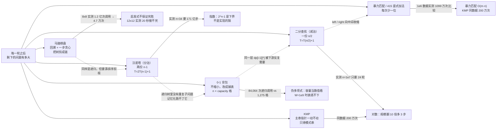
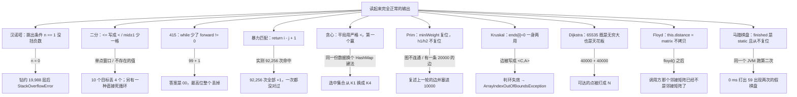

# 算法练习 · Java 手写实现与笔记

十二个小程序，一个知识点一份可运行的 `.java` + 一份 `.md` 笔记。笔记里不抄定义，只讲三件事：**这段代码为什么这么写、下标/参数怎么动、写错一处会长成什么样**，所有数字都是在本机实跑出来的。

包名 `com.ittxf`，源码在 `src/`，笔记和程序放在同一个目录下。

## 思路图

这些程序分属不同章节（分治、查找、贪心、动态规划、字符串匹配、图、回溯），但它们在同一根轴上：**每一轮之后，剩下的问题有多大**。



第二张图是全仓库那条主线：**写漏半句、忘了复位，后果通常不是报错，而是安静地给一个像模像样的错答案。**



## 四份图程序用的其实是两张图

四份程序都叫 `Graph`、都是 7 个顶点 A..G 的邻接矩阵，很容易以为是同一张图。逐格核过之后是这样的：

| 程序 | "无边"用的常量 | 对角线 | 上三角边数 | 对称性 | 结果 |
| --- | --- | --- | --- | --- | --- |
| `PrimAlgorithm` | `10000` | 10000 | 10 | 完全对称 | 最小生成树总权 25 |
| `KruskalCase` | `Integer.MAX_VALUE` | 0 | 12 | 完全对称 | **另一张图**，最小生成树总权 36 |
| `DijkstraAlgorithm` | `65535` | 65535 | 10 | 完全对称 | **和 Prim 同一张图**，从 G 出发 `[2,3,9,10,4,6,0]` |
| `FloydAlgorithm` | `65535` | 0 | 9 | **6 处不对称** | B 的三条边只填了一半，实际是张有向图 |

三个能直接拿来当自查用的结论：

- **Prim 和 Dijkstra 是同一张图**（10 条边逐条一致），所以可以对着看"最小生成树 ≠ 最短路"：Prim 选出的树里 A→D 只能走 `A-G-E-F-D` 花 15，而真正的最短路是 `A-G-F-D` 花 12（那条 `G-F(6)` 压根没进生成树）。
- **Kruskal 是另一张图**（12 条边），所以 25 和 36 之间没有任何可比性。
- **Floyd 的矩阵漏填了 `B→D` 和 `B→G`、又多出一条只有去程的 `B→F`**，从 B 出发的 4 对距离因此和对称矩阵上的 Dijkstra 不一致（其余 42 对全一致）。它不报错、输出很漂亮 —— 这类录入错误只能靠"矩阵和自己转置比一遍"来抓。

## 知识点清单

| 板块 | 程序 | 笔记 | 核心点 |
| --- | --- | --- | --- |
| 分治 | `HanoiTower.java` | [汉诺塔.md](src/com/ittxf/study/dac/汉诺塔.md) | 把形参读成一句自然语言「把 n 个盘从 a 搬到 c，可借 b」；**实测 n=1..12 的逐步移动对照真棋盘模拟，0 次违规、每次都真的搬完**；打印次数 = 方法调用次数 = 2^n-1，而最大递归深度只有 n —— 慢在步数不在栈；纯计数实测 n=24→34 是 16ms→16.4s（正好 2^10 倍），**打印比递归本身贵约 360 倍**；`n == 1` 少了 `<=` → `hanoiTower(0, ...)` 实测钻到约 2 万层爆栈 |
| 查找 | `BinarySearchNoRecursion.java` | [二分查找非递归.md](src/com/ittxf/study/binarysearchnorecursion/二分查找非递归.md) | **`<=` / `mid-1` / `mid+1` 是一整套**：去掉 `=` 实测丢 4/10 个答案，少写一格实测死循环，而**能命中的 target 表现完全正常**；重复值返回"路上第一个撞到的"；**不检查数组有没有序**：2 万组随机乱序数组实测 64.81% 漏答、0 次假阳性；8 万数据实测目标在下标 0 时线性 1 次比较 vs 二分 16 次；`n` 从 10 到 1000 万实测轮数 4→24 = `ceil(log2 n)` |
| LeetCode | `LeetCode415_AddStrings.java` | [LeetCode415-字符串相加.md](src/com/ittxf/leetcode/LeetCode415-字符串相加.md) | 逐位推演 `"456"+"77"="533"`；**删掉 `forward != 0` 实测 `"99"+"1"`→`"00"`，而不进位的用例照样对**；穷举确认进位只会是 0/1；20 万位相加实测 6ms，`BigInteger` 981ms；`-'0'` 是纯算术，实测 `"12a"+"3"`→`"172"`、`"1 2"+"3"`→`"06-5"` |
| 动态规划 | `KnapsackProblem.java` | [0-1背包动态规划.md](src/com/ittxf/study/dynamic/0-1背包动态规划.md) | 两个分支都回到 `i-1` 行才是"0-1"的来历；4,000 组随机实例实测 `dp` 值、反推方案总重量、总价值**三项全部 0 次失败**（含 481 组平局）；平局时 `>` 偏向"放"→ 报出的是下标较大的物品；重量 0 的物品实测把 1100 算成 1000；自顶向下写法 n=24 要 **84,064 次调用**，表格只需 1,275 格；一维滚动数组结果全同、省 2000 倍内存，**但没有 `path` 就反推不出方案** |
| 贪婪算法 | `GreedyAlgorithm.java` | [贪婪算法电台覆盖.md](src/com/ittxf/study/greedy/贪婪算法电台覆盖.md) | 穷举 32 个子集确认最少 4 个且**可行解只有两种**；平局用严格 `<` → **同一份数据只换 HashMap 的构造方式实测得到两种答案**，被支配的 K4 会顶掉 K1；`else break` 是必需的；3,000 组随机集合覆盖实测**贪心 8.30% 的实例比最优多花电台** |
| 字符串匹配 | `ViolenceMatch.java`、`KMPAlgorithm.java` | [暴力匹配与KMP.md](src/com/ittxf/study/kmp/暴力匹配与KMP.md) | **暴力那份的 `return i - j + 1` 是错的**：`main` 打印 3 而真实是 2，20 万组里 92,256 次命中**全部恰好 +1**，同一批数据上 `kmpSearch` 与 `indexOf` **全对**；比较次数实测：他自己那组几乎看不出差距（36 vs 32），换成 `A^n B` 就是 `\|pat\|²`（144）对线性（34），100 万字符实测 1,099 万 vs 200 万次；`kmpNext("")` 实测抛 AIOOBE |
| 最小生成树 | `PrimAlgorithm.java` | [Prim最小生成树.md](src/com/ittxf/study/prim/Prim最小生成树.md) | 7 个起点分别跑总权都是 25，与独立实现吻合；**`miniWeight` 每轮复位而 `h1/h2` 从不复位**，图不连通时实测复述上一轮的边并塞进 10000（总权 10004 而参考判定不连通）；权值 ≥ 10000 的真边永远看不见；O(V³)，实测 V=600 要判断约 2.15 亿格花 45ms |
| 最小生成树 | `KruskalCase.java` | [Kruskal最小生成树.md](src/com/ittxf/study/kruskal/Kruskal最小生成树.md) | 12 条边收 6 丢 6、总权 36 与独立实现一致；`ends[i]=0` 一身两用，靠"边恒为 `i<j`"才碰不到，写成 `<C,A>` 实测成环后数组越界；不连通时空槽打成字面量 `null`；`compareTo` 用减法实测会溢出（这份数据够不到） |
| 最短路径 | `DijkstraAlgorithm.java` | [Dijkstra最短路径.md](src/com/ittxf/study/dijkstra/Dijkstra最短路径.md) | 从 G 出发 7 轮实测逐轮复盘，**49 次 `len` 计算里只有 7 次真的改到 `distance`**；与参考实现**逐起点对比，7 个起点全部一致**，且和 Floyd 在同一张图上 49 对全等；**`65535` 既是无穷大也是天花板**，实测 `40000+40000` 的路径被判成"不可达"（参考给 80000）；加一条有向负边 `E→A=-10` 实测给 A=2，而 Bellman-Ford 是 -14，且**贪心参考实现跟着一起错**；`updateArr()` 的 `index` 不复位在不连通时退回起点白跑几轮（数字侥幸没错，但孤立点的 `alreadyArr` 永远是 0）；`show()` 里写死了 `{'A'..'G'}`，8 顶点的图**算对了却打印崩** |
| 最短路径 | `FloydAlgorithm.java` | [Floyd所有顶点最短路径.md](src/com/ittxf/study/floyd/Floyd所有顶点最短路径.md) | 实测 **343 次 `len` 计算（= 7³）、37 次更新**；`pre[i][j] = pre[k][j]` 的含义是"借 k→j 已算好的走法"，用它还原 **42 对路径实测全部合法且逐段加总等于 `distance`**；对角线必须填 0（换成 65535 后 A→A 变成 4，7 格变怪数）；**`this.distance = matrix` 不拷贝**，实测 `floyd()` 之后调用方那个数组从 `[0,5,7,N,N,N,2]` 变成 `[0,5,7,12,6,8,2]`（Prim/Kruskal 那两份都是逐格拷的）；INF 换成 `Integer.MAX_VALUE` 实测溢出成 -2，把两张不连通的块加成负数墙；V=800 时一次 Floyd 146ms、跑 800 次 Dijkstra 要 413ms |
| 回溯 | `HorseChessboard.java` | [马踏棋盘.md](src/com/ittxf/study/horse/马踏棋盘.md) | 输出的 8×8 棋盘**逐格验过：1..64 各一次、相邻编号全是合法马步**；实测那层 Warnsdorff 排序把 8×8 从"15 秒搜不完（1.2 亿次调用、只填到 49 格）"压到 **47,156 次调用 / 几十毫秒**，6×6 是 122 万 → 1,523（约 800 倍），5×5 直接 25 次调用零回溯；代价是每层递归要跑 25 次 `next()`（共 118 万次）；**起点从 (0,0) 挪到 (0,1)，调用量从 47,156 掉到 71（664 倍）**；`finished` 是 static 且从不复位 → 同一 JVM 第二次跑只用 64 次调用就打出一张"59 出现两次"的假棋盘；`next()` 用列去比 `X`、用行去比 `Y`，`visited` 又写成 `row * X + column` → **只有正方棋盘能掩盖这处行列互换**，实测 4×6/6×4/2×8/3×4/4×5 全部几步之内 AIOOBE；12×12 以上实测 20 秒搜不完 |

## 一条从这十二个程序里读出来的共性

写漏一处、忘复位一个变量，十五处里**只有五处会当场炸**（汉诺塔爆栈、KMP 空模式串、Kruskal 判环失效后越界、
马踏棋盘非正方越界、Dijkstra 的 `show()` 遇到 8 个顶点），一处变成死循环，
剩下九处都是安静地给出一个格式完全正常的错答案 / 次优答案 / 被改坏的数据：

| 漏写/混用的那一处 | 触发输入 | 实测后果 |
| --- | --- | --- |
| 汉诺塔 `if (n == 1)` 没挡 `n <= 1` | `hanoiTower(0, ...)` | 一路递归到负数，钻约 19,988 层后 `StackOverflowError` |
| 二分 `while (left <= right)` 的 `=` | 答案落在单点窗口那一轮 | 10 个目标值丢 4 个，返回 -1，从不返回错下标 |
| 二分 `right = mid` / `left = mid` 少一格 | 查询一个不存在的值 | 死循环（实测 1000 步仍未收敛，能命中的用例一切正常） |
| 415 `while` 少了 `forward != 0` | 最高位产生进位 | `"99"+"1"` 得 `"00"`，不进位的用例完全正确 |
| 暴力匹配 `return i - j + 1` | 任何一次命中 | 92,256 次命中 92,256 次 +1，程序照常打印 |
| KMP `next[0] = 0` | 空模式串 | `ArrayIndexOutOfBoundsException`（崩得倒是干脆） |
| 贪心平局时用严格 `<` + `HashMap` 顺序 | 两个电台覆盖数相同 | 同一份数据两种容器构造 → 两种答案 |
| Prim `h1/h2` 不复位 | 某一轮找不到跨堆边（不连通、有向矩阵、边权 ≥ 10000） | 打印上一轮的边 + 权值 10000，总权值凭空多 10000 |
| Kruskal `ends[i]=0` 当哨兵 | 边的第二个端点是下标 0（本程序生成不出） | 合并变空操作 → 成环 → `res` 数组越界 |
| Dijkstra `65535` 当无穷大 | 路径总长 ≥ 65535 | 实测 `40000+40000` 的点被打成 "N"（不可达） |
| Dijkstra `show()` 写死顶点表 | 8 个顶点的图 | 算对了，打印时 `Index 7 out of bounds for length 7` |
| Floyd `this.distance = matrix` | 任何一次 `floyd()` | 调用方的邻接矩阵被就地改成距离表，原图丢失 |
| Floyd 矩阵只填了一半 | B 的三条边 | 从 B 出发的 4 对距离与对称图不一致，其余 42 对全对 |
| 马踏棋盘 `finished` 是 static | 同一 JVM 跑第二次 | 64 次调用"秒出"一张编号重复的假棋盘 |
| 马踏棋盘 `next()` 行列用反 + `visited` 用 `row * X` | 任何 X ≠ Y 的棋盘 | 几步之内 `ArrayIndexOutOfBoundsException` |

结论很一致：**"跑一个正常用例"能通过的密度太低**。上面每个坑都是靠专门去撞边界（不存在的值、单点窗口、空串、0 个盘、平局、孤立的顶点、恰好等于无穷大的权值、重量 0 的物品、非正方棋盘、同一个 JVM 跑第二遍）才暴露出来的。

## 目录结构

```text
src/com/ittxf/
├── study/
│   ├── dac/                         HanoiTower.java                + 汉诺塔.md
│   ├── binarysearchnorecursion/     BinarySearchNoRecursion.java   + 二分查找非递归.md
│   ├── dynamic/                     KnapsackProblem.java           + 0-1背包动态规划.md
│   ├── greedy/                      GreedyAlgorithm.java           + 贪婪算法电台覆盖.md
│   ├── kmp/                         ViolenceMatch.java          ┐
│                                    KMPAlgorithm.java           ┴ 暴力匹配与KMP.md
│   ├── prim/                        PrimAlgorithm.java           + Prim最小生成树.md
│   ├── kruskal/                     KruskalCase.java              + Kruskal最小生成树.md
│   ├── dijkstra/                    DijkstraAlgorithm.java        + Dijkstra最短路径.md
│   ├── floyd/                       FloydAlgorithm.java           + Floyd所有顶点最短路径.md
│   └── horse/                       HorseChessboard.java          + 马踏棋盘.md
└── leetcode/                        LeetCode415_AddStrings.java   + LeetCode415-字符串相加.md
```

`prim` / `kruskal` / `dijkstra` / `floyd` 四个包都各自在同一文件里带了辅助类（`MiniSpanTree`+`Graph`、`EData`、`Graph`+`VisitedVertex`、`Graph`），所以是"一个文件一个知识点"。
注意 `dijkstra` 和 `floyd` 两个包里都有叫 `Graph` 的类，靠不同包名区分，**把它们挪进同一个包会立刻重名冲突**。
`out/`（IDEA 编译输出）、`.idea/`、`*.iml` 不入库。

## 怎么跑

十二个 `.java` 都带 `main`，跑起来不需要任何输入，直接打印结果。IDEA 里点绿色三角即可。命令行（本机 JDK 21.0.12.1，十二个文件一次编译全部通过）：

```powershell
# 单个程序
javac -encoding UTF-8 -d out src\com\ittxf\study\horse\HorseChessboard.java
java -cp out com.ittxf.study.horse.HorseChessboard

# 整个 src 一次编译
javac -encoding UTF-8 -d out (Get-ChildItem -Recurse src -Filter *.java).FullName
```

Git Bash / WSL 下中文输出要加一个参数，否则控制台会按 GBK 出字节（实测同一个程序：不加参数输出 `b5da 31b8 f6...`，加了输出 `e7ac ac31 e4b8 aa...` 才是 UTF-8 的"第1个盘"）：

```bash
java -Dstdout.encoding=UTF-8 -cp out com.ittxf.study.dijkstra.DijkstraAlgorithm
```

各程序的预期输出（都是实测）：

```
com.ittxf.study.dac.HanoiTower                     31 行 "第k个盘从X->Y"（main 里写的是 n=5）
com.ittxf.study.binarysearchnorecursion…           目标值 7 的索引为 6
com.ittxf.leetcode.LeetCode415_AddStrings          533
com.ittxf.study.dynamic.KnapsackProblem            3 行 dp 表 + 4 行 path 表 + 放入物品 3、1 + 最大价值 3500
com.ittxf.study.greedy.GreedyAlgorithm             得到的选择结果是：[K1, K2, K3, K5]
com.ittxf.study.kmp.ViolenceMatch                  index = 3            ← 正确答案是 2，见笔记第一节
com.ittxf.study.kmp.KMPAlgorithm                   [0, 0, 0, 0, 1, 2, 0] / index = 15
com.ittxf.study.prim.PrimAlgorithm                 7×7 邻接矩阵 + 6 条边 + 总权值 25
com.ittxf.study.kruskal.KruskalCase                邻接矩阵 + 12 条边排序 + ends 数组 + 6 条树边
com.ittxf.study.dijkstra.DijkstraAlgorithm         7 行矩阵 + 三个数组 + A(2)…G(0)，从 G 出发
com.ittxf.study.floyd.FloydAlgorithm               7 组两行（前驱名字 + 距离），G 行 = 2 3 9 10 4 6 0
com.ittxf.study.horse.HorseChessboard              耗时 ~80 ms + 一张填满 1..64 的 8×8 棋盘
```

几处要注意的：

- `ViolenceMatch` 打印的 `index = 3` 是**错的**（`indexOf` 给 2），`return` 语句本身多写了 `+1`；同一份写法在 `KMPAlgorithm` 里是对的，见那篇笔记第一、二节。
- `HanoiTower` 的 `main` 里 n 写死为 5。改成 25 会打印 33,554,431 行（实测约每秒 290 万行，要 11 秒），想试规模请先把它接到命令行参数上。
- `HorseChessboard` 只能跑正方棋盘：`X` 和 `Y` 改成不等（哪怕 4×6）会在几步之内 `ArrayIndexOutOfBoundsException`，原因见那篇笔记第六、七节。想换棋盘大小先确认 `X == Y`。
- `HorseChessboard` 的 `main` 里 `row = 1; col = 1;` 传参时 `-1`，所以实际是从 `(0,0)` 角上出发 —— 这是实测最难的起点（47,156 次调用）；改成 `row = 1; col = 2`（即从 `(0,1)` 起）实测只要 71 次。
- 四个图程序的矩阵**不是同一张**，无穷大常量也各不相同（10000 / `Integer.MAX_VALUE` / 65535），对照上面那张表再看输出。
- 十二个 `main` 都只演示一组数据。笔记里的边界结论 —— 不存在的值、单点窗口、空串、0 个盘、平局、孤立的顶点、`≥ 65535` 的路径长度、重量 0 的物品、非正方棋盘、同一个 JVM 跑第二遍 —— 都得自己换入参才能复现，各篇笔记里的实测表就是照着这个目的写的。
