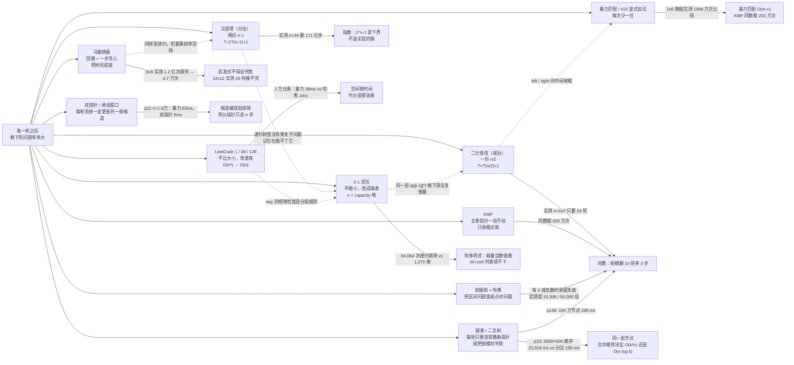

# 算法练习 · Java 手写实现与笔记

五十一个程序（52 个 `.java`，其中 `p543` 目前只有空 `main`、没有实现，未收录），一个知识点一份可运行的 `.java` + 一份 `.md` 笔记。笔记里不抄定义，只讲三件事：**这段代码为什么这么写、下标/参数怎么动、写错一处会长成什么样**，所有数字都是在本机实跑出来的。

`src/com/ittxf/study/` 是课程知识点（分治、查找、DP、贪心、字符串匹配、图、回溯），`src/com/ittxf/leetcode/` 是 LeetCode 题解 —— 其中 `hot100/` 下**一题一个包**，按技巧能归九组：双指针（11 / 42 / 15）、滑动窗口（3 / 76 / 239 / 438）、哈希表（1 / 49 / 128）、前缀和（560）、数组原地操作（41 / 189 / 238 / 53 / 56）、矩阵（48 / 54 / 73 / 240）、链表基础（141 / 160 / 206 / 234）、链表进阶（2 / 19 / 21 / 23 / 24 / 25 / 138 / 142 / 146 / 148）、二叉树（94 / 101 / 104 / 226）。包名 `com.ittxf`，笔记和程序放在同一个目录下。

## 思路图

这些程序在同一根轴上：**每一轮之后，剩下的问题有多大**；哈希表那一档换的是另一个东西 —— 用一张表把"再扫一遍"变成"查一次"。



第二张图是全仓库那条主线：**写漏半句、忘了复位、两句顺序颠倒，后果通常不是报错，而是安静地给一个像模像样的错答案。**

```mermaid
flowchart TD
    E["读起来完全正常的输出"]
    E --> F1["汉诺塔：跳出条件 n == 1 没挡负数"]
    E --> F2["二分：<= 写成 < / mid±1 少一格"]
    E --> F3["415：while 少了 forward != 0"]
    E --> F4["暴力匹配：return i - j + 1"]
    E --> F5["贪心：平局用严格 <，第一个赢"]
    E --> F6["Prim：miniWeight 复位，h1/h2 不复位"]
    E --> F7["Kruskal：ends[i]=0 一身两用"]
    E --> F8["Dijkstra：65535 既是无穷大也是天花板"]
    E --> F9["Floyd：this.distance = matrix 不拷贝"]
    E --> F10["马踏棋盘：finished 是 static 且从不复位"]
    E --> F11["两数之和：put 写在 containsKey 之前"]
    E --> F12["分组：拿 char[] 当 HashMap 的 key"]
    E --> F13["最长子串：left 直接赋值，去掉 Math.max"]
    E --> F14["水桶：动了较高的那一边"]
    E --> F15["239：k &gt; n 没挡，直接开负长度数组"]
    E --> F16["560：删掉 put(0, 1)"]
    E --> F17["三数之和：去掉命中后的 left++ / right--"]
    E --> F18["438：输入里冒出一个大写字母"]
    E --> F19["p94：list 是实例字段"]
    E --> F20["p25：k ≤ 0 没挡"]
    E --> F21["p19：n = 0 / n 超长没挡"]
    E --> F22["p23：逐个累加合并"]
    F1 -->|"n = 0"| G1["钻约 19,988 层后 StackOverflowError"]
    F2 -->|"单点窗口 / 不存在的值"| G2["10 个目标丢 4 个；另有一种直接死循环"]
    F3 -->|"99 + 1"| G3["答案是 00，最高位整个丢掉"]
    F4 -->|"实测 92,256 次命中"| G4["92,256 次全部 +1，一次都没对过"]
    F5 -->|"同一份数据换个 HashMap 建法"| G5["选中集合从 K1 换成 K4"]
    F6 -->|"图不连通 / 有一条 20000 的边"| G6["复述上一轮的边并塞进 10000"]
    F7 -->|"边被写成 &lt;C,A&gt;"| G7["判环失效 → ArrayIndexOutOfBoundsException"]
    F8 -->|"40000 + 40000"| G8["可达的点被打成 N"]
    F9 -->|"floyd() 之后"| G9["调用方那个邻接矩阵已经不是邻接矩阵了"]
    F10 -->|"同一个 JVM 跑第二次"| G10["0 ms 打出 59 出现两次的假棋盘"]
    F11 -->|"[3,3] target 6"| G11["返回 [0,0]：自己配自己"]
    F12 -->|"6 个词"| G12["变成 6 组，每组一条"]
    F13 -->|"abba"| G13["50,000 组随机错 27,081 次"]
    F14 -->|"[1,1,0]"| G14["得 0，真值是 1"]
    F15 -->|"k=5, n=3"| G15["NegativeArraySizeException: -1"]
    F16 -->|"[3,1,1] k=3"| G16["30.39% 的随机数据悄悄漏答案"]
    F17 -->|"命中一次之后"| G17["指针原地不动 → 死循环"]
    F18 -->|"A - a = -32"| G18["26 格频次表直接越界"]
    F19 -->|"同一实例第 2、3 次调用"| G19["满树遍历打印 10 个值，三次返回同一个 List"]
    F20 -->|"n = 5, k = 0"| G20["不报错：返回 dummy 自环，5 个节点全丢"]
    F21 -->|"n = 0"| G21["second 停在尾节点 → NullPointerException"]
    F22 -->|"2000 列 × 500 个"| G22["22,616 ms（同一批节点两两分治 199 ms）"]
```



## 四份图程序用的其实是两张图

四份程序都叫 `Graph`、都是 7 个顶点 A..G 的邻接矩阵，很容易以为是同一张图。逐格核过之后是这样的：

| 程序 | "无边"用的常量 | 对角线 | 上三角边数 | 对称性 | 结果 |
| --- | --- | --- | --- | --- | --- |
| `PrimAlgorithm` | `10000` | 10000 | 10 | 完全对称 | 最小生成树总权 25 |
| `KruskalCase` | `Integer.MAX_VALUE` | 0 | 12 | 完全对称 | **另一张图**，最小生成树总权 36 |
| `DijkstraAlgorithm` | `65535` | 65535 | 10 | 完全对称 | **和 Prim 同一张图**，从 G 出发 `[2,3,9,10,4,6,0]` |
| `FloydAlgorithm` | `65535` | 0 | 9 | **6 处不对称** | B 的三条边只填了一半，实际是张有向图 |

三个能直接拿来当自查用的结论：

- **Prim 和 Dijkstra 是同一张图**（10 条边逐条一致），所以可以对着看"最小生成树 ≠ 最短路"：Prim 选出的树里 A→D 只能走 `A-G-E-F-D` 花 15，而真正的最短路是 `A-G-F-D` 花 12（那条 `G-F(6)` 压根没进生成树）。
- **Kruskal 是另一张图**（12 条边），所以 25 和 36 之间没有任何可比性。
- **Floyd 的矩阵漏填了 `B→D` 和 `B→G`、又多出一条只有去程的 `B→F`**，从 B 出发的 4 对距离因此和对称矩阵上的 Dijkstra 不一致（其余 42 对全一致）。它不报错、输出很漂亮 —— 这类录入错误只能靠"矩阵和自己转置比一遍"来抓。

## 知识点清单

| 板块 | 程序 | 笔记 | 核心点 |
| --- | --- | --- | --- |
| 分治 | `HanoiTower.java` | [汉诺塔.md](src/com/ittxf/study/dac/汉诺塔.md) | 把形参读成一句自然语言「把 n 个盘从 a 搬到 c，可借 b」；**实测 n=1..12 的逐步移动对照真棋盘模拟，0 次违规、每次都真的搬完**；打印次数 = 方法调用次数 = 2^n-1，而最大递归深度只有 n —— 慢在步数不在栈；纯计数实测 n=24→34 是 16ms→16.4s（正好 2^10 倍），**打印比递归本身贵约 360 倍**；`n == 1` 少了 `<=` → `hanoiTower(0, ...)` 实测钻到约 2 万层爆栈 |
| 查找 | `BinarySearchNoRecursion.java` | [二分查找非递归.md](src/com/ittxf/study/binarysearchnorecursion/二分查找非递归.md) | **`<=` / `mid-1` / `mid+1` 是一整套**：去掉 `=` 实测丢 4/10 个答案，少写一格实测死循环，而**能命中的 target 表现完全正常**；重复值返回"路上第一个撞到的"；**不检查数组有没有序**：2 万组随机乱序数组实测 64.81% 漏答、0 次假阳性；8 万数据实测目标在下标 0 时线性 1 次比较 vs 二分 16 次；`n` 从 10 到 1000 万实测轮数 4→24 = `ceil(log2 n)` |
| LeetCode | `LeetCode415_AddStrings.java` | [LeetCode415-字符串相加.md](src/com/ittxf/leetcode/LeetCode415-字符串相加.md) | 逐位推演 `"456"+"77"="533"`；**删掉 `forward != 0` 实测 `"99"+"1"`→`"00"`，而不进位的用例照样对**；穷举确认进位只会是 0/1；20 万位相加实测 6ms，`BigInteger` 981ms；`-'0'` 是纯算术，实测 `"12a"+"3"`→`"172"`、`"1 2"+"3"`→`"06-5"` |
| 哈希表 | `p1_twosum/LeetCode1_TwoSum.java` | [LeetCode1-两数之和.md](src/com/ittxf/leetcode/hot100/p1_twosum/LeetCode1-两数之和.md) | 把"找一对"换成"找补数"，一遍扫 + 一张表；**`containsKey` 写在 `put` 之前是"不许自己配自己"的唯一保证** —— 实测把两句调换：`[3,3]/6` 返回 `[0,0]`、`[1,1,1]/2` 返回 `[0,0]`、单个 `3` 配 `6` 也返回 `[0,0]`（应为无解），而 `main` 里那组 `[2,7,11,15]` 恰好测不出来；同一个值只留最后一个下标 → 解不唯一时返回的不是最靠前那对（60,000 组里 8,581 次不同，**全部合法**）；120,000 组随机对拍四类失败全 0；无解返回 `new int[0]` → 按长度 2 取值实测 AIOOBE；`target - nums[i]` 在题面 ±10⁹ 下不溢出但只剩约 7% 余量；实测 n=2 万 哈希 2ms vs 暴力 38ms、n=200 万 哈希 135ms（暴力要 2 万亿次比较）；`containsKey+get` 改成一次 `get` 实测只差在噪声里（5ms vs 4ms）；**注释里那份暴力没有 `break`，返回的是最后一组解**（实测 `[0,2]` vs `[1,3]`） |
| 哈希表 | `p49_groupanagrams/LeetCode49_GroupAnagrams.java` | [LeetCode49-字母异位词分组.md](src/com/ittxf/leetcode/hot100/p49_groupanagrams/LeetCode49-字母异位词分组.md) | 全部逻辑压在"key 按内容相等"上，所以 `new String(chars)` 不能省 —— **实测拿 `char[]` 当 key 会把 6 个词分成 6 组（应 3 组）**，因为数组的 `hashCode`/`equals` 都按引用；输出的组顺序由容器决定（`HashMap` / `LinkedHashMap` / `TreeMap` 实测三种顺序、内容同一套，`TreeMap` 那版能对上 key 的字典序 `abt<aet<ant`）；与"按字母计数"的独立实现对拍 5,000 组 **0 差异**；排序 key vs 26 槽计数 key **看词长定胜负**：短词排序赢（59 vs 133ms）、2000 字符时计数碾压（97 vs 1,031ms），而**把槽扩到 128 反而比排序还慢**（137 vs ~100ms）；`computeIfAbsent` 实测比 `containsKey+put+get` 快 1.4 倍（41→29ms / 20 万词）；含空串时打印成 `[[, ], [a]]` 容易误读；注释那份用了 JDK 21 的 `List.reversed()`，实测 `--release 17` **编译不过** |
| 双指针 | `p11_containerwithmostwater/LeetCode11_ContainerWithMostWater.java` | [LeetCode11-盛最多水的容器.md](src/com/ittxf/leetcode/hot100/p11_containerwithmostwater/LeetCode11-盛最多水的容器.md) | `min(两柱高) × 宽度`，宽度是 `right - left` 不是柱高；**只能动较矮的一边**——动较高的那边等于把"高度不可能更高、宽度还变小"的一族候选留下当答案，实测反过来写 **20,000 组随机里错 12,980 组（64.90%）**，最短反例只要 3 个数：`[1,1,0]` 正确 1、反过来写得 0；他的示例（9 根柱子）逐轮打点核对，第 2 轮就取到 49 之后全是徒劳；20,000 组与暴力 **0 差异**；n=16,000 实测双指针 0 ms vs 暴力 63 ms；这份没有 null 判断（`p42`、`p3` 有），传 null 直接 NPE |
| 双指针 | `p42_trappingtainwater/LeetCode42_TrappingRainWater.java` | [LeetCode42-接雨水.md](src/com/ittxf/leetcode/hot100/p42_trappingtainwater/LeetCode42-接雨水.md) | 每格的水 = `min(左最高, 右最高) - height[i]`，难点是"没扫到的那一侧"；`leftMax < rightMax` 就是在担保**右边已经有一根不比 leftMax 矮的柱子**，所以左格可以立刻结算 —— 每轮恰好有一侧定案，故 `O(n)` 时间 `O(1)` 空间；真实逐轮打点（11 轮、贡献 `下标2=1、4=1、5=2、6=1、9=1`，合计 6）**结算顺序不是从左到右**：下标 11/10/9/8 先被右支结掉；20,000 组与逐列暴力 **0 差异**，把 `<` 换成 `<=` 也 0 差异；`[5,1,5]`→4、`[2,0,2]`→2、长度 ≤2 直接 0、null 也挡了 |
| 双指针+去重 | `p49_3sum/LeetCode49_3Sum.java` | [LeetCode15-三数之和.md](src/com/ittxf/leetcode/hot100/p49_3sum/LeetCode15-三数之和.md) | 排序是"内层双指针方向唯一"和"三处跳重"的共同前提，`nums[i] > 0` 就 `break` 只在 target=0 时成立；20,000 组与"暴力+按值去重"**0 差异**；**三处跳重各自管什么，是逐个删掉测出来的**：删外层 `continue` → 40.88% 的随机实例条数变多、他的示例也从 2 组变 3 组；删内层两个 `while` → 18.84% 变多但**他的示例完全测不出来**（`[-2,0,0,2,2]` 才会重复）；删命中后的 `left++; right--` → **指针原地不动，直接死循环**（不是给错答案）；注释那份三重循环在他的示例上多给 1 组（3 vs 2），随机数据 61.25% 组数对不上；方法里 `Arrays.sort(nums)` 把入参排序了 + 多打一行；n=300 实测 0 ms vs 三重循环 22 ms；**题号写成了 49**（三数之和是第 15 题，与同层 `p49_groupanagrams` 撞号） |
| 原地划分 | `p283_movezeroes/LeetCode283_MoveZeroes.java` | [LeetCode283-移动零.md](src/com/ittxf/leetcode/hot100/p283_movezeroes/LeetCode283-移动零.md) | 两段式（非零前移 + 尾部补零）能原地的全部理由是一条不变量 **`index <= i` 恒成立**，写目标永远不越过读目标（20,000 组与"另开数组"的稳定划分参考 **0 差异**）；`nums[index] = nums[i]` 在没有零的数组上是纯粹的自写自（`[1,2,3,4]` 实测 4 次），存在但无害；与交换写法结果逐组一致而**写次数更少**（20,000 组里交换更多 14,663 次、相等 5,337 次、覆盖更多的情况 0 次）；注释那份额外数组版里 `Arrays.fill` 是多余的（`new int[n]` 本就全 0），也不合题面"原地"要求；这份没挡 null |
| 滑动窗口 | `p3_.../LeetCode3_LongestSubstringWithoutRepeatingCharacters.java` | [LeetCode3-无重复字符的最长子串.md](src/com/ittxf/leetcode/hot100/p3_longestsubstringwithoutrepeatingcharacters/LeetCode3-无重复字符的最长子串.md) | `main` 用 `"1R1T7"` → 4；**`left = Math.max(left, map.get(c) + 1)` 里那个 max 是"left 只许前进"的守门人**：直接赋值时 `"abba"` 得 3（真值 2），50,000 组随机 **错 27,081 次（54.16%）**，而且它同时是 O(n) 复杂度论证的前提（指针一旦能后退就不是线性了）；注释说 value 存的是"索引 + 1"，代码存的其实是 `right`、`+1` 写在取值处 —— 照着注释改会造成"双重 +1"，实测 200,000 组**错 101,958 次**，最短反例 `"aab"`（2 → 1），而 `"abcabc"`、`"abba"` 在这种错法下仍然对；用 `Map` 而不是定长数组，才让大写 `R`/`T` 照跑（对比 438 越界） |
| 滑动窗口 | `p239_slidingwindowmaximum/LeetCode239_SlidingWindowMaximum.java` | [LeetCode239-滑动窗口最大值.md](src/com/ittxf/leetcode/hot100/p239_slidingwindowmaximum/LeetCode239-滑动窗口最大值.md) | 队列存**下标**而不是值（值会重复，判不出"滑出窗口"）；四步顺序：扔过期 → 扔被压 → 进队 → 记录；逐轮打点看他的 `[1,3,-1,-3,5,3,6,7]`：`i=6` 时下标 4 是被新值**压掉**的而不是过期扔掉的 —— 真正在瘦身的是第二步；20,000 组随机对拍 0 差异，**队尾 `<` 还是 `<=`、队头 `if` 还是 `while` 都不影响正确性**（注释里"一定要用 `<=`"不准确，它只让队列平均长度从 2.70 变 3.04）；`k=1`/`k=n`/空数组/`k=0` 都正常，但 **`k > n` 抛 `NegativeArraySizeException: -1`**（`new int[n-k+1]`），开头的 `n == 0 \|\| k == 0` 挡不住；注释那份 `O(nk)` 在 n=32万/k=1600 上实测 216 ms vs 6 ms |
| 滑动窗口 | `p438_.../LeetCode438_FindAllAnagramsInAString.java` | [LeetCode438-找到字符串中所有字母异位词.md](src/com/ittxf/leetcode/hot100/p438_findallanagramsinastring/LeetCode438-找到字符串中所有字母异位词.md) | `need[]` 中途会**变负数**（表示窗口里这个字符超额了），所以进窗口判 `> 0`、出窗口判 `>= 0` 两处符号故意不对称，写成一样就错报命中；8,000 组随机与"每个窗口排序"版 **0 差异**，`"cbaebabacd"/"abc"` → `[0, 6]`；他 `main` 那个长串命中 150 个起点、间隔恰好 26；排序版是**对的**只是慢 —— 实测 \|s\|=10万、\|p\|=100 时 2 ms vs 157 ms，但**在他 main 那个 3,900 长度上两种写法都测不出差别**（规模不够大的复现等于没复现）；`'A' - 'a' = -32` → 26 格数组 **AIOOBE**，题面保证小写所以不触发，但用定长数组就等于把字符集写进契约（p3 用 Map 就免疫）；注释里那句"一定要用 `<=`"同 239 一样只是避免冗余 |
| 前缀和 | `p560_subarraysumequalsk/LeetCode560_SubarraySumEqualsK.java` | [LeetCode560-和为K的子数组.md](src/com/ittxf/leetcode/hot100/p560_subarraysumequalsk/LeetCode560-和为K的子数组.md) | 区间和换成"两个前缀和之差"，于是 `count += map.get(preSum - k)` 累加的是**次数**不是 1；`put(0, 1)` 是空前缀，删掉后 `[3,1,1]/3` 从 1 变 0、`[1,2,3]/3` 从 2 变 1、`[0,0,0]/0` 从 6 变 3，**20,000 组随机里 30.39% 会漏、69.61% 悄悄混过去**；把 `getOrDefault+1` 写成 `put(x,1)` 同理（4,235/20,000 组出错，但 `[1,1,1]/2` 仍然对）；**"能不能用滑窗"分四档实测**：严格全正数且 `k>=1` 时滑窗 50,000 组全对（固定右端点最多一个左端点），允许 0 就错 10,306/50,000，`k=0` 时把空区间数进去 20,000/20,000 全错，含负数则单调性彻底没了（题面 `[-1000,1000]` 正落在最后一档）；20,000 组与两重循环暴力 0 差异 |
| 哈希集合 | `p128_longestconsecutivesequence/LeetCode128_LongestConsecutiveSequence.java` | [LeetCode128-最长连续序列.md](src/com/ittxf/leetcode/hot100/p128_longestconsecutivesequence/LeetCode128-最长连续序列.md) | 一句 `if (!set.contains(num - 1))` 让每个连续段只展开一次，`O(L²)` → `O(L)`；20,000 组随机（含空数组、重复、跨零段）与排序扫描 **0 差异**，空数组不需要特判；**`num - 1` / `currentNum + 1` 是裸 int 加减**：`{MIN_VALUE, MAX_VALUE}` 实测返回 2（真值 1），因为两端互相"承认相邻"，题面 ±10⁹ 挡得住；`System.out.println(numSet)` 那行是巧合升序——换 `{100,3,7,250,1,99}` 就打成 `[1, 3, 99, 100, 7, 250]`；注释那份排序版 `O(n log n)`、要特判空数组、`else` 里有一行死代码，还会把调用方的数组就地排序 |
| 滑动窗口 | `p76_minimumwindowsubstring/LeetCode76_MinimumWindowSubstring.java` | [LeetCode76-最小覆盖子串.md](src/com/ittxf/leetcode/hot100/p76_minimumwindowsubstring/LeetCode76-最小覆盖子串.md) | `count` 记的是"凑齐的字符**个数**"（不是种类），所以判满是 `count == t.length()`，`need` 允许变负；给逻辑加打印跑出收缩阶段：`ADOBEC`(6) → `DOBECODEBA`(10) → … → `BANC`(4)，**答案会反复刷新，第一次凑齐不是答案**；20,000 组与暴力 0 差异；`\|s\|=200,000, \|t\|=500` 实测 10 ms；`t` 为空串会让 `while` 恒真、`left` 缩过界 → `StringIndexOutOfBoundsException`；`int[128]` 只覆盖 ASCII，`'中'` 直接 AIOOBE |
| 动态规划 | `p53_maximumsubarray/LeetCode53_MaximumSubarray.java` | [LeetCode53-最大子数组和.md](src/com/ittxf/leetcode/hot100/p53_maximumsubarray/LeetCode53-最大子数组和.md) | 每步二选一：接着上一段，还是从自己重新开始；`currentSum` 和 `maxSum` 必须分开存（第 2 步 `currentSum` 掉到 −2、`maxSum` 仍是 1）；**两个初值都取 `nums[0]` 而不是 0** —— 全负数组上初值 0 会给出 0（`[-2,-1,-3]` 应为 −1），20,000 组随机里 **2,086 组**不同；20,000 组与暴力 0 差异；n=100 万 Kadane **4 ms**、两重循环 **216,096 ms（3.6 分钟，真的跑完了）**，差 54,024 倍 |
| 区间 | `p56_mergeintervals/LeetCode56_MergeIntervals.java` | [LeetCode56-合并区间.md](src/com/ittxf/leetcode/hot100/p56_mergeintervals/LeetCode56-合并区间.md) | 按起点排序后"和任意一段重叠"降级成"只和结果集最后一段比"；终点必须取 `max`（`[[1,10],[2,3]]` 被包含）、判定用 `<=`（端点相接 `[[1,2],[2,3]]` 要合并）；20,000 组与参考实现 **0 差异**；**它会就地排序并改写入参里的 `int[]`**（实测 `[[1,4],[0,2],[5,6]]` → `[[0,4],[1,4],[5,6]]`，`[0,2]` 对象被改成 `[0,4]`），长度 ≤1 时直接返回同一对象；`null` 会 NPE（注释掉的旧版里反而有 null 判断）；比较器 `a[0]-b[0]` 这题安全（约束 ±10⁴），±10⁹ 时会排错（算式实测 −294,967,296） |
| 数组 | `p189_rotatearray/LeetCode189_RotateArray.java` | [LeetCode189-轮转数组.md](src/com/ittxf/leetcode/hot100/p189_rotatearray/LeetCode189-轮转数组.md) | 整体反转 → 反转前 k 个 → 反转剩下的；`k % n` 是必需的（`k=4, n=3` 实测走出 1 步 `[3,1,2]`），但**空数组会让它 `ArithmeticException: / by zero`、`k=-1` 会让 `reverse` 从 −1 开始 AIOOBE**；20,000 组随机（k 故意大于 n）与参考实现 0 差异；n=80,000 时三段反转 1 ms vs 逐格右移 146 ms（O(n) vs O(n·k)） |
| 前缀积 | `p238_productofarrayexceptself/LeetCode238_ProductOfArrayExceptSelf.java` | [LeetCode238-除自身以外数组的乘积.md](src/com/ittxf/leetcode/hot100/p238_productofarrayexceptself/LeetCode238-除自身以外数组的乘积.md) | `result` 先存左边的积、再乘右边的积，两趟 O(n)、除输出外 O(1) 空间；**不用除法，所以含 0 天然正确**（`[0,1,2,0]` → 全 0）；20,000 组与暴力 0 差异；int 溢出靠题面"任意前缀/后缀乘积在 32 位内"兜着 —— 放宽约束会静默溢出（`[100000]×3` 实测 `1410065408`） |
| 原地哈希 | `p41_firstmissingpositive/LeetCode41_FirstMissingPositive.java` | [LeetCode41-缺失的第一个正数.md](src/com/ittxf/leetcode/hot100/p41_firstmissingpositive/LeetCode41-缺失的第一个正数.md) | 答案一定在 `[1, n+1]`，把值换到"值减一"的位置上（cyclic sort），每个数最多归位一次 → O(n)/O(1)；三个条件缺一不可，**`nums[i] != nums[nums[i]-1]` 是重复值死循环的唯一屏障**（`[1,1]` 在 `i=0` 会自己换自己）；20,000 组与 HashSet 参考 0 差异；空数组返回 1（n+1）不需要特判；**它会就地重排入参**（`[3,4,-1,1]` → `[1,-1,3,4]`） |
| 矩阵 | `p73_setmatrixzeroes/LeetCode73_SetMatrixZeroes.java` | [LeetCode73-矩阵置零.md](src/com/ittxf/leetcode/hot100/p73_setmatrixzeroes/LeetCode73-矩阵置零.md) | 先记录、再统一抹零（边扫边改会把新零当成原有零、扩散到整张矩阵）；他的版本用 `O(m+n)` 布尔数组，清楚但不符合题面的 `O(1)` 进阶；20,000 组与 Set 参考 **0 差异**；`new int[0][]` 在 `matrix[0].length` 处 AIOOBE，而 `new int[1][0]` 因为列数为 0 反而不崩 |
| 矩阵 | `p54_spiralmatrix/LeetCode54_SpiralMatrix.java` | [LeetCode54-螺旋矩阵.md](src/com/ittxf/leetcode/hot100/p54_spiralmatrix/LeetCode54-螺旋矩阵.md) | 四条边界收缩；上边/右边不用判断（循环条件已保证），**下边/左边必须判断** —— 去掉后 1×4 变 `[1,2,3,4,3,2,1]`、4×1 变 `[1,2,3,4,3,2]`，而 2×2、3×3 测不出来；20,000 组与"方向数组 + visited"参考实现 0 差异；空矩阵 AIOOBE；1×n / n×1 / 1×1 都正确 |
| 矩阵 | `p48_rotateimage/LeetCode48_RotateImage.java` | [LeetCode48-旋转图像.md](src/com/ittxf/leetcode/hot100/p48_rotateimage/LeetCode48-旋转图像.md) | 顺时针 90° = 转置 + 逐行反转（坐标映射 `(i,j) → (j, n-1-i)`）；**转置的内层 `j` 必须从 `i` 开始**，从 0 开始会转两遍等于没动，只有非对称矩阵能测出来；20,000 组随机方阵与参考实现 0 差异；非方阵 AIOOBE（题面保证 n×n） |
| 矩阵 | `p240_searcha2DmatrixII/LeetCode240_SearchA2DMatrixII.java` | [LeetCode240-搜索二维矩阵II.md](src/com/ittxf/leetcode/hot100/p240_searcha2DmatrixII/LeetCode240-搜索二维矩阵II.md) | 从左下角出发：比 target 大就 `i--`（**排除整行**）、小就 `j++`（**排除整列**），每步必排除一整行或一整列 → O(m+n)；左上/右下不行（两个方向都指向更大的值）；20,000 组与暴力 0 差异；3×3 上遍历所有 target 实测最大步数 **5 = m+n-1**；空矩阵 AIOOBE；它不检查"行/列是否有序"，前提写在使用者身上 |
| 链表 | `p160_intersectionoftwolinkedlists/LeetCode160_IntersectionOfTwoLinkedLists.java` | [LeetCode160-相交链表.md](src/com/ittxf/leetcode/hot100/p160_intersectionoftwolinkedlists/LeetCode160-相交链表.md) | `pA` 走完 A 接着走 B、`pB` 反之 —— 长度差自动补平；**必须按引用比较**（题面不保证值不重复）；20,000 组（随机共享同一段尾链）与 HashSet 参考 **0 差异**；实测步数：等长无交点走 m 步，不等长最多 m+n+1（8 / 5 / 11 / 4）；两条各 100 万无交点 3 ms；链表带环会死循环（题面保证无环） |
| 链表 | `p206_reverselinkedlist/LeetCode206_ReverseLinkedList.java` | [LeetCode206-反转链表.md](src/com/ittxf/leetcode/hot100/p206_reverselinkedlist/LeetCode206-反转链表.md) | 三指针四步：存 `next` → 反向 → `prev` 前进 → `curr` 前进；**第一步丢了，改完 `next` 就找不到后面**；20,000 组与"数组倒序重建"0 差异（比对带 cap，环会被值序列暴露）；null / 单节点 / 两节点都对；迭代 O(n)/O(1)，递归版长链表会爆栈 |
| 链表 | `p234_palindromelinkedlist/LeetCode234_PalindromeLinkedList.java` | [LeetCode234-回文链表.md](src/com/ittxf/leetcode/hot100/p234_palindromelinkedlist/LeetCode234-回文链表.md) | 快慢找中点 → 反转后半 → 双指针比对 → **再翻回来恢复链表**；停止条件 `fast.next != null && fast.next.next != null` 让 `slow.next` 永远是后半段头（奇偶都成立）；比对用 `p2 != null`；20,000 组与"字符数组两头比"0 差异；**6 种形状实测调用前后完全一致，非回文提前 break 时恢复代码也执行了**；O(n)/O(1) |
| 链表 | `p141_linkedlistcycle/LeetCode141_LinkedListCycle.java` | [LeetCode141-环形链表.md](src/com/ittxf/leetcode/hot100/p141_linkedlistcycle/LeetCode141-环形链表.md) | 慢 1 快 2：有环必相遇（每轮距离缩短 1），无环靠 `fast == null \|\| fast.next == null` 刹车；这份把 `fast` 初始化成 `head.next`，单节点自环在 while 之前就判定完；第一行挡 null / 单节点；20,000 组（随机成环）与 HashSet 参考 **0 差异**；步数 ≤ n；n=100 万实测 4 ms，O(1) 空间 |
| 链表 | `p2_addtwonumbers/LeetCode2_AddTwoNumbers.java` | [LeetCode2-两数相加.md](src/com/ittxf/leetcode/hot100/p2_addtwonumbers/LeetCode2-两数相加.md) | 低位在表头 = 从个位做竖式：`sum = a + b + carry`，当前位 `sum % 10`、进位 `sum / 10`；**`while` 第三个条件 `carry != 0` 是最高位进位的唯一保障**（`[9,9,9,9]+[1]` 实测 `[0,0,0,0,1]`）；短链补 0、走完的指针不再 `next`；全程 `new`、入参不变；20,000 组与 `BigInteger` **0 差异**，1 万位 0.06 ms |
| 链表 | `p19_removenthnodefromendoflist/LeetCode19_RemoveNthNodeFromEndOfList.java` | [LeetCode19-删除链表的倒数第N个节点.md](src/com/ittxf/leetcode/hot100/p19_removenthnodefromendoflist/LeetCode19-删除链表的倒数第N个节点.md) | dummy + 固定间距 n+1：first 先走 n+1 步，再与 second 同步；**dummy 是“删头”时唯一可用的前驱**（n=长度 实测 `[2,3,4,5]`）；合法 n 20,000 组 0 差异；**非法 n 全 NPE、没有静默删错**：n=0 时 second 停在尾节点、n=长度+1 时 first 越界、空链+n=0 同样 NPE；10 万节点 0.41 ms |
| 链表 | `p21_mergetwosortedlists/LeetCode21_MergeTwoSortedLists.java` | [LeetCode21-合并两个有序链表.md](src/com/ittxf/leetcode/hot100/p21_mergetwosortedlists/LeetCode21-合并两个有序链表.md) | dummy + 摘链，**全程不 new**；`<` 使相等时先取右边（实测首节点来自 list2）；输出 6/6 复用输入节点，代价是入参被拆开（`[1,10,11]+[2,3]` 后从原 list1 头走成 `1→2→3→10→11`）；剩一条整段挂上；20,000 组（值域 0..9 大量重复）0 差异；约 100 万节点 3.8 ms |
| 链表 | `p23_mergeksortedlists/LeetCode23_MergeKSortedLists.java` | [LeetCode23-合并K个升序链表.md](src/com/ittxf/leetcode/hot100/p23_mergeksortedlists/LeetCode23-合并K个升序链表.md) | `merge` 套 for，正确性没问题，**但“累加结果再并下一条”是 O(k²n)**；2000 列 × 500 个实测 **22,616 ms**，同一批节点两两分治 199 ms、优先队列 301 ms（114 倍）；20,000 组（允许 null 列）0 差异；空数组 / null 数组 / 全 null 都返回 null，单链原样返回；输出 8/8 复用原节点 |
| 链表 | `p24_swapnodesinpairs/LeetCode24_SwapNodesInPairs.java` | [LeetCode24-两两交换链表中的节点.md](src/com/ittxf/leetcode/hot100/p24_swapnodesinpairs/LeetCode24-两两交换链表中的节点.md) | dummy + 三指针：先存 `nextPair`，再 `second.next=first`、`first.next=nextPair`、`prev.next=second`，最后 `prev=first`（交换后的尾巴）；循环条件同时挡“后面没了”和“只剩一个”；连交换两次还原；4/4 复用、无环；20,000 组 0 差异；100 万节点 3.4 ms |
| 链表 | `p25_reversenodesinkgroup/LeetCode25_ReverseNodesInkGroup.java` | [LeetCode25-K个一组翻转链表.md](src/com/ittxf/leetcode/hot100/p25_reversenodesinkgroup/LeetCode25-K个一组翻转链表.md) | 先用 `kth` 走 k 步判断这一组够不够，不够就停；反转时 **`prev` 从 `groupNext` 起**（不是 null），尾巴自动接下一组，`groupPrev` 前进到 `groupStart`；k=2/3/5/6 实测；20,000 组（k≥1）0 差异、10/10 复用、10 万 0.3 ms；**k≤0 不报错但把链全改成自环并返回 dummy，5 个节点全丢** |
| 链表 | `p138_copylistwithrandompointer/LeetCode138_CopyListWithRandomPointer.java` | [LeetCode138-复制带随机指针的链表.md](src/com/ittxf/leetcode/hot100/p138_copylistwithrandompointer/LeetCode138-复制带随机指针的链表.md) | 两趟 + `HashMap[旧节点→新节点]`：第一趟只 new，第二趟用 `map.get(cur.next)` / `map.get(cur.random)` 接指针；`map.get(null)` 返回 null，所以尾节点和 null random 不用特判；深拷贝按“节点身份 + random 指向”验；5,000 组 0 差异；10 万节点 12.2 ms；O(n) 表 |
| 链表 | `p142_linkedlistcycleII/LeetCode142_LinkedListCycleII.java` | [LeetCode142-环形链表II.md](src/com/ittxf/leetcode/hot100/p142_linkedlistcycleII/LeetCode142-环形链表II.md) | 相遇后 `ptr` 回表头、与 `slow` 同速走，碰头处即入口；推导 `2(a+b)=a+2b+c → a=c`；11 种形状实测 **ptr 步数 = 入口下标**（0..99）；20,000 组 vs HashSet 0 差异；100 万节点 2.9 ms；**main 的案例 2/3 注释与 pos 参数对不上（代码对、标签错）** |
| 缓存 | `p146_lrucache/LeetCode146_LRUCache.java` | [LeetCode146-LRU缓存.md](src/com/ittxf/leetcode/hot100/p146_lrucache/LeetCode146-LRU缓存.md) | `LinkedHashMap(cap, 0.75f, true)` + `removeEldestEntry(size()>cap)`；`getOrDefault` 被 JDK 重写，**实测也会刷新访问顺序**（`[2,3,1]` → `[3,1,2]`）；覆盖已有 key 同样刷新；容量 0 立即淘汰；100 万次 get 16.6 ms；**main 是空的、运行输出 0 字节**；非线程安全 |
| 链表 | `p148_sortlist/LeetCode148_SortList.java` | [LeetCode148-排序链表.md](src/com/ittxf/leetcode/hot100/p148_sortlist/LeetCode148-排序链表.md) | 自顶向下归并：`fast=head.next` 让 `slow` 停在左半段尾，`slow.next=null` 断开，递归后用 21 题 `merge`；100 万节点 **195/215 ms** vs 注释版“转 List 再 sort”294/307 ms；20,000 组 0 差异、4/4 复用；深度只有 ~20；**注释版 `a.val-b.val` 比较器溢出**（20 万+极值实测 `IllegalArgumentException`） |
| 二叉树 | `p94_binarytreeinordertraversal/LeetCode94_BinaryTreeInorderTraversal.java` | [LeetCode94-二叉树的中序遍历.md](src/com/ittxf/leetcode/hot100/p94_binarytreeinordertraversal/LeetCode94-二叉树的中序遍历.md) | 中序递归本身正确，**但 `List` 是实例字段**：同一 `Solution` 连续调用共用一个 List 且返回同一对象，main 第三次打印出 10 个值（`[1,3,2,4,2,5,1,6,3,7]`）；每次 new 实例则 `[4,2,5,1,6,3,7]`；深链 5,000 层安全、10,000 层冷启动爆栈、JIT 预热后同深度又能过 |
| 二叉树 | `p101_symmetrictree/LeetCode101_SymmetricTree.java` | [LeetCode101-对称二叉树.md](src/com/ittxf/leetcode/hot100/p101_symmetrictree/LeetCode101-对称二叉树.md) | 镜像递归：`check(p.left,q.right) && check(p.right,q.left)`；**“完全二叉树肯定对称”是错的** —— `[1,2,3,4,5,6,7]` 实测 false（镜像是 2 对 3），`[1,2,2,3,4,4,3]` 才 true；结构相同 ≠ 值镜像；20,000 组 0 差异；20,000 层可跑、50,000 层爆栈 |
| 二叉树 | `p104_maximumdepthofbinarytree/LeetCode104_MaximumDepthOfBinaryTree.java` | [LeetCode104-二叉树的最大深度.md](src/com/ittxf/leetcode/hot100/p104_maximumdepthofbinarytree/LeetCode104-二叉树的最大深度.md) | `max(左,右)+1`，空树 0；叶子那行 `return 1` 可删（会走 `max(0,0)+1`）；20,000 组与 BFS 0 差异；**栈深度等于树高**：100 万节点满树（高 20）2.2 ms，5 万节点斜链爆栈 |
| 二叉树 | `p226_invertbinarytree/LeetCode226_InvertBinaryTree.java` | [LeetCode226-翻转二叉树.md](src/com/ittxf/leetcode/hot100/p226_invertbinarytree/LeetCode226-翻转二叉树.md) | 后序翻转、返回同一个根（原地、不 new）；连翻两次必还原；20,000 组（带 null 的序列化比对）0 差异；100 万节点满树 3.6 ms；10,000 层可跑、20,000 层爆栈；**main 直接 println 树对象，输出 `TreeNode@hash`，看不到结构** |
| 动态规划 | `KnapsackProblem.java` | [0-1背包动态规划.md](src/com/ittxf/study/dynamic/0-1背包动态规划.md) | 两个分支都回到 `i-1` 行才是"0-1"的来历；4,000 组随机实例实测 `dp` 值、反推方案总重量、总价值**三项全部 0 次失败**（含 481 组平局）；平局时 `>` 偏向"放"→ 报出的是下标较大的物品；重量 0 的物品实测把 1100 算成 1000；自顶向下写法 n=24 要 **84,064 次调用**，表格只需 1,275 格；一维滚动数组结果全同、省 2000 倍内存，**但没有 `path` 就反推不出方案** |
| 贪婪算法 | `GreedyAlgorithm.java` | [贪婪算法电台覆盖.md](src/com/ittxf/study/greedy/贪婪算法电台覆盖.md) | 穷举 32 个子集确认最少 4 个且**可行解只有两种**；平局用严格 `<` → **同一份数据只换 HashMap 的构造方式实测得到两种答案**，被支配的 K4 会顶掉 K1；`else break` 是必需的；3,000 组随机集合覆盖实测**贪心 8.30% 的实例比最优多花电台** |
| 字符串匹配 | `ViolenceMatch.java`、`KMPAlgorithm.java` | [暴力匹配与KMP.md](src/com/ittxf/study/kmp/暴力匹配与KMP.md) | **暴力那份的 `return i - j + 1` 是错的**：`main` 打印 3 而真实是 2，20 万组里 92,256 次命中**全部恰好 +1**，同一批数据上 `kmpSearch` 与 `indexOf` **全对**；比较次数实测：他自己那组几乎看不出差距（36 vs 32），换成 `A^n B` 就是暴力的 `\|pat\|²`（144）对线性（34），100 万字符实测 1,099 万 vs 200 万次；`kmpNext("")` 实测抛 AIOOBE |
| 最小生成树 | `PrimAlgorithm.java` | [Prim最小生成树.md](src/com/ittxf/study/prim/Prim最小生成树.md) | 7 个起点分别跑总权都是 25，与独立实现吻合；**`miniWeight` 每轮复位而 `h1/h2` 从不复位**，图不连通时实测复述上一轮的边并塞进 10000（总权 10004 而参考判定不连通）；权值 ≥ 10000 的真边永远看不见；O(V³)，实测 V=600 要判断约 2.15 亿格花 45ms |
| 最小生成树 | `KruskalCase.java` | [Kruskal最小生成树.md](src/com/ittxf/study/kruskal/Kruskal最小生成树.md) | 12 条边收 6 丢 6、总权 36 与独立实现一致；`ends[i]=0` 一身两用，靠"边恒为 `i<j`"才碰不到，写成 `<C,A>` 实测成环后数组越界；不连通时空槽打成字面量 `null`；`compareTo` 用减法实测会溢出（这份数据够不到） |
| 最短路径 | `DijkstraAlgorithm.java` | [Dijkstra最短路径.md](src/com/ittxf/study/dijkstra/Dijkstra最短路径.md) | 从 G 出发 7 轮实测逐轮复盘，**49 次 `len` 计算里只有 7 次真的改到 `distance`**；与参考实现**逐起点对比，7 个起点全部一致**，且和 Floyd 在同一张图上 49 对全等；**`65535` 既是无穷大也是天花板**，实测 `40000+40000` 的路径被判成"不可达"（参考给 80000）；加一条有向负边 `E→A=-10` 实测给 A=2，而 Bellman-Ford 是 -14，且**贪心参考实现跟着一起错**；`updateArr()` 的 `index` 不复位在不连通时退回起点白跑几轮（数字侥幸没错，但孤立点的 `alreadyArr` 永远是 0）；`show()` 里写死了 `{'A'..'G'}`，8 顶点的图**算对了却打印崩** |
| 最短路径 | `FloydAlgorithm.java` | [Floyd所有顶点最短路径.md](src/com/ittxf/study/floyd/Floyd所有顶点最短路径.md) | 实测 **343 次 `len` 计算（= 7³）、37 次更新**；`pre[i][j] = pre[k][j]` 的含义是"借 k→j 已算好的走法"，用它还原 **42 对路径实测全部合法且逐段加总等于 `distance`**；对角线必须填 0（换成 65535 后 A→A 变成 4，7 格变怪数）；**`this.distance = matrix` 不拷贝**，实测 `floyd()` 之后调用方那个数组从 `[0,5,7,N,N,N,2]` 变成 `[0,5,7,12,6,8,2]`（Prim/Kruskal 那两份都是逐格拷的）；INF 换成 `Integer.MAX_VALUE` 实测溢出成 -2，把两张不连通的块加成负数墙；V=800 时一次 Floyd 146ms、跑 800 次 Dijkstra 要 413ms |
| 回溯 | `HorseChessboard.java` | [马踏棋盘.md](src/com/ittxf/study/horse/马踏棋盘.md) | 输出的 8×8 棋盘**逐格验过：1..64 各一次、相邻编号全是合法马步**；实测那层 Warnsdorff 排序把 8×8 从"15 秒搜不完（1.2 亿次调用、只填到 49 格）"压到 **47,156 次调用 / 几十毫秒**，6×6 是 122 万 → 1,523（约 800 倍），5×5 直接 25 次调用零回溯；代价是每层递归要跑 25 次 `next()`（共 118 万次）；**起点从 (0,0) 挪到 (0,1)，调用量从 47,156 掉到 71（664 倍）**；`finished` 是 static 且从不复位 → 同一 JVM 第二次跑只用 64 次调用就打出一张"59 出现两次"的假棋盘；`next()` 用列去比 `X`、用行去比 `Y`，`visited` 又写成 `row * X + column` → **只有正方棋盘能掩盖这处行列互换**，实测 4×6/6×4/2×8/3×4/4×5 全部几步之内 AIOOBE；12×12 以上实测 20 秒搜不完 |

## 一条从这五十一个程序里读出来的共性

写漏一处、忘复位一个变量、两句顺序颠倒 —— 三十九处里**十处会当场抛异常**（汉诺塔爆栈、KMP 空模式串、Kruskal 判环失效后越界、
马踏棋盘非正方越界、Dijkstra 的 `show()` 遇到 8 个顶点、239 的 `k > n`、438 的一个大写字母、76 的空 `t`、189 的空数组、**19 的 `n` 越界**），
**两处直接编译不过**（分组注释版的 `List.reversed()` 在 `--release 17` 下、两个 `Solution` 放进同一个包），
**两处变成死循环**（二分的 `mid±1` 少一格、三数之和去掉收尾的 `left++/right--`），
剩下二十五处都是安静地给出一个格式完全正常的错答案 / 次优答案 / 被改坏的数据：

| 漏写/混用/顺序颠倒的那一处 | 触发输入 | 实测后果 |
| --- | --- | --- |
| 汉诺塔 `if (n == 1)` 没挡 `n <= 1` | `hanoiTower(0, ...)` | 一路递归到负数，钻约 19,988 层后 `StackOverflowError` |
| 二分 `while (left <= right)` 的 `=` | 答案落在单点窗口那一轮 | 10 个目标值丢 4 个，返回 -1，从不返回错下标 |
| 二分 `right = mid` / `left = mid` 少一格 | 查询一个不存在的值 | 死循环（实测 1000 步仍未收敛，能命中的用例一切正常） |
| 415 `while` 少了 `forward != 0` | 最高位产生进位 | `"99"+"1"` 得 `"00"`，不进位的用例完全正确 |
| 暴力匹配 `return i - j + 1` | 任何一次命中 | 92,256 次命中 92,256 次 +1，程序照常打印 |
| KMP `next[0] = 0` | 空模式串 | `ArrayIndexOutOfBoundsException`（崩得倒是干脆） |
| 贪心平局时用严格 `<` + `HashMap` 顺序 | 两个电台覆盖数相同 | 同一份数据两种容器构造 → 两种答案 |
| Prim `h1/h2` 不复位 | 某一轮找不到跨堆边（不连通、有向矩阵、边权 ≥ 10000） | 打印上一轮的边 + 权值 10000，总权值凭空多 10000 |
| Kruskal `ends[i]=0` 当哨兵 | 边的第二个端点是下标 0（本程序生成不出） | 合并变空操作 → 成环 → `res` 数组越界 |
| Dijkstra `65535` 当无穷大 | 路径总长 ≥ 65535 | 实测 `40000+40000` 的点被打成 "N"（不可达） |
| Dijkstra `show()` 写死顶点表 | 8 个顶点的图 | 算对了，打印时 `Index 7 out of bounds for length 7` |
| Floyd `this.distance = matrix` | 任何一次 `floyd()` | 调用方的邻接矩阵被就地改成距离表，原图丢失 |
| Floyd 矩阵只填了一半 | B 的三条边 | 从 B 出发的 4 对距离与对称图不一致，其余 42 对全对 |
| 马踏棋盘 `finished` 是 static | 同一 JVM 跑第二次 | 64 次调用"秒出"一张编号重复的假棋盘 |
| 马踏棋盘 `next()` 行列用反 + `visited` 用 `row * X` | 任何 X ≠ Y 的棋盘 | 几步之内 `ArrayIndexOutOfBoundsException` |
| 两数之和 `put` 写在 `containsKey` 之前 | `[3,3]` target 6（任何 `2·x == target`） | 返回 `[0,0]`：同一个元素用了两次；**题面示例测不出来** |
| 分组拿 `char[]` 当 key | 任何输入 | 6 个词分成 6 组（数组的 `hashCode`/`equals` 按引用，谁也不等于谁） |
| 分组注释版用 `List.reversed()` | 放开注释 + `--release 17` | `错误: 找不到符号 方法 reversed()`（JDK 21 才有） |
| 两个 `class Solution` 放进同一个包 | 第二道题写进同一层目录 | `错误: 重复: pkgdemo.Solution`，编译直接顶掉 |
| 最长子串 `left` 去掉 `Math.max` | 重复字符在窗口左侧外出现过（`abba`） | 50,000 组随机错 27,081 次；顺带把"指针只前进"这条 O(n) 前提也废了 |
| 水桶 `if` 反过来（动较高的一边） | `[1, 1, 0]` | 得 0，真值 1；20,000 组随机错 12,980 组 |
| 三数之和去掉命中后的 `left++; right--` | 任何一次命中（且当前值不重复） | **死循环**：指针原地不动，`sum` 永远是 0 |
| 239 只挡 `n == 0 \|\| k == 0` | `k > n`（`new int[n - k + 1]`） | `NegativeArraySizeException: -1`，信息里只有一个 `-1` |
| 438 用 `int[26]` 当哈希表 | 输入含大写（`'A' - 'a' = -32`） | `ArrayIndexOutOfBoundsException`，题面保证小写才不触发 |
| 560 删掉 `preSumMap.put(0, 1)` | 答案里有从下标 0 开始的段 | 20,000 组随机漏 30.39%，其余 69.61% 悄悄对得上 |
| 560 顺手改用滑动窗口 | 数组含 0（`k>=1`）或 `k = 0`，或含负数 | 全正数且 `k>=1` 时 50,000 组全对；含 0 错 10,306；`k=0` 时把空区间数进去，20,000 组全错 |
| 128 的 `num - 1` / `currentNum + 1` | `{Integer.MIN_VALUE, Integer.MAX_VALUE}` | 返回 2（真值 1）：两端互相"承认相邻"，起点判断被绕开 |
| 53 的 `currentSum` 初值写成 0 | 全负数组（`[-2,-1,-3]`） | 返回 0，真值 −1；20,000 组随机里 2,086 组不同 |
| 76 的 `while (count == t.length())` | `t` 为空串 | `StringIndexOutOfBoundsException`：条件恒真，`left` 缩过右边界 |
| 189 的 `k % n` | 空数组 / 负 `k` | `ArithmeticException: / by zero` / `ArrayIndexOutOfBoundsException: Index -1` |
| 238 的前缀积用 `int` | 乘积超过 32 位 | 题面保证不溢出才安全；`[100000]×3` 实测 `1410065408`（静默错） |
| 54 去掉下边/左边那两条 `if` | 单行或单列矩阵 | 1×4 变 `[1,2,3,4,3,2,1]`（下边重复），4×1 变 `[1,2,3,4,3,2]` |
| 48 转置的内层 `j` 从 0 开始 | 非对称方阵 | 转置两遍 = 原矩阵，看起来"很规整"；对称矩阵完全测不出来 |
| 56 / 41 / 49 直接改入参 | 任何一次调用 | 排序、端点、位置被就地改写（`[[1,4],[0,2],[5,6]]` → `[[0,4],[1,4],[5,6]]`） |
| 234 把"恢复链表"写在 `break` 之后 | 非回文（提前 break） | 实测 6 种形状都完好；写成 `return false` 就会把后半段永久反转 |
| 94 把 `List` 写成 `Solution` 的实例字段 | 同一实例第 2、3 次调用 | 三次返回同一个 List，满树遍历输出 10 个值（`[1,3,2,4,2,5,1,6,3,7]`），不报错 |
| 19 没有挡 `n` 的边界 | `n = 0`、`n > 长度`、空链 + `n = 0` | `NullPointerException`：second 停在尾节点（n=0）或 first 越界（n>长度） |
| 25 没有挡 `k <= 0` | `n = 5, k = 0`（或 −1） | 不报错也不死循环：每个节点被改成自环，返回 dummy 自环，原 5 个节点全部丢失 |
| 23 用"累加结果再并下一条" | k=2000、每列 500 个节点 | 结果正确但 22,616 ms；同一批节点两两分治 199 ms（114 倍） |

结论很一致：**"跑一个正常用例"能通过的密度太低**。上面每个坑都是靠专门去撞边界（不存在的值、单点窗口、空串、0 个盘、平局、孤立的顶点、恰好等于无穷大的权值、重量 0 的物品、非正方棋盘、**恰好带重复元素的数组**、含 0 的数组、`k` 比数组还长、一个大写字母、`int` 两端、单行/单列矩阵、空串 `t`、全负数组、同一个 JVM 跑第二遍、**同一个 Solution 实例第二次调用**、`k = 0`、`n = 0`）才暴露出来的。

顺带一条这批题解共同暴露的习惯：**方法里的调试打印和就地改入参**（`p49_3sum` 排完序打一行、`p128` 打 `numSet`、Floyd 直接接管矩阵、三份图程序里只有两份是逐格拷贝的），本地看很直观，交上去要么多输出一行、要么把调用方的数据改坏。链表题还多一层：**复用节点还是新建节点**，决定了返回值之外的原链表还能不能用 —— `2` / `138` 全程新建，`21` / `23` / `24` / `25` / `148` 只改 `next`，返回之后原链表已经被拆开了。

## 这批链表 / 二叉树程序的三个共性

**一、复用节点的题，返回值是唯一正确的入口。** 21 题合并 `[1,10,11]` 与 `[2,3]` 后，从原 list1 头出发走成 `1→2→3→10→11`；24/25/148 的节点复用率实测 4/4、10/10、4/4。而 2 题（竖式）和 138 题（深拷贝）全程 `new`，入参一个字节都不动 —— 同样是"链表题"，约定完全不同，用之前看清 `merge`/`new` 落在哪。

**二、`main` 只演示 happy path，注释里的"预期"经常没被验证过。** 94 题第三行打印 10 个值、注释写的是 7 个；101 题的注释断言"完全二叉树肯定对称"，实测 `false`；142 题的案例 2/3 注释和 `pos` 参数对不上；226 题打印 `TreeNode@hash` 而不是结构；146 题的 `main` 干脆是空的（运行输出 0 字节）；`p543` 目前只有空 `main`，所以这一轮没有收录它。笔记里的边界表都是另写驱动跑出来的，不是从 `main` 抄的。

**三、递归的代价看树高，不看节点数。** 四份二叉树/遍历程序实测：94 题 5,000 层安全、10,000 层冷启动爆栈（JIT 预热后同深度又能过）；101 题 20,000 层安全、50,000 层爆；104 题 20,000 层安全、50,000 层爆；226 题 10,000 层安全、20,000 层爆。反过来，满树 100 万节点高度只有 20，104 题 2.2 ms、226 题 3.6 ms、148 题 100 万节点递归深度也只有约 20。**判断会不会爆栈，先看形状。**

## 目录结构

```text
src/com/ittxf/
├── study/
│   ├── dac/                         HanoiTower.java                + 汉诺塔.md
│   ├── binarysearchnorecursion/     BinarySearchNoRecursion.java   + 二分查找非递归.md
│   ├── dynamic/                     KnapsackProblem.java           + 0-1背包动态规划.md
│   ├── greedy/                      GreedyAlgorithm.java           + 贪婪算法电台覆盖.md
│   ├── kmp/                         ViolenceMatch.java          ┐
│                                    KMPAlgorithm.java           ┴ 暴力匹配与KMP.md
│   ├── prim/                        PrimAlgorithm.java           + Prim最小生成树.md
│   ├── kruskal/                     KruskalCase.java              + Kruskal最小生成树.md
│   ├── dijkstra/                    DijkstraAlgorithm.java        + Dijkstra最短路径.md
│   ├── floyd/                       FloydAlgorithm.java           + Floyd所有顶点最短路径.md
│   └── horse/                       HorseChessboard.java          + 马踏棋盘.md
└── leetcode/
    ├── LeetCode415_AddStrings.java                                 + LeetCode415-字符串相加.md
    └── hot100/                                                     一题一包，每包里 .java + 同名 .md
        ├── p1_twosum/                   LeetCode1_TwoSum.java        + LeetCode1-两数之和.md
        ├── p3_longestsubstringwithoutrepeatingcharacters/
        │                                 LeetCode3_...Characters.java + LeetCode3-无重复字符的最长子串.md
        ├── p11_containerwithmostwater/  LeetCode11_ContainerWithMostWater.java + LeetCode11-盛最多水的容器.md
        ├── p42_trappingtainwater/       LeetCode42_TrappingRainWater.java + LeetCode42-接雨水.md
        ├── p49_3sum/                    LeetCode49_3Sum.java         + LeetCode15-三数之和.md
        ├── p49_groupanagrams/           LeetCode49_GroupAnagrams.java + LeetCode49-字母异位词分组.md
        ├── p128_longestconsecutivesequence/
        │                                 LeetCode128_...Sequence.java + LeetCode128-最长连续序列.md
        ├── p239_slidingwindowmaximum/   LeetCode239_SlidingWindowMaximum.java + LeetCode239-滑动窗口最大值.md
        ├── p283_movezeroes/             LeetCode283_MoveZeroes.java  + LeetCode283-移动零.md
        ├── p438_findallanagramsinastring/
        │                                 LeetCode438_...String.java   + LeetCode438-找到字符串中所有字母异位词.md
        ├── p560_subarraysumequalsk/     LeetCode560_SubarraySumEqualsK.java + LeetCode560-和为K的子数组.md
        ├── p41_firstmissingpositive/    LeetCode41_FirstMissingPositive.java + LeetCode41-缺失的第一个正数.md
        ├── p48_rotateimage/             LeetCode48_RotateImage.java      + LeetCode48-旋转图像.md
        ├── p53_maximumsubarray/         LeetCode53_MaximumSubarray.java  + LeetCode53-最大子数组和.md
        ├── p54_spiralmatrix/            LeetCode54_SpiralMatrix.java     + LeetCode54-螺旋矩阵.md
        ├── p56_mergeintervals/          LeetCode56_MergeIntervals.java   + LeetCode56-合并区间.md
        ├── p73_setmatrixzeroes/         LeetCode73_SetMatrixZeroes.java  + LeetCode73-矩阵置零.md
        ├── p76_minimumwindowsubstring/  LeetCode76_...Substring.java      + LeetCode76-最小覆盖子串.md
        ├── p141_linkedlistcycle/        LeetCode141_LinkedListCycle.java + LeetCode141-环形链表.md
        ├── p160_intersectionoftwolinkedlists/
        │                                 LeetCode160_...Lists.java        + LeetCode160-相交链表.md
        ├── p189_rotatearray/            LeetCode189_RotateArray.java     + LeetCode189-轮转数组.md
        ├── p206_reverselinkedlist/      LeetCode206_ReverseLinkedList.java + LeetCode206-反转链表.md
        ├── p234_palindromelinkedlist/   LeetCode234_...LinkedList.java   + LeetCode234-回文链表.md
        ├── p238_productofarrayexceptself/
        │                                 LeetCode238_...Self.java         + LeetCode238-除自身以外数组的乘积.md
        ├── p2_addtwonumbers/            LeetCode2_AddTwoNumbers.java       + LeetCode2-两数相加.md
        ├── p19_removenthnodefromendoflist/
        │                                 LeetCode19_...EndOfList.java      + LeetCode19-删除链表的倒数第N个节点.md
        ├── p21_mergetwosortedlists/     LeetCode21_...SortedLists.java    + LeetCode21-合并两个有序链表.md
        ├── p23_mergeksortedlists/       LeetCode23_...SortedLists.java    + LeetCode23-合并K个升序链表.md
        ├── p24_swapnodesinpairs/        LeetCode24_...NodesInPairs.java   + LeetCode24-两两交换链表中的节点.md
        ├── p25_reversenodesinkgroup/    LeetCode25_...NodesInKGroup.java  + LeetCode25-K个一组翻转链表.md
        ├── p138_copylistwithrandompointer/
        │                                 LeetCode138_...RandomPointer.java + LeetCode138-复制带随机指针的链表.md
        ├── p142_linkedlistcycleII/      LeetCode142_...CycleII.java       + LeetCode142-环形链表II.md
        ├── p146_lrucache/               LeetCode146_LRUCache.java         + LeetCode146-LRU缓存.md
        ├── p148_sortlist/               LeetCode148_SortList.java         + LeetCode148-排序链表.md
        ├── p94_binarytreeinordertraversal/
        │                                 LeetCode94_...Traversal.java      + LeetCode94-二叉树的中序遍历.md
        ├── p101_symmetrictree/          LeetCode101_...Tree.java          + LeetCode101-对称二叉树.md
        ├── p104_maximumdepthofbinarytree/
        │                                 LeetCode104_...Tree.java          + LeetCode104-二叉树的最大深度.md
        ├── p226_invertbinarytree/       LeetCode226_...Tree.java          + LeetCode226-翻转二叉树.md
        └── p543_diameterofbinarytree/   LeetCode543_...Tree.java                （空 main，未收录）
```

`p543_diameterofbinarytree` 里目前只有类和空的 `main`，没有 `Solution`，所以这轮的 14 篇笔记和上面的知识点清单都不包含它 —— 等它写出来再补笔记。

`p42_trappingtainwater` 这个目录名少了个 `r`（`trapping` 写成 `trappingt`），类名 `LeetCode42_TrappingRainWater` 是对的；
`p49_3sum` 里装的是第 15 题（三数之和），和旁边真正的 49 题撞了号 —— 两处都只是命名，不影响编译和运行。

`prim` / `kruskal` / `dijkstra` / `floyd` 四个包各自在同一文件里带了辅助类（`MiniSpanTree`+`Graph`、`EData`、`Graph`+`VisitedVertex`、`Graph`），所以是"一个文件一个知识点"。
`dijkstra` 和 `floyd` 两个包里都有叫 `Graph` 的类；`hot100/` 下 39 个有实现的包里辅助类**全都叫 `Solution`**（LeetCode 网页模板就这么给的），**全靠包名区分 —— 把它们挪进同一个包会立刻 `错误: 重复`**（实测）。
`out/`（IDEA 编译输出）、`.idea/`、`*.iml` 不入库。

## 怎么跑

五十二个 `.java` 全部带 `main`（`p543` 的 `main` 是空的），跑起来不需要任何输入，直接打印结果。IDEA 里点绿色三角即可。命令行（本机 JDK 21.0.12.1，五十二个文件一次编译全部通过）：

```powershell
# 单个程序
javac -encoding UTF-8 -d out src\com\ittxf\leetcode\hot100\p1_twosum\LeetCode1_TwoSum.java
java -cp out com.ittxf.leetcode.hot100.p1_twosum.LeetCode1_TwoSum

# 整个 src 一次编译
javac -encoding UTF-8 -d out (Get-ChildItem -Recurse src -Filter *.java).FullName
```

Git Bash / WSL 下中文输出要加一个参数，否则控制台会按 GBK 出字节（实测同一个程序：不加参数输出 `b5da 31b8 f6...`，加了输出 `e7ac ac31 e4b8 aa...` 才是 UTF-8 的"第1个盘"）：

```bash
java -Dstdout.encoding=UTF-8 -cp out com.ittxf.leetcode.hot100.p49_groupanagrams.LeetCode49_GroupAnagrams
```

各程序的预期输出（都是实测）：

```
com.ittxf.study.dac.HanoiTower                     31 行 "第k个盘从X->Y"（main 里写的是 n=5）
com.ittxf.study.binarysearchnorecursion…           目标值 7 的索引为 6
com.ittxf.study.dynamic.KnapsackProblem            3 行 dp 表 + 4 行 path 表 + 放入物品 3、1 + 最大价值 3500
com.ittxf.study.greedy.GreedyAlgorithm             得到的选择结果是：[K1, K2, K3, K5]
com.ittxf.study.kmp.ViolenceMatch                  index = 3            ← 正确答案是 2，见笔记第一节
com.ittxf.study.kmp.KMPAlgorithm                   [0, 0, 0, 0, 1, 2, 0] / index = 15
com.ittxf.study.prim.PrimAlgorithm                 7×7 邻接矩阵 + 6 条边 + 总权值 25
com.ittxf.study.kruskal.KruskalCase                邻接矩阵 + 12 条边排序 + ends 数组 + 6 条树边
com.ittxf.study.dijkstra.DijkstraAlgorithm         7 行矩阵 + 三个数组 + A(2)…G(0)，从 G 出发
com.ittxf.study.floyd.FloydAlgorithm               7 组两行（前驱名字 + 距离），G 行 = 2 3 9 10 4 6 0
com.ittxf.study.horse.HorseChessboard              耗时 ~80 ms + 一张填满 1..64 的 8×8 棋盘
com.ittxf.leetcode.LeetCode415_AddStrings          533
com.ittxf.leetcode.hot100.p1_twosum…               [0, 1]
com.ittxf.leetcode.hot100.p3_…                     4
com.ittxf.leetcode.hot100.p11_…                    49
com.ittxf.leetcode.hot100.p42_…                    6
com.ittxf.leetcode.hot100.p49_3sum…                [-4, -1, -1, 0, 1, 2] 然后 [[-1, -1, 2], [-1, 0, 1]]
com.ittxf.leetcode.hot100.p49_groupanagrams…       [[eat, tea, ate], [bat], [tan, nat]]
com.ittxf.leetcode.hot100.p128_…                   [0, 1, 2, 3, 4, 5, 6, 7, 8] 然后 9
com.ittxf.leetcode.hot100.p239_…                   [3, 3, 5, 5, 6, 7]
com.ittxf.leetcode.hot100.p283_…                   [1, 3, 12, 0, 0]
com.ittxf.leetcode.hot100.p438_…                   150 个起点：[4, 30, 56, 82, 108, ...]（间隔 26）
com.ittxf.leetcode.hot100.p560_…                   2
com.ittxf.leetcode.hot100.p76_…                    BANC
com.ittxf.leetcode.hot100.p53_…                    6
com.ittxf.leetcode.hot100.p56_…                    [[1, 4]]
com.ittxf.leetcode.hot100.p189_…                   [5, 6, 7, 1, 2, 3, 4]
com.ittxf.leetcode.hot100.p238_…                   [24, 12, 8, 6]
com.ittxf.leetcode.hot100.p41_…                    1
com.ittxf.leetcode.hot100.p73_…                    [[0, 0, 0, 0], [0, 4, 5, 0], [0, 3, 1, 0]]
com.ittxf.leetcode.hot100.p54_…                    [1, 2, 3, 6, 9, 8, 7, 4, 5]
com.ittxf.leetcode.hot100.p48_…                    [[7, 4, 1], [8, 5, 2], [9, 6, 3]]
com.ittxf.leetcode.hot100.p240_…                   true
com.ittxf.leetcode.hot100.p160_…                   相交节点的值是: 8
com.ittxf.leetcode.hot100.p206_…                   反转前: 1 -> 2 -> 3 -> 4 -> 5 / 反转后: 5 -> 4 -> 3 -> 2 -> 1
com.ittxf.leetcode.hot100.p234_…                   三个案例 + 两个"执行后链表恢复情况"回显
com.ittxf.leetcode.hot100.p141_…                   true / false / true（有环 / 无环 / 自身成环）
com.ittxf.leetcode.hot100.p2_…                     7 -> 0 -> 8
com.ittxf.leetcode.hot100.p19_…                    1 -> 2 -> 3 -> 5
com.ittxf.leetcode.hot100.p21_…                    1 -> 1 -> 2 -> 3 -> 4 -> 4
com.ittxf.leetcode.hot100.p23_…                    三条原链 + 1 -> 1 -> 2 -> 3 -> 4 -> 4 -> 5 -> 6
com.ittxf.leetcode.hot100.p24_…                    2 -> 1 -> 4 -> 3 -> 5
com.ittxf.leetcode.hot100.p25_…                    2 -> 1 -> 4 -> 3 -> 5（文案写的“交换后的链表”）
com.ittxf.leetcode.hot100.p138_…                   原链 / 新链各一行，随机指针值 3、1、2
com.ittxf.leetcode.hot100.p142_…                   2 / 1 / null
com.ittxf.leetcode.hot100.p146_…                   （无输出：main 是空的）
com.ittxf.leetcode.hot100.p148_…                   1 -> 2 -> 3 -> 4
com.ittxf.leetcode.hot100.p94_…                    空树 [] / [1, 3, 2] / [1, 3, 2, 4, 2, 5, 1, 6, 3, 7]（第三行被前一次污染）
com.ittxf.leetcode.hot100.p101_…                   true / false / false
com.ittxf.leetcode.hot100.p104_…                   0 / 3 / 3
com.ittxf.leetcode.hot100.p226_…                   null / TreeNode@hash / TreeNode@hash
```

几处要注意的：

- `ViolenceMatch` 打印的 `index = 3` 是**错的**（`indexOf` 给 2），`return` 语句本身多写了 `+1`；同一份写法在 `KMPAlgorithm` 里是对的，见那篇笔记第一、二节。
- `HanoiTower` 的 `main` 里 n 写死为 5。改成 25 会打印 33,554,431 行（实测约每秒 290 万行，要 11 秒），想试规模请先把它接到命令行参数上。
- `HorseChessboard` 只能跑正方棋盘：`X` 和 `Y` 改成不等（哪怕 4×6）会在几步之内 `ArrayIndexOutOfBoundsException`，原因见那篇笔记第六、七节；`main` 里 `row = 1; col = 1;` 传参时 `-1`，实际从 `(0,0)` 角上出发 —— 这是实测最难的起点（47,156 次调用），改成 `row = 1; col = 2`（即 `(0,1)`）实测只要 71 次。
- `LeetCode49` 那行输出里组的先后（`eat, bat, tan`）**既不是插入顺序也不是字典序**，是 `HashMap` 的桶顺序；换 `LinkedHashMap`/`TreeMap` 会得到另外两种顺序而内容不变，见那篇笔记第三节。
- `LeetCode1_TwoSum` 的 `[0, 1]` 是对的，但这份代码的正确性挂在"`containsKey` 写在 `put` 前面"这个顺序上 —— 调换之后 `[3,3]/6` 会返回 `[0,0]`，而那组示例恰好测不出来（见那篇笔记第二节）。
- 四个图程序的矩阵**不是同一张**，无穷大常量也各不相同（10000 / `Integer.MAX_VALUE` / 65535），对照前面那张表再看输出。
- 题解的辅助类都叫 `Solution`、图的辅助类都叫 `Graph`，靠"一题一包 / 一章一包"避开重名，**别把它们并到同一个包里**。
- `p94` 第三行与注释不符是**代码问题，不是打印问题**：`List` 挂在 `Solution` 实例上，三次调用共用同一个对象并返回它，第三次自然带上前两次的 `[1,3,2]`；每次都 `new Solution()` 就恢复成 `[4,2,5,1,6,3,7]`。
- `p146` 的 `main` 是空的，直接运行没有输出；LRU 语义是用独立驱动验的（含 `getOrDefault` 是否刷新顺序）。
- `p25` 的 `k <= 0` 不报错也不死循环，而是返回 dummy 自环、原链表 5 个节点全部丢失；`p543` 目前只有空 `main`，没有实现，这轮未收录。
- `p23` 结果一定对，但"累加结果再并下一条"在 2000 列 × 500 个节点上要 **22.6 秒**（同一批节点两两分治 199 ms），规模大时请换成分治或优先队列。
- 五十二个 `main` 都只演示一组数据。笔记里的边界结论 —— 不存在的值、单点窗口、空串、0 个盘、平局、孤立的顶点、`≥ 65535` 的路径长度、重量 0 的物品、非正方棋盘、**恰好带重复元素的数组**、同一个 JVM 跑第二遍、**同一个 `Solution` 实例第二次调用**、`k = 0`、`n = 0` —— 都得自己换入参才能复现，各篇笔记里的实测表就是照着这个目的写的。
