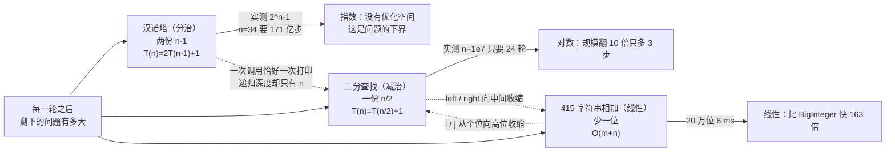
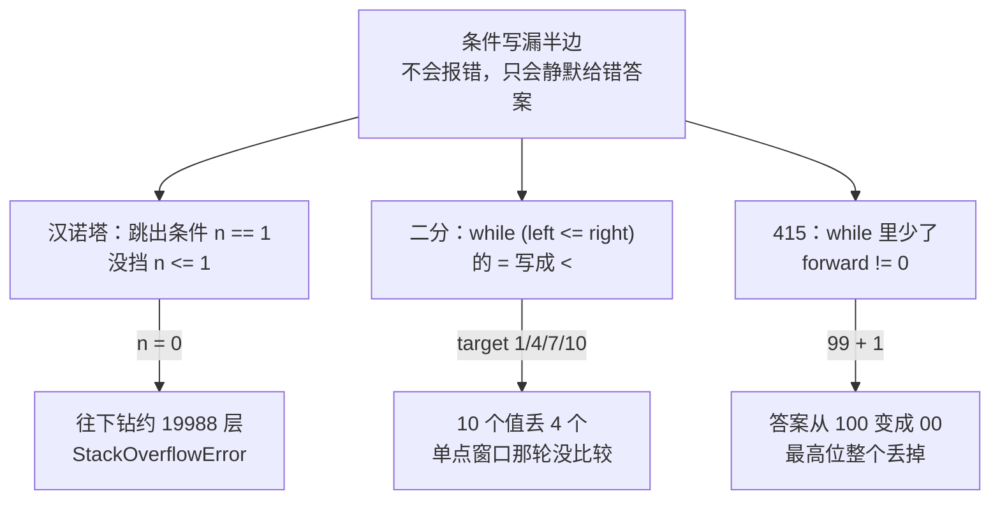

# 算法练习 · Java 手写实现与笔记

三个小程序，一个知识点一份可运行的 `.java` + 一份 `.md` 笔记。笔记里不抄定义，只讲三件事：**这段代码为什么这么写、下标/参数怎么动、写错一处会长成什么样**，所有数字都是在本机实跑出来的。

包名 `com.ittxf`，源码在 `src/`，笔记和程序放在同一个目录下。

## 思路图

三个程序看起来不相干（分治、查找、LeetCode 字符串题），但它们其实在同一根轴上：**每一轮把问题规模缩到多少**。



另一条贯穿三篇的线，是**"循环/递归的条件有没有写全"**——三个程序各有一个"少写半边"的实测后果：



## 知识点清单

| 板块 | 程序 | 笔记 | 核心点 |
| --- | --- | --- | --- |
| 分治 | `HanoiTower.java` | [汉诺塔.md](src/com/ittxf/study/dac/汉诺塔.md) | 把形参读成一句自然语言「把 n 个盘从 a 搬到 c，可借 b」，两次递归交换参数只是同一句话换了角色；**实测 n=1..12 的 31/4095 步逐盘对照真棋盘模拟，0 次违规、每次都真的搬完**；打印次数 = 方法调用次数 = 2^n-1（一次调用恰好一次 println），而最大递归深度只有 n —— 慢在步数不在栈；实测纯计数 n=24→34 是 16ms→16.4s（正好 2^10 倍），而**打印比递归本身贵约 360 倍**（n=22 是 419 万行 / 1.46 秒）；三种写错的变体全部实测：忘交换的那份 255 步里 247 步在从空柱取盘，而**"第三次递归写反"那版每一步都合法、255 行输出挑不出毛病，只是盘子根本没搬完**；`n == 1` 少了 `<=` 那半边 → `hanoiTower(0, ...)` 实测钻到约 2 万层爆栈；64 个盘按实测速度换算约 5849 年 |
| 查找 | `BinarySearchNoRecursion.java` | [二分查找非递归.md](src/com/ittxf/study/binarysearchnorecursion/二分查找非递归.md) | `main` 里那次 target=7 逐轮打出来是 4 轮 `[0,9]→[5,9]→[5,6]→[6,6]`；**`<=` / `mid-1` / `mid+1` 是一整套**：把 `=` 去掉实测丢 4/10 个答案（单点窗口那轮根本没比较），把 `right=mid` 或 `left=mid` 各少一格则实测在 target=0 / 10 / 11 上死循环（1000 步不收敛），而**能命中的 target 表现完全正常** —— 只测 target=7 发现不了；重复值返回的是"路上第一个撞到的"（实测 `{1,3,3,3,3,3,8}` 返回 3，首 1 末 5 都不是），与 `Arrays.binarySearch` 一致；**不检查数组有没有序**：2 万组随机乱序数组实测 64.81% 漏答、但 0 次假阳性（只在 `a[mid]==target` 时返回），递减数组 10 个值只找到 1 个；8 万数据实测比较次数：目标在下标 0 时线性 1 次 vs 二分 16 次，最后一个时线性 80000 次 vs 二分 17 次，1000 次查找线性 5~6ms vs 二分不足 1ms；`n` 从 10 到 1000 万实测轮数 4→24，正好等于 `ceil(log2 n)`；`(left+right)/2` 溢出用真实下标算式实测得到 -397483648（Java 数组撑不到那个长度，这一条只成立于算式本身） |
| LeetCode | `LeetCode415_AddStrings.java` | [LeetCode415-字符串相加.md](src/com/ittxf/leetcode/LeetCode415-字符串相加.md) | `"456"+"77"="533"` 逐位推演成表（低位先写、最后 reverse）；三个循环条件各挡一种情况，**删掉 `forward != 0` 实测：`"99"+"1"`→`"00"`、`"5"+"5"`→`"0"`，而不进位的 `"456"+"77"` 照样对** —— 两组测试就能骗过去的 bug；不 reverse 得到 `"335"`，`"120"+"30"` 得到 `"051"`（长度和数位集合都没错，只有顺序反）；穷举 `x,y∈0..9, forward∈0..1` 确认进位只会是 0/1（`sum` 上限 19），所以每轮 `append` 恰好写一个数字；`Long.MAX_VALUE` 只有 19 位、30 个 9 实测抛 `NumberFormatException`，这就是题目禁止 `parseInt` 的理由；20 万位相加实测 6ms，`BigInteger` 981ms（结果一致，差 163 倍）；`-'0'` 是纯算术不做校验，实测 `"12a"+"3"`→`"172"`（`'a'-'0'=49`，被当成"这一位是 9、进 4"）、`"1 2"+"3"`→`"06-5"`（空格是 -16，`append(-6)` 写出两个字符）；与前导零/空串的三处分歧（`"007"+"1"`→`"008"`、两个空串相加返回空串而不是 `"0"`） |

## 一条从这三个程序里读出来的共性

三个程序加起来有四处"少写半边条件"，而且**后果都不是报错**：

| 少写的那一处 | 触发输入 | 实测后果 |
| --- | --- | --- |
| 汉诺塔 `if (n == 1)` 没挡 `n <= 1` | `hanoiTower(0, ...)` | 一路递归到负数，钻约 19,988 层后 `StackOverflowError` |
| 二分 `while (left <= right)` 的 `=` | 答案落在单点窗口的那一轮 | 10 个目标值丢 4 个，返回 -1（"不存在"），从不返回错下标 |
| 二分 `right = mid` / `left = mid` 少一格 | 查询一个不存在的值 | 死循环（实测 1000 步仍未收敛，且能命中的用例一切正常） |
| 415 `while` 少了 `forward != 0` | 最高位产生进位 | `"99"+"1"` 得 `"00"`，不进位的用例完全正确 |

写递归/双指针的时候，"跑一个正常用例"能通过的密度太低 —— 这三篇笔记里每个坑都是靠**专门去撞边界**（不存在的值、单点窗口、空串、0 个盘）才暴露出来的。

## 目录结构

```text
src/com/ittxf/
├── study/
│   ├── dac/                         HanoiTower.java                + 汉诺塔.md
│   └── binarysearchnorecursion/     BinarySearchNoRecursion.java   + 二分查找非递归.md
└── leetcode/                        LeetCode415_AddStrings.java    + LeetCode415-字符串相加.md
```

`out/`（IDEA 编译输出）、`.idea/`、`*.iml` 不入库。

## 怎么跑

三个 `.java` 都带 `main`，跑起来不需要任何输入，直接打印结果。IDEA 里点绿色三角即可。命令行（本机 JDK 21.0.12.1，三个文件全部编译通过）：

```powershell
# 单个程序
javac -encoding UTF-8 -d out src\com\ittxf\study\dac\HanoiTower.java
java -cp out com.ittxf.study.dac.HanoiTower

# 整个 src 一次编译
javac -encoding UTF-8 -d out (Get-ChildItem -Recurse src -Filter *.java).FullName
```

Git Bash / WSL 下中文输出要加一个参数，否则控制台会按 GBK 出字节（实测同一个程序：不加参数输出 `b5da 31b8 f6...`，加了输出 `e7ac ac31 e4b8 aa...` 才是 UTF-8 的"第1个盘"）：

```bash
java -Dstdout.encoding=UTF-8 -cp out com.ittxf.study.dac.HanoiTower
```

三个程序的预期输出：

```
HanoiTower                 31 行 "第k个盘从X->Y"（main 里写的是 n=5）
BinarySearchNoRecursion    目标值 7 的索引为 6
LeetCode415_AddStrings     533
```

两处要注意的：

- `HanoiTower` 的 `main` 里 n 是写死的 5。改成 25 会打印 33,554,431 行（按实测每秒约 290 万行要 11 秒），改成 30 就是 10 亿行。**想试规模请先把它接到命令行参数上**，直接改大数字只会让控制台卡住。
- 三个 `main` 都只演示一组数据（`BinarySearchNoRecursion` 查的是 target=7，`LeetCode415_AddStrings` 加的是 `"456"+"77"`）。笔记里那些边界结论 —— 不存在的值、单点窗口、0 个盘、空串、非法字符 —— 都得自己换入参才能复现，三篇笔记各自的实测表就是照着这个目的写的。
