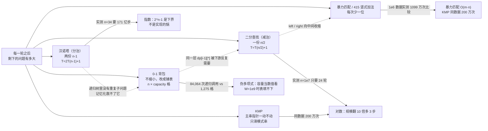
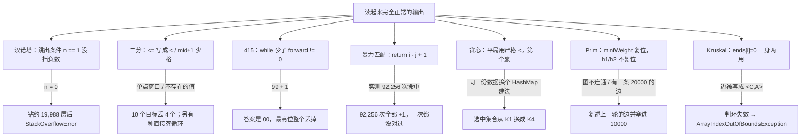

# 算法练习 · Java 手写实现与笔记

九个小程序，一个知识点一份可运行的 `.java` + 一份 `.md` 笔记。笔记里不抄定义，只讲三件事：**这段代码为什么这么写、下标/参数怎么动、写错一处会长成什么样**，所有数字都是在本机实跑出来的。

包名 `com.ittxf`，源码在 `src/`，笔记和程序放在同一个目录下。

## 思路图

这些程序看着分属不同章节（分治、查找、贪心、动态规划、字符串匹配、最小生成树），但它们其实在同一根轴上：**每一轮之后，剩下的问题有多大**。



另一条贯穿全仓库的线：**写漏半句、忘了复位，后果通常不是报错，而是安静地给一个像模像样的错答案。**



## 知识点清单

| 板块 | 程序 | 笔记 | 核心点 |
| --- | --- | --- | --- |
| 分治 | `HanoiTower.java` | [汉诺塔.md](src/com/ittxf/study/dac/汉诺塔.md) | 把形参读成一句自然语言「把 n 个盘从 a 搬到 c，可借 b」，两次递归交换参数只是同一句话换了角色；**实测 n=1..12 的逐步移动对照真棋盘模拟，0 次违规、每次都真的搬完**；打印次数 = 方法调用次数 = 2^n-1，而最大递归深度只有 n —— 慢在步数不在栈；纯计数实测 n=24→34 是 16ms→16.4s（正好 2^10 倍），**打印比递归本身贵约 360 倍**；三种写错的变体全部实测：忘交换的那份 255 步里 247 步在从空柱取盘，而**"第三次递归写反"那版每一步都合法、255 行输出挑不出毛病，只是盘子根本没搬完**；`n == 1` 少了 `<=` → `hanoiTower(0, ...)` 实测钻到约 2 万层爆栈 |
| 查找 | `BinarySearchNoRecursion.java` | [二分查找非递归.md](src/com/ittxf/study/binarysearchnorecursion/二分查找非递归.md) | target=7 逐轮打出来是 4 轮 `[0,9]→[5,9]→[5,6]→[6,6]`；**`<=` / `mid-1` / `mid+1` 是一整套**：去掉 `=` 实测丢 4/10 个答案，少写一格实测在 target=0 / 10 / 11 上死循环，而**能命中的 target 表现完全正常**（只测 target=7 发现不了）；重复值返回"路上第一个撞到的"（实测 `{1,3,3,3,3,3,8}` 返回 3，首 1 末 5 都不是）；**不检查数组有没有序**：2 万组随机乱序数组实测 64.81% 漏答、0 次假阳性；8 万数据实测目标在下标 0 时线性 1 次比较 vs 二分 16 次，最后一个时线性 80,000 vs 二分 17；`n` 从 10 到 1000 万实测轮数 4→24 = `ceil(log2 n)` |
| LeetCode | `LeetCode415_AddStrings.java` | [LeetCode415-字符串相加.md](src/com/ittxf/leetcode/LeetCode415-字符串相加.md) | `"456"+"77"="533"` 逐位推演成表（低位先写、最后 reverse）；**删掉 `forward != 0` 实测：`"99"+"1"`→`"00"`、`"5"+"5"`→`"0"`，而不进位的 `"456"+"77"` 照样对**；不 reverse 得到 `"335"`，`"120"+"30"` 得到 `"051"`（长度和数位集合都没错，只有顺序反）；穷举确认进位只会是 0/1；`Long.MAX_VALUE` 只有 19 位，这就是题目禁止 `parseInt` 的理由；20 万位相加实测 6ms，`BigInteger` 981ms；`-'0'` 是纯算术，实测 `"12a"+"3"`→`"172"`（`'a'-'0'=49` 被当成"这一位 9、进 4"）、`"1 2"+"3"`→`"06-5"` |
| 动态规划 | `KnapsackProblem.java` | [0-1背包动态规划.md](src/com/ittxf/study/dynamic/0-1背包动态规划.md) | 3 个物品、容量 4 的完整 `dp` 表（含程序不打印的第 0 行第 0 列）+ 反推路径逐步走一遍；**两个分支都回到 `i-1` 行才是"0-1"的来历**，写成 `dp[i][j-w]` 就变成完全背包；`max` 会丢掉决策，所以必须额外一张 `path` 才能反推装了什么；4,000 组随机实例实测 `dp[n][cap]`、反推方案的总重量、总价值三项**全部 0 次失败**（其中 481 组出现过平局）；平局时 `>` 让它偏向"放"，于是**价值相同的物品报出来的是下标较大的那几个**；`weights[i-1] > j` 那格不给 `path` 赋值，"塞不下"和"选了不放"在表上长得一样；重量 0 的物品实测把答案从 1100 算成 1000（第 0 列默认 0 隐含了"所有重量 ≥ 1"）；自顶向下写法实测 n=24 要 **84,064 次调用**，表格只需 1,275 格；穷举实测 n=26 要 2,864ms 而 dp 始终 0ms；一维滚动数组与二维 3,000 组结果全同、n=2000/W=5000 时 2ms vs 37ms、20,004 字节 vs 40,028,004 字节，**但没有 `path` 就反推不出方案** |
| 贪婪算法 | `GreedyAlgorithm.java` | [贪婪算法电台覆盖.md](src/com/ittxf/study/greedy/贪婪算法电台覆盖.md) | 逐轮复现"每轮挑还能覆盖最多的"，4 轮选出 `[K1, K2, K3, K5]`；穷举 32 个子集确认最少 4 个、且**可行解只有 `{K1,K2,K3,K5}` 和 `{K2,K3,K4,K5}` 这两种**；平局用严格 `<` 判断 → 胜者是"遍历顺序里第一个达到最大值的"，于是**同一份数据只换 HashMap 的构造方式（逐个 put vs putAll，桶数 16 vs 8）实测就得到两种答案**，被 K1 支配的 K4 会顶掉 K1 —— 这次仍是 4 个纯属运气（K1 多出的北京恰好被 K2 覆盖了）；`else break` 是必需的：手动加一个没人覆盖的"武汉"实测跑 5 轮后靠它收场，删掉就是死循环；3,000 组随机集合覆盖实测**贪心 8.30% 的实例比最优多花电台**（最多 +2），这份数据只是恰好落在最优那一侧；`selects` 是 HashSet，打印顺序不等于选中顺序（实测两种顺序确实不同） |
| 字符串匹配 | `ViolenceMatch.java`、`KMPAlgorithm.java` | [暴力匹配与KMP.md](src/com/ittxf/study/kmp/暴力匹配与KMP.md) | **暴力那份的 `return i - j + 1` 是错的**：`main` 打印 `index = 3`，而 `"hello txf, thank you".indexOf("ll")` 是 2；20 万组随机串里 92,256 次命中**全部恰好 +1，正确 0 次**，而同一批数据上 `kmpSearch` 与 `indexOf` **20 万组全对** —— 同一个 return 写法在 KMP 里是对的，因为两边的 `i` 含义不同（暴力退出时 i 已在匹配段之后，KMP 的 i 停在最后一个匹配字符上）；比较次数实测：他自己那组 23/7 字符上暴力 36 vs KMP 25+7=32（**几乎看不出差距**），换成 `A^n B` 形状就是暴力的 `\|pat\|²`（144）对 KMP 的线性（34），100 万字符实测 1,099 万 vs 200 万次；`kmpNext("")` 实测直接 `ArrayIndexOutOfBoundsException`；两份都只返回第一个匹配（`ABABABABAB` 找 `ABAB` 实测返回 0，真实有 4 处） |
| 最小生成树 | `PrimAlgorithm.java` | [Prim最小生成树.md](src/com/ittxf/study/prim/Prim最小生成树.md) | 7 个顶点从 A 出发实测输出 6 条边、总权 25，**和独立实现逐一吻合，而且 7 个起点分别跑都是 25**（生成树权值与起点无关这条性质顺手验了）；代价是 `V-1` 轮 × 每轮扫整张 `V×V` 矩阵 = O(V³)，实测 V=600 要判断约 2.15 亿次格子里挑 2,385 条边、花 45ms，同一数据 Kruskal 主循环 0ms；**`miniWeight` 每轮复位而 `h1/h2` 从不复位**，于是"这一轮没找到候选"时它会**复述上一轮的边并配上 10000 的权值**：D 孤立的图实测打出 `边< A, C > 权值：10000`、总权 10004（参考实现判定不连通）；权值 ≥ 10000 的真边永远看不见，实测一条 20000 的边让总权从 20003 变 10003；矩阵只填下三角时实测打出两行 `边< A, A > 权值：10000` |
| 最小生成树 | `KruskalCase.java` | [Kruskal最小生成树.md](src/com/ittxf/study/kruskal/Kruskal最小生成树.md) | 12 条边排序后收 6 丢 6、总权 36，与独立实现一致（V 到 600 的随机连通图次次一致）；`ends` 数组逐个翻译（`[6,5,3,5,5,6,0]` → 七个点全走到根 G）；**`ends[i]=0` 同时表示"没连"和"我是根"，而 A 的下标就是 0** —— 它靠"`getEdges()` 生成的边恒为 `i<j`、第二个端点不可能是 0"才没出事，把同一条边写成 `<C,A>` 实测判环失效、3 个点收 3 条边成环，然后不是给错数字而是 `ArrayIndexOutOfBoundsException`（`res` 只开 V-1 格）；图不连通时 `res` 的空槽被增强 for 打成字面量 `null`；`compareTo` 用减法实测溢出（`2e9 - (-2e9)` = -294,967,296，排序结果原样不动），但这份数据过滤掉 INF 后够不到；`printMatrix` 的注释还写着"遇到 10000"，实际判断的是 `Integer.MAX_VALUE`；**它和 Prim 那份用的是两张不同的图**（12 条边 vs 10 条边），36 和 25 不可比 |

## 一条从这九个程序里读出来的共性

写漏一处、忘复位一个变量，八处里**只有两处会当场炸**（汉诺塔的 `StackOverflowError`、Kruskal 的数组越界），
一处变成死循环，剩下五处都是安静地给出一个格式完全正常的错答案：

| 漏写/混用的那一处 | 触发输入 | 实测后果 |
| --- | --- | --- |
| 汉诺塔 `if (n == 1)` 没挡 `n <= 1` | `hanoiTower(0, ...)` | 一路递归到负数，钻约 19,988 层后 `StackOverflowError` |
| 二分 `while (left <= right)` 的 `=` | 答案落在单点窗口那一轮 | 10 个目标值丢 4 个，返回 -1（"不存在"），从不返回错下标 |
| 二分 `right = mid` / `left = mid` 少一格 | 查询一个不存在的值 | 死循环（实测 1000 步仍未收敛，且能命中的用例一切正常） |
| 415 `while` 少了 `forward != 0` | 最高位产生进位 | `"99"+"1"` 得 `"00"`，不进位的用例完全正确 |
| 暴力匹配 `return i - j + 1` | 任何一次命中 | 92,256 次命中 92,256 次 +1，程序照常打印 |
| 贪心平局时用严格 `<` + `HashMap` 顺序 | 两个电台覆盖数相同 | 同一份数据两种容器构造 → 两种答案；被支配的 K4 顶掉 K1 |
| Prim `h1/h2` 不复位 | 某一轮找不到跨堆边（图不连通、有向矩阵填错方向、边权 ≥ 10000） | 打印上一轮的边 + 权值 10000，总权值凭空多 10000 |
| Kruskal `ends[i]=0` 当哨兵 | 边的第二个端点是下标 0（本程序 `getEdges()` 生成不出这种边） | 合并变成空操作 → 判环失效 → 收第 V 条边时数组越界 |

结论很一致：**"跑一个正常用例"能通过的密度太低**。这三张表里每个坑都是靠专门去撞边界（不存在的值、单点窗口、空串、0 个盘、平局、孤立的顶点、恰好等于无穷大的权值）才暴露出来的。

## 目录结构

```text
src/com/ittxf/
├── study/
│   ├── dac/                         HanoiTower.java                + 汉诺塔.md
│   ├── binarysearchnorecursion/     BinarySearchNoRecursion.java   + 二分查找非递归.md
│   ├── dynamic/                     KnapsackProblem.java           + 0-1背包动态规划.md
│   ├── greedy/                      GreedyAlgorithm.java           + 贪婪算法电台覆盖.md
│   ├── kmp/                         ViolenceMatch.java          ┐
│                                    KMPAlgorithm.java           ┴ 暴力匹配与KMP.md
│   ├── prim/                        PrimAlgorithm.java           + Prim最小生成树.md
│   └── kruskal/                     KruskalCase.java              + Kruskal最小生成树.md
└── leetcode/                        LeetCode415_AddStrings.java   + LeetCode415-字符串相加.md
```

`PrimAlgorithm.java` 和 `KruskalCase.java` 各自在同一个文件里带了辅助类（`MiniSpanTree`/`Graph`、`EData`），所以是"一个文件一个知识点"。
`out/`（IDEA 编译输出）、`.idea/`、`*.iml` 不入库。

## 怎么跑

九个 `.java` 都带 `main`，跑起来不需要任何输入，直接打印结果。IDEA 里点绿色三角即可。命令行（本机 JDK 21.0.12.1，九个文件一次编译全部通过）：

```powershell
# 单个程序
javac -encoding UTF-8 -d out src\com\ittxf\study\dac\HanoiTower.java
java -cp out com.ittxf.study.dac.HanoiTower

# 整个 src 一次编译
javac -encoding UTF-8 -d out (Get-ChildItem -Recurse src -Filter *.java).FullName
```

Git Bash / WSL 下中文输出要加一个参数，否则控制台会按 GBK 出字节（实测同一个程序：不加参数输出 `b5da 31b8 f6...`，加了输出 `e7ac ac31 e4b8 aa...` 才是 UTF-8 的"第1个盘"）：

```bash
java -Dstdout.encoding=UTF-8 -cp out com.ittxf.study.prim.PrimAlgorithm
```

各程序的预期输出（都是实测）：

```
com.ittxf.study.dac.HanoiTower                     31 行 "第k个盘从X->Y"（main 里写的是 n=5）
com.ittxf.study.binarysearchnorecursion…           目标值 7 的索引为 6
com.ittxf.leetcode.LeetCode415_AddStrings          533
com.ittxf.study.dynamic.KnapsackProblem            3 行 dp 表 + 4 行 path 表 + 放入物品 3、1 + 最大价值 3500
com.ittxf.study.greedy.GreedyAlgorithm             得到的选择结果是：[K1, K2, K3, K5]
com.ittxf.study.kmp.ViolenceMatch                  index = 3            ← 正确答案是 2，见笔记第一节
com.ittxf.study.kmp.KMPAlgorithm                   [0, 0, 0, 0, 1, 2, 0] / index = 15
com.ittxf.study.prim.PrimAlgorithm                 7×7 邻接矩阵 + 6 条边 + 总权值 25
com.ittxf.study.kruskal.KruskalCase                7×7 邻接矩阵 + 12 条边排序 + ends 数组 + 6 条树边
```

几处要注意的：

- `ViolenceMatch` 打印的 `index = 3` 是**错的**（`indexOf` 给 2）。这不是显示问题，`return` 语句本身多写了 `+1`，详见 [暴力匹配与KMP.md](src/com/ittxf/study/kmp/暴力匹配与KMP.md) 第一、二节 —— 同一份写法在 `KMPAlgorithm` 里是对的。
- `HanoiTower` 的 `main` 里 n 写死为 5。改成 25 会打印 33,554,431 行（实测约每秒 290 万行，要 11 秒），改成 30 就是 10 亿行。**想试规模请先把它接到命令行参数上**。
- 九个 `main` 都只演示一组数据。笔记里的边界结论 —— 不存在的值、单点窗口、空串、0 个盘、平局、孤立的顶点、`≥ 10000` 的权值、重量 0 的物品 —— 都得自己换入参才能复现，各篇笔记里的实测表就是照着这个目的写的。
- `GreedyAlgorithm` 的结果依赖 `HashMap`/`HashSet` 的遍历顺序，**换一种构造方式（`putAll` 代替逐个 `put`）答案就变**，见那篇笔记第二节。想复现稳定输出就用 `LinkedHashMap`。
- `Prim` 和 `Kruskal` 两份程序里的图**不是同一张**（10 条边 vs 12 条边，无穷大分别是 10000 和 `Integer.MAX_VALUE`），别拿 25 和 36 互相验证。
