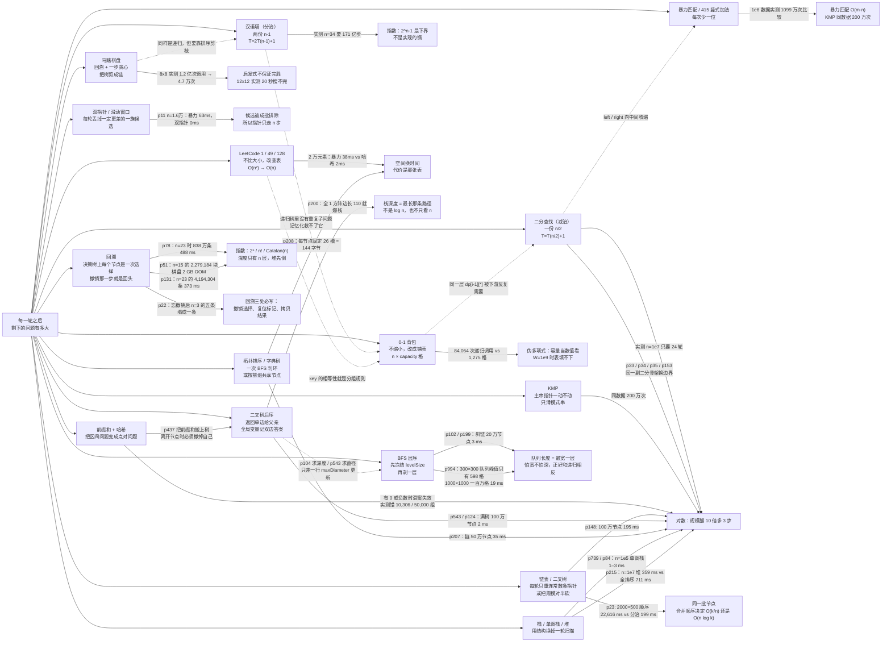

# 算法练习 · Java 手写实现与笔记

九十二个程序（92 个 `.java`、91 份 `.md` 笔记 —— `kmp` 包里暴力匹配与 KMP 两份程序共用一篇），一个知识点一份可运行的 `.java` + 一份 `.md` 笔记。笔记里不抄定义，只讲三件事：**这段代码为什么这么写、下标/参数怎么动、写错一处会长成什么样**，所有数字都是在本机实跑出来的。

`src/com/ittxf/study/` 是课程知识点（分治、查找、DP、贪心、字符串匹配、图、回溯），`src/com/ittxf/leetcode/` 是 LeetCode 题解 —— 其中 `hot100/` 下**一题一个包**，按技巧能归十九组：双指针（11 / 42 / 15 / 4）、滑动窗口（3 / 76 / 239 / 438）、哈希表（1 / 49 / 128）、前缀和（560）、数组原地操作（41 / 189 / 238 / 283 / 53 / 56）、矩阵（48 / 54 / 73 / 240）、二分查找（33 / 34 / 35 / 74 / 153）、链表基础（141 / 160 / 206 / 234）、链表进阶（2 / 19 / 21 / 23 / 24 / 25 / 138 / 142 / 146 / 148）、二叉树基础（94 / 101 / 104 / 226）、二叉搜索树（98 / 108 / 230）、二叉树进阶（102 / 105 / 114 / 124 / 199 / 236 / 437 / 543）、网格 DFS / BFS（200 / 994）、回溯（17 / 22 / 39 / 46 / 51 / 78 / 79 / 131）、图 · 拓扑排序（207）、字典树（208）、栈（20 / 155 / 394）、单调栈（84 / 739）、堆 · 优先队列（215 / 295 / 347）。`src/com/ittxf/others/` 是四份不成套的练习（爬楼梯变种、全排列、和为正的最长子数组、同花顺判定）。包名 `com.ittxf`，笔记和程序放在同一个目录下。

## 思路图

这些程序在同一根轴上：**每一轮之后，剩下的问题有多大**；哈希表那一档换的是另一个东西 —— 用一张表把"再扫一遍"变成"查一次"。



第二张图是全仓库那条主线：**写漏半句、忘了复位、两句顺序颠倒，后果通常不是报错，而是安静地给一个像模像样的错答案。**

```mermaid
flowchart TD
    E["读起来完全正常的输出"]
    E --> F1["汉诺塔：跳出条件 n == 1 没挡负数"]
    E --> F2["二分：<= 写成 < / mid±1 少一格"]
    E --> F3["415：while 少了 forward != 0"]
    E --> F4["暴力匹配：return i - j + 1"]
    E --> F5["贪心：平局用严格 <，第一个赢"]
    E --> F6["Prim：miniWeight 复位，h1/h2 不复位"]
    E --> F7["Kruskal：ends[i]=0 一身两用"]
    E --> F8["Dijkstra：65535 既是无穷大也是天花板"]
    E --> F9["Floyd：this.distance = matrix 不拷贝"]
    E --> F10["马踏棋盘：finished 是 static 且从不复位"]
    E --> F11["两数之和：put 写在 containsKey 之前"]
    E --> F12["分组：拿 char[] 当 HashMap 的 key"]
    E --> F13["最长子串：left 直接赋值，去掉 Math.max"]
    E --> F14["水桶：动了较高的那一边"]
    E --> F15["239：k &gt; n 没挡，直接开负长度数组"]
    E --> F16["560：删掉 put(0, 1)"]
    E --> F17["三数之和：去掉命中后的 left++ / right--"]
    E --> F18["438：输入里冒出一个大写字母"]
    E --> F19["p94：list 是实例字段"]
    E --> F20["p25：k ≤ 0 没挡"]
    E --> F21["p19：n = 0 / n 超长没挡"]
    E --> F22["p23：逐个累加合并"]
    E --> F23["p102：levelSize 改成实时 queue.size()"]
    E --> F24["p437：删掉第 5 步回溯"]
    E --> F25["p124 / p543：全局字段从不复位"]
    E --> F26["p200：淹没式 DFS 直接改入参"]
    E --> F27["p200：递归深度 = 最长陆地路径"]
    E --> F28["permute：res 是实例字段不清空"]
    E --> F29["最长正和子数组：每步扫全表"]
    E --> F30["p146 手写版：capacity = 0"]
    E --> F31["p98：只比父子，不传上下界"]
    E --> F32["p236：不检查 p / q 在不在树里"]
    E --> F33["p994：levelSize 改成实时 queue.size()"]
    E --> F34["p994：while 去掉 freshCount &gt; 0"]
    E --> F35["p39：删掉 sum &gt; target 的剪枝"]
    E --> F36["p46：res.add(path) 不拷贝"]
    E --> F37["p17 / p22：忘了 deleteCharAt 撤销"]
    E --> F38["p79：不加 visited，同一格反复用"]
    E --> F39["p207：count == numCourses 改成恒真"]
    E --> F40["p208：children[c - 'a'] 只认小写"]
    F1 -->|"n = 0"| G1["钻约 19,988 层后 StackOverflowError"]
    F2 -->|"单点窗口 / 不存在的值"| G2["10 个目标丢 4 个；另有一种直接死循环"]
    F3 -->|"99 + 1"| G3["答案是 00，最高位整个丢掉"]
    F4 -->|"实测 92,256 次命中"| G4["92,256 次全部 +1，一次都没对过"]
    F5 -->|"同一份数据换个 HashMap 建法"| G5["选中集合从 K1 换成 K4"]
    F6 -->|"图不连通 / 有一条 20000 的边"| G6["复述上一轮的边并塞进 10000"]
    F7 -->|"边被写成 &lt;C,A&gt;"| G7["判环失效 → ArrayIndexOutOfBoundsException"]
    F8 -->|"40000 + 40000"| G8["可达的点被打成 N"]
    F9 -->|"floyd() 之后"| G9["调用方那个邻接矩阵已经不是邻接矩阵了"]
    F10 -->|"同一个 JVM 跑第二次"| G10["0 ms 打出 59 出现两次的假棋盘"]
    F11 -->|"[3,3] target 6"| G11["返回 [0,0]：自己配自己"]
    F12 -->|"6 个词"| G12["变成 6 组，每组一条"]
    F13 -->|"abba"| G13["50,000 组随机错 27,081 次"]
    F14 -->|"[1,1,0]"| G14["得 0，真值是 1"]
    F15 -->|"k=5, n=3"| G15["NegativeArraySizeException: -1"]
    F16 -->|"[3,1,1] k=3"| G16["30.39% 的随机数据悄悄漏答案"]
    F17 -->|"命中一次之后"| G17["指针原地不动 → 死循环"]
    F18 -->|"A - a = -32"| G18["26 格频次表直接越界"]
    F19 -->|"同一实例第 2、3 次调用"| G19["满树遍历打印 10 个值，三次返回同一个 List"]
    F20 -->|"n = 5, k = 0"| G20["不报错：返回 dummy 自环，5 个节点全丢"]
    F21 -->|"n = 0"| G21["second 停在尾节点 → NullPointerException"]
    F22 -->|"2000 列 × 500 个"| G22["22,616 ms（同一批节点两两分治 199 ms）"]
    F23 -->|"main 那棵树"| G23["不死循环，但分成 [[3,9,20],[15],[7]]"]
    F24 -->|"(1,4,5) 求 target=1"| G24["右子树命中左子树留下的前缀和：真值 1 给 2，随机错 49.0%"]
    F25 -->|"大树之后调一棵小树"| G25["p124 单节点 5 仍返回 42；p543 两节点树仍返回 3"]
    F26 -->|"同一份地图连调两次"| G26["第一次 1，第二次 0：'1' 全被抹成 '0'"]
    F27 -->|"全 1 方阵逐档试探"| G27["边长 110（1.2 万格）就 StackOverflowError，题面 300×300 也在范围内"]
    F28 -->|"同一实例连调三次"| G28["6 → 12 → 14 组，第三批还带着第一批的行"]
    F29 -->|"全 1 数组 n=16,000"| G29["227 ms，比 O(n²) 暴力 62 ms 还慢（随机数据只有 180 个 key，看着像线性）"]
    F30 -->|"空表时淘汰取到哨兵 head"| G30["NullPointerException: head.prev is null（旧 LinkedHashMap 版给 -1）"]
    F31 -->|"先造合法 BST 再改一个值"| G31["16,368 个非法实例漏掉 1,238 个（7.6%），而随机树只暴露 0.23%"]
    F32 -->|"p 在树里、q 是幽灵节点"| G32["把 p 当成 LCA 返回（参考实现给 null）"]
    F33 -->|"最短反例只有 3 个格子"| G33["[[2,2,1]] 原版 1、实时读 2；穷举 21,297 组错 5,591，而 main 上两者都给 4"]
    F34 -->|"感染完了但队列还剩 1 个"| G34["白转一轮：main 从 4 变 5，14,425 组正数用例各 +1"]
    F35 -->|"{2,3,5} 求 8"| G35["sum 冲过 target 再也等不到相等：钻 5,192 层后 StackOverflowError"]
    F36 -->|"{1,2,3}"| G36["六条全变成 []：存进去的是同一个 path，回溯到底已被清空"]
    F37 -->|"p17 输入 2 / p22 输入 n=3"| G37["p17 变 [a, ab, abc]；p22 五条塌成 [((()))]，而 main 上都像样"]
    F38 -->|"同一格被别的路径再用"| G38["ABCB 会判 true（题面示例就测得出）"]
    F39 -->|"{{1,0},{0,1}} 有环"| G39["返回 true：这道题的判断全挂在这一行上"]
    F40 -->|"'A' / '1' / 空格 / 中文"| G40["Index -32 / -48 / -65 / 19916 out of bounds for length 26"]
```



## 四份图程序用的其实是两张图

四份程序都叫 `Graph`、都是 7 个顶点 A..G 的邻接矩阵，很容易以为是同一张图。逐格核过之后是这样的：

| 程序 | "无边"用的常量 | 对角线 | 上三角边数 | 对称性 | 结果 |
| --- | --- | --- | --- | --- | --- |
| `PrimAlgorithm` | `10000` | 10000 | 10 | 完全对称 | 最小生成树总权 25 |
| `KruskalCase` | `Integer.MAX_VALUE` | 0 | 12 | 完全对称 | **另一张图**，最小生成树总权 36 |
| `DijkstraAlgorithm` | `65535` | 65535 | 10 | 完全对称 | **和 Prim 同一张图**，从 G 出发 `[2,3,9,10,4,6,0]` |
| `FloydAlgorithm` | `65535` | 0 | 9 | **6 处不对称** | B 的三条边只填了一半，实际是张有向图 |

三个能直接拿来当自查用的结论：

- **Prim 和 Dijkstra 是同一张图**（10 条边逐条一致），所以可以对着看"最小生成树 ≠ 最短路"：Prim 选出的树里 A→D 只能走 `A-G-E-F-D` 花 15，而真正的最短路是 `A-G-F-D` 花 12（那条 `G-F(6)` 压根没进生成树）。
- **Kruskal 是另一张图**（12 条边），所以 25 和 36 之间没有任何可比性。
- **Floyd 的矩阵漏填了 `B→D` 和 `B→G`、又多出一条只有去程的 `B→F`**，从 B 出发的 4 对距离因此和对称矩阵上的 Dijkstra 不一致（其余 42 对全一致）。它不报错、输出很漂亮 —— 这类录入错误只能靠"矩阵和自己转置比一遍"来抓。

## 知识点清单

| 板块 | 程序 | 笔记 | 核心点 |
| --- | --- | --- | --- |
| 分治 | `HanoiTower.java` | [汉诺塔.md](src/com/ittxf/study/dac/汉诺塔.md) | 把形参读成一句自然语言「把 n 个盘从 a 搬到 c，可借 b」；**实测 n=1..12 的逐步移动对照真棋盘模拟，0 次违规、每次都真的搬完**；打印次数 = 方法调用次数 = 2^n-1，而最大递归深度只有 n —— 慢在步数不在栈；纯计数实测 n=24→34 是 16ms→16.4s（正好 2^10 倍），**打印比递归本身贵约 360 倍**；`n == 1` 少了 `<=` → `hanoiTower(0, ...)` 实测钻到约 2 万层爆栈 |
| 查找 | `BinarySearchNoRecursion.java` | [二分查找非递归.md](src/com/ittxf/study/binarysearchnorecursion/二分查找非递归.md) | **`<=` / `mid-1` / `mid+1` 是一整套**：去掉 `=` 实测丢 4/10 个答案，少写一格实测死循环，而**能命中的 target 表现完全正常**；重复值返回"路上第一个撞到的"；**不检查数组有没有序**：2 万组随机乱序数组实测 64.81% 漏答、0 次假阳性；8 万数据实测目标在下标 0 时线性 1 次比较 vs 二分 16 次；`n` 从 10 到 1000 万实测轮数 4→24 = `ceil(log2 n)` |
| LeetCode | `LeetCode415_AddStrings.java` | [LeetCode415-字符串相加.md](src/com/ittxf/leetcode/LeetCode415-字符串相加.md) | 逐位推演 `"456"+"77"="533"`；**删掉 `forward != 0` 实测 `"99"+"1"`→`"00"`，而不进位的用例照样对**；穷举确认进位只会是 0/1；20 万位相加实测 6ms，`BigInteger` 981ms；`-'0'` 是纯算术，实测 `"12a"+"3"`→`"172"`、`"1 2"+"3"`→`"06-5"` |
| 哈希表 | `p1_twosum/LeetCode1_TwoSum.java` | [LeetCode1-两数之和.md](src/com/ittxf/leetcode/hot100/p1_twosum/LeetCode1-两数之和.md) | 把"找一对"换成"找补数"，一遍扫 + 一张表；**`containsKey` 写在 `put` 之前是"不许自己配自己"的唯一保证** —— 实测把两句调换：`[3,3]/6` 返回 `[0,0]`、`[1,1,1]/2` 返回 `[0,0]`、单个 `3` 配 `6` 也返回 `[0,0]`（应为无解），而 `main` 里那组 `[2,7,11,15]` 恰好测不出来；同一个值只留最后一个下标 → 解不唯一时返回的不是最靠前那对（60,000 组里 8,581 次不同，**全部合法**）；120,000 组随机对拍四类失败全 0；无解返回 `new int[0]` → 按长度 2 取值实测 AIOOBE；`target - nums[i]` 在题面 ±10⁹ 下不溢出但只剩约 7% 余量；实测 n=2 万 哈希 2ms vs 暴力 38ms、n=200 万 哈希 135ms（暴力要 2 万亿次比较）；`containsKey+get` 改成一次 `get` 实测只差在噪声里（5ms vs 4ms）；**注释里那份暴力没有 `break`，返回的是最后一组解**（实测 `[0,2]` vs `[1,3]`） |
| 哈希表 | `p49_groupanagrams/LeetCode49_GroupAnagrams.java` | [LeetCode49-字母异位词分组.md](src/com/ittxf/leetcode/hot100/p49_groupanagrams/LeetCode49-字母异位词分组.md) | 全部逻辑压在"key 按内容相等"上，所以 `new String(chars)` 不能省 —— **实测拿 `char[]` 当 key 会把 6 个词分成 6 组（应 3 组）**，因为数组的 `hashCode`/`equals` 都按引用；输出的组顺序由容器决定（`HashMap` / `LinkedHashMap` / `TreeMap` 实测三种顺序、内容同一套，`TreeMap` 那版能对上 key 的字典序 `abt<aet<ant`）；与"按字母计数"的独立实现对拍 5,000 组 **0 差异**；排序 key vs 26 槽计数 key **看词长定胜负**：短词排序赢（59 vs 133ms）、2000 字符时计数碾压（97 vs 1,031ms），而**把槽扩到 128 反而比排序还慢**（137 vs ~100ms）；`computeIfAbsent` 实测比 `containsKey+put+get` 快 1.4 倍（41→29ms / 20 万词）；含空串时打印成 `[[, ], [a]]` 容易误读；注释那份用了 JDK 21 的 `List.reversed()`，实测 `--release 17` **编译不过** |
| 双指针 | `p11_containerwithmostwater/LeetCode11_ContainerWithMostWater.java` | [LeetCode11-盛最多水的容器.md](src/com/ittxf/leetcode/hot100/p11_containerwithmostwater/LeetCode11-盛最多水的容器.md) | `min(两柱高) × 宽度`，宽度是 `right - left` 不是柱高；**只能动较矮的一边**——动较高的那边等于把"高度不可能更高、宽度还变小"的一族候选留下当答案，实测反过来写 **20,000 组随机里错 12,980 组（64.90%）**，最短反例只要 3 个数：`[1,1,0]` 正确 1、反过来写得 0；他的示例（9 根柱子）逐轮打点核对，第 2 轮就取到 49 之后全是徒劳；20,000 组与暴力 **0 差异**；n=16,000 实测双指针 0 ms vs 暴力 63 ms；这份没有 null 判断（`p42`、`p3` 有），传 null 直接 NPE |
| 双指针 | `p42_trappingtainwater/LeetCode42_TrappingRainWater.java` | [LeetCode42-接雨水.md](src/com/ittxf/leetcode/hot100/p42_trappingtainwater/LeetCode42-接雨水.md) | 每格的水 = `min(左最高, 右最高) - height[i]`，难点是"没扫到的那一侧"；`leftMax < rightMax` 就是在担保**右边已经有一根不比 leftMax 矮的柱子**，所以左格可以立刻结算 —— 每轮恰好有一侧定案，故 `O(n)` 时间 `O(1)` 空间；真实逐轮打点（11 轮、贡献 `下标2=1、4=1、5=2、6=1、9=1`，合计 6）**结算顺序不是从左到右**：下标 11/10/9/8 先被右支结掉；20,000 组与逐列暴力 **0 差异**，把 `<` 换成 `<=` 也 0 差异；`[5,1,5]`→4、`[2,0,2]`→2、长度 ≤2 直接 0、null 也挡了 |
| 双指针+去重 | `p15_3sum/LeetCode15_3Sum.java` | [LeetCode15-三数之和.md](src/com/ittxf/leetcode/hot100/p15_3sum/LeetCode15-三数之和.md) | 排序是"内层双指针方向唯一"和"三处跳重"的共同前提，`nums[i] > 0` 就 `break` 只在 target=0 时成立；20,000 组与"暴力+按值去重"**0 差异**；**三处跳重各自管什么，是逐个删掉测出来的**：删外层 `continue` → 40.88% 的随机实例条数变多、他的示例也从 2 组变 3 组；删内层两个 `while` → 18.84% 变多但**他的示例完全测不出来**（`[-2,0,0,2,2]` 才会重复）；删命中后的 `left++; right--` → **指针原地不动，直接死循环**（不是给错答案）；注释那份三重循环在他的示例上多给 1 组（3 vs 2），随机数据 61.25% 组数对不上；方法里 `Arrays.sort(nums)` 把入参排序了 + 多打一行；n=300 实测 0 ms vs 三重循环 22 ms；目录/类名/笔记已统一改成 15 题（原先误写成 49，与 `p49_groupanagrams` 撞号） |
| 双指针 | `p4_medianoftwosortedarrays/LeetCode4_MedianOfTwoSortedArrays.java` | [LeetCode4-寻找两个正序数组的中位数.md](src/com/ittxf/leetcode/hot100/p4_medianoftwosortedarrays/LeetCode4-寻找两个正序数组的中位数.md) | 两个指针虚拟归并，只走到 `mn/2`，`left`/`right` 保存中间两个；194,380 组随机小数组 0 差异；**双空数组 AIOOBE**，单空数组正常；`(left + right) / 2.0` 是先 int 加法：`{2e9}+{2e9}` 给 −1.47483648E8（真值 2e9），题面 ±10⁷ 安全；**是 O(m+n) 不是题面的 O(log)**：5e6+5e6 实测 3 ms，注释版 concat+sort 66 ms / 40 MB；入参只读 |
| 原地划分 | `p283_movezeroes/LeetCode283_MoveZeroes.java` | [LeetCode283-移动零.md](src/com/ittxf/leetcode/hot100/p283_movezeroes/LeetCode283-移动零.md) | 两段式（非零前移 + 尾部补零）能原地的全部理由是一条不变量 **`index <= i` 恒成立**，写目标永远不越过读目标（20,000 组与"另开数组"的稳定划分参考 **0 差异**）；`nums[index] = nums[i]` 在没有零的数组上是纯粹的自写自（`[1,2,3,4]` 实测 4 次），存在但无害；与交换写法结果逐组一致而**写次数更少**（20,000 组里交换更多 14,663 次、相等 5,337 次、覆盖更多的情况 0 次）；注释那份额外数组版里 `Arrays.fill` 是多余的（`new int[n]` 本就全 0），也不合题面"原地"要求；这份没挡 null |
| 滑动窗口 | `p3_.../LeetCode3_LongestSubstringWithoutRepeatingCharacters.java` | [LeetCode3-无重复字符的最长子串.md](src/com/ittxf/leetcode/hot100/p3_longestsubstringwithoutrepeatingcharacters/LeetCode3-无重复字符的最长子串.md) | `main` 用 `"1R1T7"` → 4；**`left = Math.max(left, map.get(c) + 1)` 里那个 max 是"left 只许前进"的守门人**：直接赋值时 `"abba"` 得 3（真值 2），50,000 组随机 **错 27,081 次（54.16%）**，而且它同时是 O(n) 复杂度论证的前提（指针一旦能后退就不是线性了）；注释说 value 存的是"索引 + 1"，代码存的其实是 `right`、`+1` 写在取值处 —— 照着注释改会造成"双重 +1"，实测 200,000 组**错 101,958 次**，最短反例 `"aab"`（2 → 1），而 `"abcabc"`、`"abba"` 在这种错法下仍然对；用 `Map` 而不是定长数组，才让大写 `R`/`T` 照跑（对比 438 越界） |
| 滑动窗口 | `p239_slidingwindowmaximum/LeetCode239_SlidingWindowMaximum.java` | [LeetCode239-滑动窗口最大值.md](src/com/ittxf/leetcode/hot100/p239_slidingwindowmaximum/LeetCode239-滑动窗口最大值.md) | 队列存**下标**而不是值（值会重复，判不出"滑出窗口"）；四步顺序：扔过期 → 扔被压 → 进队 → 记录；逐轮打点看他的 `[1,3,-1,-3,5,3,6,7]`：`i=6` 时下标 4 是被新值**压掉**的而不是过期扔掉的 —— 真正在瘦身的是第二步；20,000 组随机对拍 0 差异，**队尾 `<` 还是 `<=`、队头 `if` 还是 `while` 都不影响正确性**（注释里"一定要用 `<=`"不准确，它只让队列平均长度从 2.70 变 3.04）；`k=1`/`k=n`/空数组/`k=0` 都正常，但 **`k > n` 抛 `NegativeArraySizeException: -1`**（`new int[n-k+1]`），开头的 `n == 0 \|\| k == 0` 挡不住；注释那份 `O(nk)` 在 n=32万/k=1600 上实测 216 ms vs 6 ms |
| 滑动窗口 | `p438_.../LeetCode438_FindAllAnagramsInAString.java` | [LeetCode438-找到字符串中所有字母异位词.md](src/com/ittxf/leetcode/hot100/p438_findallanagramsinastring/LeetCode438-找到字符串中所有字母异位词.md) | `need[]` 中途会**变负数**（表示窗口里这个字符超额了），所以进窗口判 `> 0`、出窗口判 `>= 0` 两处符号故意不对称，写成一样就错报命中；8,000 组随机与"每个窗口排序"版 **0 差异**，`"cbaebabacd"/"abc"` → `[0, 6]`；他 `main` 那个长串命中 150 个起点、间隔恰好 26；排序版是**对的**只是慢 —— 实测 \|s\|=10万、\|p\|=100 时 2 ms vs 157 ms，但**在他 main 那个 3,900 长度上两种写法都测不出差别**（规模不够大的复现等于没复现）；`'A' - 'a' = -32` → 26 格数组 **AIOOBE**，题面保证小写所以不触发，但用定长数组就等于把字符集写进契约（p3 用 Map 就免疫）；注释里那句"一定要用 `<=`"同 239 一样只是避免冗余 |
| 前缀和 | `p560_subarraysumequalsk/LeetCode560_SubarraySumEqualsK.java` | [LeetCode560-和为K的子数组.md](src/com/ittxf/leetcode/hot100/p560_subarraysumequalsk/LeetCode560-和为K的子数组.md) | 区间和换成"两个前缀和之差"，于是 `count += map.get(preSum - k)` 累加的是**次数**不是 1；`put(0, 1)` 是空前缀，删掉后 `[3,1,1]/3` 从 1 变 0、`[1,2,3]/3` 从 2 变 1、`[0,0,0]/0` 从 6 变 3，**20,000 组随机里 30.39% 会漏、69.61% 悄悄混过去**；把 `getOrDefault+1` 写成 `put(x,1)` 同理（4,235/20,000 组出错，但 `[1,1,1]/2` 仍然对）；**"能不能用滑窗"分四档实测**：严格全正数且 `k>=1` 时滑窗 50,000 组全对（固定右端点最多一个左端点），允许 0 就错 10,306/50,000，`k=0` 时把空区间数进去 20,000/20,000 全错，含负数则单调性彻底没了（题面 `[-1000,1000]` 正落在最后一档）；20,000 组与两重循环暴力 0 差异 |
| 哈希集合 | `p128_longestconsecutivesequence/LeetCode128_LongestConsecutiveSequence.java` | [LeetCode128-最长连续序列.md](src/com/ittxf/leetcode/hot100/p128_longestconsecutivesequence/LeetCode128-最长连续序列.md) | 一句 `if (!set.contains(num - 1))` 让每个连续段只展开一次，`O(L²)` → `O(L)`；20,000 组随机（含空数组、重复、跨零段）与排序扫描 **0 差异**，空数组不需要特判；**`num - 1` / `currentNum + 1` 是裸 int 加减**：`{MIN_VALUE, MAX_VALUE}` 实测返回 2（真值 1），因为两端互相"承认相邻"，题面 ±10⁹ 挡得住；`System.out.println(numSet)` 那行是巧合升序——换 `{100,3,7,250,1,99}` 就打成 `[1, 3, 99, 100, 7, 250]`；注释那份排序版 `O(n log n)`、要特判空数组、`else` 里有一行死代码，还会把调用方的数组就地排序 |
| 滑动窗口 | `p76_minimumwindowsubstring/LeetCode76_MinimumWindowSubstring.java` | [LeetCode76-最小覆盖子串.md](src/com/ittxf/leetcode/hot100/p76_minimumwindowsubstring/LeetCode76-最小覆盖子串.md) | `count` 记的是"凑齐的字符**个数**"（不是种类），所以判满是 `count == t.length()`，`need` 允许变负；给逻辑加打印跑出收缩阶段：`ADOBEC`(6) → `DOBECODEBA`(10) → … → `BANC`(4)，**答案会反复刷新，第一次凑齐不是答案**；20,000 组与暴力 0 差异；`\|s\|=200,000, \|t\|=500` 实测 10 ms；`t` 为空串会让 `while` 恒真、`left` 缩过界 → `StringIndexOutOfBoundsException`；`int[128]` 只覆盖 ASCII，`'中'` 直接 AIOOBE |
| 动态规划 | `p53_maximumsubarray/LeetCode53_MaximumSubarray.java` | [LeetCode53-最大子数组和.md](src/com/ittxf/leetcode/hot100/p53_maximumsubarray/LeetCode53-最大子数组和.md) | 每步二选一：接着上一段，还是从自己重新开始；`currentSum` 和 `maxSum` 必须分开存（第 2 步 `currentSum` 掉到 −2、`maxSum` 仍是 1）；**两个初值都取 `nums[0]` 而不是 0** —— 全负数组上初值 0 会给出 0（`[-2,-1,-3]` 应为 −1），20,000 组随机里 **2,086 组**不同；20,000 组与暴力 0 差异；n=100 万 Kadane **4 ms**、两重循环 **216,096 ms（3.6 分钟，真的跑完了）**，差 54,024 倍 |
| 区间 | `p56_mergeintervals/LeetCode56_MergeIntervals.java` | [LeetCode56-合并区间.md](src/com/ittxf/leetcode/hot100/p56_mergeintervals/LeetCode56-合并区间.md) | 按起点排序后"和任意一段重叠"降级成"只和结果集最后一段比"；终点必须取 `max`（`[[1,10],[2,3]]` 被包含）、判定用 `<=`（端点相接 `[[1,2],[2,3]]` 要合并）；20,000 组与参考实现 **0 差异**；**它会就地排序并改写入参里的 `int[]`**（实测 `[[1,4],[0,2],[5,6]]` → `[[0,4],[1,4],[5,6]]`，`[0,2]` 对象被改成 `[0,4]`），长度 ≤1 时直接返回同一对象；`null` 会 NPE（注释掉的旧版里反而有 null 判断）；比较器 `a[0]-b[0]` 这题安全（约束 ±10⁴），±10⁹ 时会排错（算式实测 −294,967,296） |
| 数组 | `p189_rotatearray/LeetCode189_RotateArray.java` | [LeetCode189-轮转数组.md](src/com/ittxf/leetcode/hot100/p189_rotatearray/LeetCode189-轮转数组.md) | 整体反转 → 反转前 k 个 → 反转剩下的；`k % n` 是必需的（`k=4, n=3` 实测走出 1 步 `[3,1,2]`），但**空数组会让它 `ArithmeticException: / by zero`、`k=-1` 会让 `reverse` 从 −1 开始 AIOOBE**；20,000 组随机（k 故意大于 n）与参考实现 0 差异；n=80,000 时三段反转 1 ms vs 逐格右移 146 ms（O(n) vs O(n·k)） |
| 前缀积 | `p238_productofarrayexceptself/LeetCode238_ProductOfArrayExceptSelf.java` | [LeetCode238-除自身以外数组的乘积.md](src/com/ittxf/leetcode/hot100/p238_productofarrayexceptself/LeetCode238-除自身以外数组的乘积.md) | `result` 先存左边的积、再乘右边的积，两趟 O(n)、除输出外 O(1) 空间；**不用除法，所以含 0 天然正确**（`[0,1,2,0]` → 全 0）；20,000 组与暴力 0 差异；int 溢出靠题面"任意前缀/后缀乘积在 32 位内"兜着 —— 放宽约束会静默溢出（`[100000]×3` 实测 `1410065408`） |
| 原地哈希 | `p41_firstmissingpositive/LeetCode41_FirstMissingPositive.java` | [LeetCode41-缺失的第一个正数.md](src/com/ittxf/leetcode/hot100/p41_firstmissingpositive/LeetCode41-缺失的第一个正数.md) | 答案一定在 `[1, n+1]`，把值换到"值减一"的位置上（cyclic sort），每个数最多归位一次 → O(n)/O(1)；三个条件缺一不可，**`nums[i] != nums[nums[i]-1]` 是重复值死循环的唯一屏障**（`[1,1]` 在 `i=0` 会自己换自己）；20,000 组与 HashSet 参考 0 差异；空数组返回 1（n+1）不需要特判；**它会就地重排入参**（`[3,4,-1,1]` → `[1,-1,3,4]`） |
| 矩阵 | `p73_setmatrixzeroes/LeetCode73_SetMatrixZeroes.java` | [LeetCode73-矩阵置零.md](src/com/ittxf/leetcode/hot100/p73_setmatrixzeroes/LeetCode73-矩阵置零.md) | 先记录、再统一抹零（边扫边改会把新零当成原有零、扩散到整张矩阵）；他的版本用 `O(m+n)` 布尔数组，清楚但不符合题面的 `O(1)` 进阶；20,000 组与 Set 参考 **0 差异**；`new int[0][]` 在 `matrix[0].length` 处 AIOOBE，而 `new int[1][0]` 因为列数为 0 反而不崩 |
| 矩阵 | `p54_spiralmatrix/LeetCode54_SpiralMatrix.java` | [LeetCode54-螺旋矩阵.md](src/com/ittxf/leetcode/hot100/p54_spiralmatrix/LeetCode54-螺旋矩阵.md) | 四条边界收缩；上边/右边不用判断（循环条件已保证），**下边/左边必须判断** —— 去掉后 1×4 变 `[1,2,3,4,3,2,1]`、4×1 变 `[1,2,3,4,3,2]`，而 2×2、3×3 测不出来；20,000 组与"方向数组 + visited"参考实现 0 差异；空矩阵 AIOOBE；1×n / n×1 / 1×1 都正确 |
| 矩阵 | `p48_rotateimage/LeetCode48_RotateImage.java` | [LeetCode48-旋转图像.md](src/com/ittxf/leetcode/hot100/p48_rotateimage/LeetCode48-旋转图像.md) | 顺时针 90° = 转置 + 逐行反转（坐标映射 `(i,j) → (j, n-1-i)`）；**转置的内层 `j` 必须从 `i` 开始**，从 0 开始会转两遍等于没动，只有非对称矩阵能测出来；20,000 组随机方阵与参考实现 0 差异；非方阵 AIOOBE（题面保证 n×n） |
| 矩阵 | `p240_searcha2DmatrixII/LeetCode240_SearchA2DMatrixII.java` | [LeetCode240-搜索二维矩阵II.md](src/com/ittxf/leetcode/hot100/p240_searcha2DmatrixII/LeetCode240-搜索二维矩阵II.md) | 从左下角出发：比 target 大就 `i--`（**排除整行**）、小就 `j++`（**排除整列**），每步必排除一整行或一整列 → O(m+n)；左上/右下不行（两个方向都指向更大的值）；20,000 组与暴力 0 差异；3×3 上遍历所有 target 实测最大步数 **5 = m+n-1**；空矩阵 AIOOBE；它不检查"行/列是否有序"，前提写在使用者身上 |
| 二分查找 | `p33_searchinrotatedsortedarray/LeetCode33_SearchInRotatedSortedArray.java` | [LeetCode33-搜索旋转排序数组.md](src/com/ittxf/leetcode/hot100/p33_searchinrotatedsortedarray/LeetCode33-搜索旋转排序数组.md) | 旋转数组至少一半有序，先靠 `nums[lt] <= nums[mid]` 认左半；**等号只在 `lt == mid` 时生效，去掉后 `[1,0]` 找 0 从 1 变 −1，穷举 6/276、随机 388/20,000**；36 个旋转 × 所有目标 0 差异，20,000 组互不相同随机 0 差异；重复值上 96/20,000 漏答、8,489 组返回合法但非首个下标；空数组 −1、null NPE、入参只读；10⁷ 数组 100 万次查找 135 ms |
| 二分查找 | `p34_findfirstandlastpositionofelementinsortedarray/LeetCode34_FindFirstAndLastPositionOfElementInSortedArray.java` | [LeetCode34-在排序数组中查找元素的第一个和最后一个位置.md](src/com/ittxf/leetcode/hot100/p34_findfirstandlastpositionofelementinsortedarray/LeetCode34-在排序数组中查找元素的第一个和最后一个位置.md) | 两个独立二分，命中后记录并继续向同侧收（`rt = mid - 1` / `lt = mid + 1`）；穷举 13,120 组（3ⁿ 个有序小数组 × 目标）与线性扫描 0 差异，随机 20,000 组 0 差异；**不检查有序性**：`{2,1,2}` 找 2 给 `[2,2]`（真值 `[0,2]`）、`{2,2,1,2,2}` 给 `[3,4]`（真值 `[0,4]`）；空数组 `[-1,-1]`、null NPE、未命中每次返回新数组；n=10⁶ 上 20 万次调用 35 ms |
| 二分查找 | `p35_searchinsertposition/LeetCode35_SearchInsertPosition.java` | [LeetCode35-搜索插入位置.md](src/com/ittxf/leetcode/hot100/p35_searchinsertposition/LeetCode35-搜索插入位置.md) | 命中 `return mid`，未命中时 `lt == rt + 1` 就是插入点；`return lt` 与 `return rt + 1` 穷举 781,248 组 0 差异；互不相同数组上与 lowerBound 0 差异，重复值时 114,705/781,248 返回的不是第一个而是某个合法命中下标（`{1,3,3,3,5}` 找 3 给 2、`{3,3,3}` 给 1）；空数组 0、越界目标给 0/n、null NPE、入参只读 |
| 二分查找 | `p74_searcha2Dmatrix/LeetCode74_SearchA2DMatrix.java` | [LeetCode74-搜索二维矩阵.md](src/com/ittxf/leetcode/hot100/p74_searcha2Dmatrix/LeetCode74-搜索二维矩阵.md) | 行主序拼起来就是有序一维数组，`mid / n` 与 `mid % n` 直接映射、不拷贝；5,000 张随机严格矩阵 82,616 组查询与暴力 0 差异；**`matrix[0].length` 是唯一列数来源**：空矩阵 AIOOBE、`{{}}` 给 false、锯齿第 0 行短则静默漏列（`{{1},{1,2}}` 找 2 给 false）、长则 AIOOBE；注释里的展平版结果对，但 1000×1000 多花 13 ms / 4 MB，直接映射单次约 1 µs；入参只读 |
| 二分查找 | `p153_findminimuminrotatedsortedarray/LeetCode153_FindMinimumInRotatedSortedArray.java` | [LeetCode153-寻找旋转排序数组中的最小值.md](src/com/ittxf/leetcode/hot100/p153_findminimuminrotatedsortedarray/LeetCode153-寻找旋转排序数组中的最小值.md) | 和右端比：`nums[mid] < nums[rt]` 时 `rt = mid`（mid 可能就是最小），否则 `lt = mid + 1`；36 个旋转 + 20,000 组随机互不相同数据与 `min()` 0 差异；**`rt = mid` 写成 `rt = mid - 1` 穷举错 11/36、随机错 6,837/20,000**（`[2,0,1]` 给 2）；重复值会真的给错值 1,485/20,000（`[2,0,2,2,2]` 给 2，题面 distinct）；空数组 AIOOBE、null NPE；10⁷ 数组 100 万次 31 ms |
| 链表 | `p160_intersectionoftwolinkedlists/LeetCode160_IntersectionOfTwoLinkedLists.java` | [LeetCode160-相交链表.md](src/com/ittxf/leetcode/hot100/p160_intersectionoftwolinkedlists/LeetCode160-相交链表.md) | `pA` 走完 A 接着走 B、`pB` 反之 —— 长度差自动补平；**必须按引用比较**（题面不保证值不重复）；20,000 组（随机共享同一段尾链）与 HashSet 参考 **0 差异**；实测步数：等长无交点走 m 步，不等长最多 m+n+1（8 / 5 / 11 / 4）；两条各 100 万无交点 3 ms；链表带环会死循环（题面保证无环） |
| 链表 | `p206_reverselinkedlist/LeetCode206_ReverseLinkedList.java` | [LeetCode206-反转链表.md](src/com/ittxf/leetcode/hot100/p206_reverselinkedlist/LeetCode206-反转链表.md) | 三指针四步：存 `next` → 反向 → `prev` 前进 → `curr` 前进；**第一步丢了，改完 `next` 就找不到后面**；20,000 组与"数组倒序重建"0 差异（比对带 cap，环会被值序列暴露）；null / 单节点 / 两节点都对；迭代 O(n)/O(1)，递归版长链表会爆栈 |
| 链表 | `p234_palindromelinkedlist/LeetCode234_PalindromeLinkedList.java` | [LeetCode234-回文链表.md](src/com/ittxf/leetcode/hot100/p234_palindromelinkedlist/LeetCode234-回文链表.md) | 快慢找中点 → 反转后半 → 双指针比对 → **再翻回来恢复链表**；停止条件 `fast.next != null && fast.next.next != null` 让 `slow.next` 永远是后半段头（奇偶都成立）；比对用 `p2 != null`；20,000 组与"字符数组两头比"0 差异；**6 种形状实测调用前后完全一致，非回文提前 break 时恢复代码也执行了**；O(n)/O(1) |
| 链表 | `p141_linkedlistcycle/LeetCode141_LinkedListCycle.java` | [LeetCode141-环形链表.md](src/com/ittxf/leetcode/hot100/p141_linkedlistcycle/LeetCode141-环形链表.md) | 慢 1 快 2：有环必相遇（每轮距离缩短 1），无环靠 `fast == null \|\| fast.next == null` 刹车；这份把 `fast` 初始化成 `head.next`，单节点自环在 while 之前就判定完；第一行挡 null / 单节点；20,000 组（随机成环）与 HashSet 参考 **0 差异**；步数 ≤ n；n=100 万实测 4 ms，O(1) 空间 |
| 链表 | `p2_addtwonumbers/LeetCode2_AddTwoNumbers.java` | [LeetCode2-两数相加.md](src/com/ittxf/leetcode/hot100/p2_addtwonumbers/LeetCode2-两数相加.md) | 低位在表头 = 从个位做竖式：`sum = a + b + carry`，当前位 `sum % 10`、进位 `sum / 10`；**`while` 第三个条件 `carry != 0` 是最高位进位的唯一保障**（`[9,9,9,9]+[1]` 实测 `[0,0,0,0,1]`）；短链补 0、走完的指针不再 `next`；全程 `new`、入参不变；20,000 组与 `BigInteger` **0 差异**，1 万位 0.06 ms |
| 链表 | `p19_removenthnodefromendoflist/LeetCode19_RemoveNthNodeFromEndOfList.java` | [LeetCode19-删除链表的倒数第N个节点.md](src/com/ittxf/leetcode/hot100/p19_removenthnodefromendoflist/LeetCode19-删除链表的倒数第N个节点.md) | dummy + 固定间距 n+1：first 先走 n+1 步，再与 second 同步；**dummy 是“删头”时唯一可用的前驱**（n=长度 实测 `[2,3,4,5]`）；合法 n 20,000 组 0 差异；**非法 n 全 NPE、没有静默删错**：n=0 时 second 停在尾节点、n=长度+1 时 first 越界、空链+n=0 同样 NPE；10 万节点 0.41 ms |
| 链表 | `p21_mergetwosortedlists/LeetCode21_MergeTwoSortedLists.java` | [LeetCode21-合并两个有序链表.md](src/com/ittxf/leetcode/hot100/p21_mergetwosortedlists/LeetCode21-合并两个有序链表.md) | dummy + 摘链，**全程不 new**；`<` 使相等时先取右边（实测首节点来自 list2）；输出 6/6 复用输入节点，代价是入参被拆开（`[1,10,11]+[2,3]` 后从原 list1 头走成 `1→2→3→10→11`）；剩一条整段挂上；20,000 组（值域 0..9 大量重复）0 差异；约 100 万节点 3.8 ms |
| 链表 | `p23_mergeksortedlists/LeetCode23_MergeKSortedLists.java` | [LeetCode23-合并K个升序链表.md](src/com/ittxf/leetcode/hot100/p23_mergeksortedlists/LeetCode23-合并K个升序链表.md) | `merge` 套 for，正确性没问题，**但“累加结果再并下一条”是 O(k²n)**；2000 列 × 500 个实测 **22,616 ms**，同一批节点两两分治 199 ms、优先队列 301 ms（114 倍）；20,000 组（允许 null 列）0 差异；空数组 / null 数组 / 全 null 都返回 null，单链原样返回；输出 8/8 复用原节点 |
| 链表 | `p24_swapnodesinpairs/LeetCode24_SwapNodesInPairs.java` | [LeetCode24-两两交换链表中的节点.md](src/com/ittxf/leetcode/hot100/p24_swapnodesinpairs/LeetCode24-两两交换链表中的节点.md) | dummy + 三指针：先存 `nextPair`，再 `second.next=first`、`first.next=nextPair`、`prev.next=second`，最后 `prev=first`（交换后的尾巴）；循环条件同时挡“后面没了”和“只剩一个”；连交换两次还原；4/4 复用、无环；20,000 组 0 差异；100 万节点 3.4 ms |
| 链表 | `p25_reversenodesinkgroup/LeetCode25_ReverseNodesInkGroup.java` | [LeetCode25-K个一组翻转链表.md](src/com/ittxf/leetcode/hot100/p25_reversenodesinkgroup/LeetCode25-K个一组翻转链表.md) | 先用 `kth` 走 k 步判断这一组够不够，不够就停；反转时 **`prev` 从 `groupNext` 起**（不是 null），尾巴自动接下一组，`groupPrev` 前进到 `groupStart`；k=2/3/5/6 实测；20,000 组（k≥1）0 差异、10/10 复用、10 万 0.3 ms；**k≤0 不报错但把链全改成自环并返回 dummy，5 个节点全丢** |
| 链表 | `p138_copylistwithrandompointer/LeetCode138_CopyListWithRandomPointer.java` | [LeetCode138-复制带随机指针的链表.md](src/com/ittxf/leetcode/hot100/p138_copylistwithrandompointer/LeetCode138-复制带随机指针的链表.md) | 两趟 + `HashMap[旧节点→新节点]`：第一趟只 new，第二趟用 `map.get(cur.next)` / `map.get(cur.random)` 接指针；`map.get(null)` 返回 null，所以尾节点和 null random 不用特判；深拷贝按“节点身份 + random 指向”验；5,000 组 0 差异；10 万节点 12.2 ms；O(n) 表 |
| 链表 | `p142_linkedlistcycleII/LeetCode142_LinkedListCycleII.java` | [LeetCode142-环形链表II.md](src/com/ittxf/leetcode/hot100/p142_linkedlistcycleII/LeetCode142-环形链表II.md) | 相遇后 `ptr` 回表头、与 `slow` 同速走，碰头处即入口；推导 `2(a+b)=a+2b+c → a=c`；11 种形状实测 **ptr 步数 = 入口下标**（0..99）；20,000 组 vs HashSet 0 差异；100 万节点 2.9 ms；**main 的案例 2/3 注释与 pos 参数对不上（代码对、标签错）** |
| 缓存 | `p146_lrucache/LeetCode146_LRUCache.java` | [LeetCode146-LRU缓存.md](src/com/ittxf/leetcode/hot100/p146_lrucache/LeetCode146-LRU缓存.md) | **已从 `LinkedHashMap` 三行版重写成 HashMap + 哨兵双向链表**：`Node` 必须存 `key`（淘汰时要 `map.remove(tailNode.key)`），`head`/`tail` 哨兵让摘挂不用判 null，`addNode` 四句先接新节点再改邻居；`get` 和 `put` 覆盖都要 `moveToHead`，淘汰判断放在 `else` 分支里（覆盖不挤人）；`main` 跑官方序列实测 `1 / -1 / -1 / 3 / 4`；3,000 条随机序列共 **180,000 次操作**与 `LinkedHashMap` 版和手工 LRU 模型**都 0 差异**；`key=-1` 与哨兵同值但安全（哨兵不在 map 里）；**`capacity=0` 执行 put 会 NPE**（空表淘汰取到哨兵 head，`head.prev` 是 null），旧 `LinkedHashMap` 版同输入给 −1；200 万次混合操作手写 64 ms vs `LinkedHashMap` 61 ms（打平），`javap` 实测 `Node` 没有 `this$0` 字段；非线程安全 |
| 链表 | `p148_sortlist/LeetCode148_SortList.java` | [LeetCode148-排序链表.md](src/com/ittxf/leetcode/hot100/p148_sortlist/LeetCode148-排序链表.md) | 自顶向下归并：`fast=head.next` 让 `slow` 停在左半段尾，`slow.next=null` 断开，递归后用 21 题 `merge`；100 万节点 **195/215 ms** vs 注释版“转 List 再 sort”294/307 ms；20,000 组 0 差异、4/4 复用；深度只有 ~20；**注释版 `a.val-b.val` 比较器溢出**（20 万+极值实测 `IllegalArgumentException`） |
| 二叉树 | `p94_binarytreeinordertraversal/LeetCode94_BinaryTreeInorderTraversal.java` | [LeetCode94-二叉树的中序遍历.md](src/com/ittxf/leetcode/hot100/p94_binarytreeinordertraversal/LeetCode94-二叉树的中序遍历.md) | 中序递归本身正确，**但 `List` 是实例字段**：同一 `Solution` 连续调用共用一个 List 且返回同一对象，main 第三次打印出 10 个值（`[1,3,2,4,2,5,1,6,3,7]`）；每次 new 实例则 `[4,2,5,1,6,3,7]`；深链 5,000 层安全、10,000 层冷启动爆栈、JIT 预热后同深度又能过 |
| 二叉树 | `p101_symmetrictree/LeetCode101_SymmetricTree.java` | [LeetCode101-对称二叉树.md](src/com/ittxf/leetcode/hot100/p101_symmetrictree/LeetCode101-对称二叉树.md) | 镜像递归：`check(p.left,q.right) && check(p.right,q.left)`；**“完全二叉树肯定对称”是错的** —— `[1,2,3,4,5,6,7]` 实测 false（镜像是 2 对 3），`[1,2,2,3,4,4,3]` 才 true；结构相同 ≠ 值镜像；20,000 组 0 差异；20,000 层可跑、50,000 层爆栈 |
| 二叉树 | `p104_maximumdepthofbinarytree/LeetCode104_MaximumDepthOfBinaryTree.java` | [LeetCode104-二叉树的最大深度.md](src/com/ittxf/leetcode/hot100/p104_maximumdepthofbinarytree/LeetCode104-二叉树的最大深度.md) | `max(左,右)+1`，空树 0；叶子那行 `return 1` 可删（会走 `max(0,0)+1`）；20,000 组与 BFS 0 差异；**栈深度等于树高**：100 万节点满树（高 20）2.2 ms，5 万节点斜链爆栈 |
| 二叉树 | `p226_invertbinarytree/LeetCode226_InvertBinaryTree.java` | [LeetCode226-翻转二叉树.md](src/com/ittxf/leetcode/hot100/p226_invertbinarytree/LeetCode226-翻转二叉树.md) | 后序翻转、返回同一个根（原地、不 new）；连翻两次必还原；20,000 组（带 null 的序列化比对）0 差异；100 万节点满树 3.6 ms；10,000 层可跑、20,000 层爆栈；**main 直接 println 树对象，输出 `TreeNode@hash`，看不到结构** |
| 二叉树 | `p102_binarytreelevelordertraversal/LeetCode102_BinaryTreeLevelOrderTraversal.java` | [LeetCode102-二叉树的层序遍历.md](src/com/ittxf/leetcode/hot100/p102_binarytreelevelordertraversal/LeetCode102-二叉树的层序遍历.md) | `int levelSize = queue.size()` 是**快照**，for 里塞进去的孩子不会改变它，所以一轮恰好剥一层；**改成实时 `i < queue.size()` 不死循环**（我原本以为会），但把 9、20 算进第一层：`[[3,9,20],[15],[7]]`；20,000 组与"DFS 带 depth 分桶"0 差异；换 `ArrayDeque` 输出逐组一致；**队列峰值 = 最宽一层**（满树高 16 时 32,768），所以右斜链 10 万 / 20 万节点只要 1 / 3 ms，而同形状的 DFS 参考直接爆栈 |
| 二叉树 | `p199_binarytreerightsideview/LeetCode199_BinaryTreeRightSideView.java` | [LeetCode199-二叉树的右视图.md](src/com/ittxf/leetcode/hot100/p199_binarytreerightsideview/LeetCode199-二叉树的右视图.md) | 层序骨架 + 一行 `if (i == levelSize - 1)`；**右视图不是"一路向右"**：main 那棵树给 `[1,3,4,5]`（第 3、4 层右边全空），纯左斜链给 `[1,2,3]`；20,000 组与"每层取最后"和"DFS 先右后左"两种参考都 0 差异；**先右后左入队、或改成 `i == 0`，都错 19,127/20,000**（同一个错误的两种写法，都变成左视图），示例树上只有 `i==0` 测得出（给 `[1,2,5]`）；斜链 10 万节点 BFS 正常、DFS 爆栈 |
| 二叉树 | `p543_diameterofbinarytree/LeetCode543_DiameterOfBinaryTree.java` | [LeetCode543-二叉树的直径.md](src/com/ittxf/leetcode/hot100/p543_diameterofbinarytree/LeetCode543-二叉树的直径.md) | 和 104 题只差一行 `maxDiameter = max(maxDiameter, 左深+右深)`；**深度返回节点数、左+右恰好是边数，不要再 ±1**：更新式多加 `+1` → main 树给 4、20,000 组全错，`return` 漏掉 `+1` → 全部给 0；**只看根的左+右**在 main 树上恰好对，随机数据错 1,022/20,000（5.1%）；20,000 组与"无向图两次 BFS 求直径"0 差异；**`maxDiameter` 是实例字段不复位**：大树之后调两节点树仍给 3（真值 1）、调单节点仍给 3（真值 0）；满树 100 万节点 2 ms、直径 38，斜链 5 万爆栈 |
| 二叉树 | `p124_binarytreemaximumpathsum/LeetCode124_BinaryTreeMaximumPathSum.java` | [LeetCode124-二叉树中的最大路径和.md](src/com/ittxf/leetcode/hot100/p124_binarytreemaximumpathsum/LeetCode124-二叉树中的最大路径和.md) | **一个函数干两件事**：`priceNewPath = 我+左+右`（拐点，就地更新 `maxSum`）、`return 我+max(左,右)`（报价，只能一边否则分叉）；20,000 组与"枚举所有简单路径"0 差异；三个变体分别错 **6,529 / 1,637 / 3,282** 组（去钳位 / 初值 0 / 报价用拐点和），而 **main 那棵树一个都测不出来**；给 return 也套 `max(0,…)` 实测 0/20,000（两层钳位重合，无害）；**`null` 返回 −2147483648**（初值原样吐出）；**`maxSum` 不复位**：42 之后调单节点 5 仍给 42（连调同一棵树测不出来）；满树 100 万节点 2 ms，斜链 5 万爆栈 |
| 二叉树 | `p105_constructbinarytreefrompreorderandinordertraversal/LeetCode105_...Traversal.java` | [LeetCode105-从前序与中序遍历序列构造二叉树.md](src/com/ittxf/leetcode/hot100/p105_constructbinarytreefrompreorderandinordertraversal/LeetCode105-从前序与中序遍历序列构造二叉树.md) | `leftSize = rootIndex - inLeft` 是唯一的桥梁：**由中序算出、用来切前序**；20,000 组还原后与原树同形 0 差异；**indexMap 只在左斜树上显形**（n=4,000：1 ms vs 每层线性扫 7 ms），右斜树上根永远在 `inLeft`、平衡树上总量只有 O(n log n)，两种写法都测不出差别；`indexMap`/`preorder` 是实例字段**从不 clear**（连调两次 map 从 3 个 key 变 5 个）；重复值 `{1,1}` → AIOOBE、前序值不在中序里 → 拆箱 NPE、两数组长度不一致 → 静默建出 `()1(()2())`；斜链 1 万爆栈（帧比 104 大，门槛更低），平衡树 2 万只要 2 ms |
| 二叉树 | `p114_flattenbinarytreetolinkedlist/LeetCode117_FlattenBinaryTreeToLinkedList.java` | [LeetCode114-二叉树展开为链表.md](src/com/ittxf/leetcode/hot100/p114_flattenbinarytreetolinkedlist/LeetCode114-二叉树展开为链表.md) | 找左子树最右节点（前序前驱）→ 原右子树挂上去 → 左子树挪到右边 → 左指针清空；**第 2、3 步顺序颠倒会整棵丢掉原右子树**；删掉 `curr.left = null` 后值序列仍全对但左指针残留；20,000 组与前序遍历 0 差异、0 棵残留左孩子；null 安全、幂等；**内层 while 实测约 1.8n 步**（n=1,000→1,799；n=10,000→17,999），纯右链 0 步，迭代原地 O(1) 空间不爆栈；注释那份前序数组版是对的但要 O(n) 列表且深链爆栈；**类名/文件名写的是 117，题目其实是 114**，两个 import 是给注释版留的 |
| 二叉树 | `p236_lowestcommonancestorofabinarytree/LeetCode236_...BinaryTree.java` | [LeetCode236-二叉树的最近公共祖先.md](src/com/ittxf/leetcode/hot100/p236_lowestcommonancestorofabinarytree/LeetCode236-二叉树的最近公共祖先.md) | 三行返回：**左右都非空 → 我就是拐点**，只有一边非空 → 往上传那一边；`root == p \|\| root == q` 提前返回处理"p 是 q 的祖先"（随机数据里占 17.4%，3,487/20,000）；20,000 组与父指针上跳参考 0 差异；**不检查存在性**：p 在树里、q 是幽灵节点时把 p 当答案返回（参考给 null）；比较用引用 `==`；满树 100 万节点 34 ms（比 p124 慢一个量级），斜链 5 万爆栈 —— **测深度要把 p、q 放在链尾**，否则第一层就短路返回了 |
| 二叉树 | `p437_pathsumIII/LeetCode437_PathSumIII.java` | [LeetCode437-路径总和III.md](src/com/ittxf/leetcode/hot100/p437_pathsumIII/LeetCode437-路径总和III.md) | 把 560 的前缀和搬上树，"前缀"= 根到当前节点这条路径；**第 5 步回溯是命门**：删掉它右子树会命中左子树留下的前缀和，20,000 组错 **9,798（49.0%）**，最小反例 `(1,4,5)` 求 1 → 给 2；不预置 `put(0L,1)` 错 7,115 组（`(1,2)` 求 1 → 给 0）；回溯写 `put(count-1)` 留下 7 个计数 0 的 key，**不影响正确性**；**map 是局部变量**，连调三次 3,3,1 不泄漏（与 94/124/543 相反）；20,000 组与注释里的暴力 0 差异；long 是防御性的（三个 2^30 求 −2^30：long 给 0、int 给 1，题面值域下 int 也够）；满树 100 万节点 12 ms vs 暴力 29 ms —— **满树上暴力是 O(n·h) 不是 O(n²)**，只差 2 倍多 |
| 二叉搜索树 | `p98_validatebinarysearchtree/LeetCode98_ValidateBinarySearchTree.java` | [LeetCode98-验证二叉搜索树.md](src/com/ittxf/leetcode/hot100/p98_validatebinarysearchtree/LeetCode98-验证二叉搜索树.md) | 往左收紧 `upper = 父亲值`、往右收紧 `lower = 父亲值`，祖先约束一路带到底；**只比父子会被隔代违规骗过**：`(5,4,6,null,null,3,7)` 他的 false、朴素版 true，定向实验 16,368 个非法实例漏掉 **1,238（7.6%）**，而 20,000 组随机树只暴露 45 次（0.23%）—— **随机对拍测不出这个 bug**；边界用 `long`，否则单节点 `MIN_VALUE`/`MAX_VALUE` 被误判 false；`<=`/`>=` 是严格判定，重复值 false；20,000 组与"中序严格递增"0 差异；**合法斜链 2 万通过、3 万爆栈，而全 0 的非法斜链 100 万节点反而 0 ms**（第二个节点就 return false，`&&` 短路）—— 测栈深度必须用能走到底的输入 |
| 二叉搜索树 | `p108_convertsortedarraytobinarysearchtree/LeetCode108_...SearchTreeNode.java` | [LeetCode108-将有序数组转换为二叉搜索树.md](src/com/ittxf/leetcode/hot100/p108_convertsortedarraytobinarysearchtree/LeetCode108-将有序数组转换为二叉搜索树.md) | 中点当根、两边递归，有序白送 BST 性质、两边最多差 1 个节点所以高度 `⌈log₂(n+1)⌉`；`(left+right)/2` **向下取整**：`{1,2}` 的根是 1，改成 +1 取整根变 2，两个都合法；20,000 组：中序还原 0 差异、不平衡 0 次，"不是严格 BST" 19,004 次**全部由输入重复值造成**；**不检查有序性**：传乱序数组会建出形状平衡但不是 BST 的树；空数组/null 都返回 null；100 万元素 6 ms、树高 20 —— **深度由算法保证，不可能斜链爆栈**；main 打印 `TreeNode@hash`，验证不了任何东西 |
| 二叉搜索树 | `p230_kthsmallestelementinaBST/LeetCode230_KthSmallestElementInaBST.java` | [LeetCode230-二叉搜索树中第K小的元素.md](src/com/ittxf/leetcode/hot100/p230_kthsmallestelementinaBST/LeetCode230-二叉搜索树中第K小的元素.md) | BST 中序升序 → `res.get(k-1)`，思路对但**整棵树走完，没有提前停**：n=100 万、k=1 时访问 **1,000,000 个节点 / 12 ms**，提前停版只访问 **19 个 / 0 ms**；k=n 时两者相同，**耗时与 k 无关**；空间 O(n)（列表装下全部值）而不是 O(h)；20,000 组与"排序后取第 k 个"0 差异；**不检查输入是不是 BST**（非 BST 上返回的是中序第 k 个）；k=0 / k>n / k=−1 / 空树全是 `IndexOutOfBounds`，**不会静默给错值**；斜链 5 万爆栈，平衡树 100 万正常 |
| 网格 DFS | `p200_numberofislands/LeetCode200_NumberOfIslands.java` | [LeetCode200-岛屿数量.md](src/com/ittxf/leetcode/hot100/p200_numberofislands/LeetCode200-岛屿数量.md) | `count++` 只在踩到新陆地时发生，`dfs` 负责把整座岛抹成 `'0'`（这一行同时当 visited，**必须在四次递归之前**）；四连通不含对角线：`{{1,0},{0,1}}` → 2；20,000 组与并查集 0 差异；**入参被就地抹平**：同一份地图连调两次给 1 然后 0；锯齿矩阵 AIOOBE（内层统一用 `grid[0].length`）；null / 0 行 / 0 列 / 全 0 都给 0；**递归深度 = 最长陆地路径**：全 1 方阵逐档试探，**边长 110（1.2 万格）就爆栈**，200/300/500/800 全爆而 BFS 参考都给 1 —— 题面 300×300 正落在会爆的区间里 |
| 网格 BFS | `p994_rottingoranges/LeetCode994_RottingOranges.java` | [LeetCode994-腐烂的橘子.md](src/com/ittxf/leetcode/hot100/p994_rottingoranges/LeetCode994-腐烂的橘子.md) |  所有腐烂源一次性入队 = 同一层，每轮 `while` 推一层就是一分钟；**`int size = queue.size()` 必须冻结**：实时读会同时偏小（一分钟走了多层）和偏大（`poll` 让 size 变小、`k` 变大，两头挤，初始层靠后的源没轮到），**最短反例只有 3 个格子** `[[2,2,1]]` 原版 1 / 实时读 2，穷举 21,297 组小矩阵错 5,591 组（26.25%），而 **main 上两者都给 4**；**`freshCount > 0` 管收尾**：main 第 4 分钟末计数归零但队列还剩 1 个，去掉它多算一轮 → 5，20,000 组里恰好是全部 14,425 组正数用例各 +1；**`grid = 2` 管正确性不管终止**：删掉它不会死循环，`freshCount` 冲到 −6 / −87 就退出并返回 −1；提前 `return 0` 与 `minutes++` 后置实测各 0 差异（等价，别当 bug 修）；20,000 组与"逐分钟全图扫描"参考 0 差异，八连通错 8,737 组、删 `freshCount--` 错 14,425 组；**空网格 `grid[0].length` 直接 AIOOBE**（p200 有 `length == 0` 挡一层，这份没有）；锯齿矩阵第 0 行更长就崩、更短就静默漏列（`{{2},{1,1}}` 给 1，应为 2）；**入参被就地改写**：同一份网格连调两次给 4 然后 0；BFS 栈深恒为 1，蛇形 20,100 格 1 ms 而同数据递归 DFS 在 9,870 格就爆栈，1000×1000 一百万格 19 ms、队列峰值只有 598 |
| 回溯 | `p17_lettercombinationsofaphonenumber/LeetCode17_LetterCombinationsOfAPhoneNumber.java` | [LeetCode17-电话号码的字母组合.md](src/com/ittxf/leetcode/hot100/p17_lettercombinationsofaphonenumber/LeetCode17-电话号码的字母组合.md) | `index` 数的是"吃掉几个数字"，深度 = 数字个数，条数 = 各数字字母数的积（`"23"`→9、`"234"`→27、`"79"`→16）；`sb.deleteCharAt` 撤销那行删掉后 `"2"` 变 `[a, ab, abc]`，20,000 组里 16,700 组非空输入全错（只有空串那 3,300 组侥幸对）；换成每层 `new StringBuilder` 实测 0 差异、同速；**`mapping[0]="0"`、`mapping[1]="1"`，所以 `"0"`→`[0]`、`"1"`→`[1]`、`"01"`→`[01]`**；非数字靠 `c - '0'` 撞边界（`'*'`→Index −6、`"2a"`→Index 49）；`res` 是局部变量，三次调用 9→[a,b,c]→9；20,000 组与迭代笛卡尔积 0 差异；深度只有 16 层时 3¹⁶=4,304 万条就 OOM —— 瓶颈是输出条数 |
| 回溯 | `p22_generateparentheses/LeetCode22_GenerateParentheses.java` | [LeetCode22-括号生成.md](src/com/ittxf/leetcode/hot100/p22_generateparentheses/LeetCode22-括号生成.md) | `open < n` 管左括号不超编、`close < open` 管右括号不超前，两条就够；改成 `close < n` 时 n=1/2/3 从 1/2/5 条涨到 2/6/20 条（非法 1/4/15），完全去掉限制是 3/11/42 条（非法 2/9/37）；**忘 `deleteCharAt` 时 track 只会达到 n*2 一次，五条塌成 `[((()))]`**（n=1 巧合正确）；**n=0 返回 1 条空串、n=−1 返回 0 条，打印出来都是 `[]`，只有 `size()` 能区分**；n=0..10 条数全等于 Catalan(n)，非法/重复/乱序各 0，与 Catalan 递推参考 0..8 全等；深度 2n 不吃栈，n=16 时 3,535 万条 OOM |
| 回溯 | `p39_combinationsum/LeetCode39_CombinationSum.java` | [LeetCode39-组合总和.md](src/com/ittxf/leetcode/hot100/p39_combinationsum/LeetCode39-组合总和.md) | 传 `i` 是"还能选自己"（本题），传 `i+1` 是"每个只用一次"（第 40 题）：改一下 main 就只剩 `[[3,5]]`，20,000 组错 13,249；`start` 递增顺带保证组合内下标不降，不用额外去重；**`lres.removeLast()` 是 JDK 21 API，`--release 17` 直接 `找不到符号 方法 removeLast()`**（和 p49 的 `List.reversed()` 同一类）；`sum > target` 的剪枝删掉就 StackOverflowError（钻 5,192 层），候选含 0 或负数同样爆栈；`res.add` 不拷贝 → 三条全变 `[]`（20,000 组错 14,611）；结果顺序跟着输入顺序走，按集合比较 0 差异；重复候选给出重复解（`{1,1}` 找 2 → 三条 `[1,1]`）；20,000 组与完全背包 DP 0 差异；深度 = target/最小候选，1 万层能过、2 万层爆 |
| 回溯 | `p46_permutations/LeetCode46_Permutations.java` | [LeetCode46-全排列.md](src/com/ittxf/leetcode/hot100/p46_permutations/LeetCode46-全排列.md) | `used[i]` 按**下标**判重：`{1,1,2}` 给 6 条（有重复），而 `others/permute` 的 `path.contains` 按**值**判重给 0 条；`path` 撤销与 `used` 复位两处都要——删掉 `used[i]=false` 只剩 `[[1,2,3]]`，不拷贝 `path` 只剩六个空列表（20,000 组错 17,101）；**把按下标删改成按值删，在互不相同的输入上 20,000 组 0 差异，但 `{1,1,2,2}` 会少一种排列（`[2,1,2,1]` 消失、`[1,2,2,1]` 出现 8 次），带重复值的 20,000 组里错 8,320**；20,000 组与逐位交换法 0 差异；同一实例三次调用 6→2→6；`used[]` 比 `contains` 少一个 O(n)：n=10 是 295 ms vs 677 ms，n=11 起 OOM |
| 回溯 | `p51_nqueens/LeetCode51_NQueens.java` | [LeetCode51-N皇后.md](src/com/ittxf/leetcode/hot100/p51_nqueens/LeetCode51-N皇后.md) | 按行放，外层 `for` 一行一个，`isValid` 只查 `i < row` 的列与两条对角线，`queens[row]` 覆盖即可不用清；n=0..12 解数 1,1,0,0,2,10,4,40,92,352,724,2680,14200，n=1..8 与 n! 排列参考集合全等；n=0 返回 `[[]]`、n=−1 `NegativeArraySizeException`；n=14 原版 3,304 ms vs 布尔数组版 1,586 ms（2.08 倍）；**n=15 只存棋盘在 2 GB 下 OOM**，改计数版 2,279,184 个解 8.96 s、n=16 14,772,512 / 60.4 s；深度只有 n |
| 回溯 | `p78_subsets/LeetCode78_Subsets.java` | [LeetCode78-子集.md](src/com/ittxf/leetcode/hot100/p78_subsets/LeetCode78-子集.md) | 子集的答案是决策树上的**每个节点**，所以 `res.add` 写在进函数第一行、不等叶子；顺序是前序（`[]` 最先，`[1,2,3]` 在 `[1,3]` 之前），不是按长度的字典序；**`i + 1` 写成 `i` 会 StackOverflowError**——这份没有别的触底条件；只在叶子存只剩 4 条（`[[1,2,3],[1,3],[2,3],[3]]`），不拷贝 `track` 变成 8 个 `[]`，两种各错 17,768/20,000；含重复值按位置枚举会给重复子集（`{1,1}`→`[[], [1], [1,1], [1]]`，`{1,1,1}` 8 条去重后 4 条）；20,000 组与位掩码枚举 0 差异；n=23（838 万条）488 ms |
| 回溯 | `p79_wordsearch/LeetCode79_WordSearch.java` | [LeetCode79-单词搜索.md](src/com/ittxf/leetcode/hot100/p79_wordsearch/LeetCode79-单词搜索.md) | `'#'` 借用调用方的格子当 visited，但**每个 return 路径都写回 `temp`** —— 连调两次棋盘完全一致（对照 p200/p994 的永久改写）；`word` 为 null/空串给 true，`board` 为 null 才 NPE；0 行 0 列都给 false（`board[0].length` 写在循环体里，0 行时不求值）；锯齿矩阵 AIOOBE；大小写敏感；`exist` 里的 `board[i][j] == words[0]` 预筛让 200×200 单 A 棋盘 0 ms；20,000 组与 `boolean[][] visited` 参考 0 差异（9,724 组 true）；**深度 = 词长：6,727 层能过、7,260 层爆**，同棋盘换成迭代 DFS 只要 6/3 ms；题面 m,n ≤ 6、词长 ≤ 15，爆栈只在题面之外；全 A 棋盘 + 词尾不存在的字母，k=4..9 实测 37→3,896 µs，每加一字符约 ×2.5 |
| 回溯 | `p131_palindromepartitioning/LeetCode131_PalindromePartitioning.java` | [LeetCode131-分割回文串.md](src/com/ittxf/leetcode/hot100/p131_palindromepartitioning/LeetCode131-分割回文串.md) | `i` 是本段起点、`j` 是终点，`[i,j]` 回文才切，切完从 `j+1` 递归；511 个二元串 + 1,093 个三元串与"枚举切法"参考 0 差异；**删掉 `path.removeLast()` 后 506/511 出错**（`"aa"` → `[[a,a],[a,a,aa]]`，`"aab"` 路径越拼越长）；`removeLast()` 是 JDK 21 API，`--release 17` 编译不过（与 p39 同类）；空串返回 `[[]]`、null NPE；全同字符条数 = 2ⁿ⁻¹，n=23 的 419 万条 373 ms —— 瓶颈是输出条数不是栈 |
| 栈 | `p20_validparentheses/LeetCode20_ValidParentheses.java` | [LeetCode20-有效的括号.md](src/com/ittxf/leetcode/hot100/p20_validparentheses/LeetCode20-有效的括号.md) | 拿输入 `char[]` 自己当栈：左括号写入对应右括号、右括号来时 `--top` 比对；写的位置 `top ≤ i`，只覆盖读过的字符；穷举 335,923 组（长度 ≤7）+ 随机 200,000 组与 `Deque` 参考 **0 差异**；奇数长度剪枝去掉也 0 差异；非括号字符走 `default` 当右括号；空串 true、null NPE；20 万对嵌套 true（数组栈不怕深） |
| 栈 | `p155_minstack/LeetCode155_MinStack.java` | [LeetCode155-最小栈.md](src/com/ittxf/leetcode/hot100/p155_minstack/LeetCode155-最小栈.md) | 主栈存数据、辅助栈只在 `value <= minStack.peek()` 时同步压入；**`<=` 写成 `<` 会漏记重复最小值**：20,240 次对拍里 3,276 次错值 + 885 次 NPE（push 2,2 再 pop 一次，getMin 空指针）；原版 0 错；空栈 pop 静默 no-op，空栈 top / getMin 是拆箱 NPE；1e6 push 28 ms、getMin O(1) |
| 栈 | `p394_decodestring/LeetCode394_DecodeString.java` | [LeetCode394-字符串解码.md](src/com/ittxf/leetcode/hot100/p394_decodestring/LeetCode394-字符串解码.md) | 数字用 `multi = multi*10 + digit` 攒，`[` 把倍数和外层字符串压栈，`]` 弹出后 `repeat` 再接回；文法随机 20,000 组与递归下降参考 0 差异；**非法输入静默丢内容**：`[abc]` → `""`（repeat(0)）、`3[a` → `"a"`、`2[ab3[c` → `"c"`；孤立 `]` 抛 `NoSuchElementException`；全角 `'２'` 被 `isDigit` 放进来，`'２'-'0'` = 65250 → 输出 6.5 万个 a；1e8 个 a 能跑，50 层 `2[...]` 直接 OOM |
| 单调栈 | `p84_largestrectangleinhistogram/LeetCode84_LargestRectangleInHistogram.java` | [LeetCode84-柱状图中最大的矩形.md](src/com/ittxf/leetcode/hot100/p84_largestrectangleinhistogram/LeetCode84-柱状图中最大的矩形.md) | 栈存下标、高度单调递增；当前矮于栈顶就弹栈结算，宽度 = `i - 新栈顶 - 1`，`i == n` 的高度 0 哨兵负责收尾；20,000 组随机与暴力 0 差异；**去掉哨兵错 8,248/20,000**（`{9,4,2,8,3}` 给 9，真值 10）；`<=` 变体 0 差异；空数组 0、null NPE；题面内最大 1e9（1e5 × 1e4，12 ms）不溢出，1e5 × 30000 静默给 2,147,460,000（真值 3e9） |
| 单调栈 | `p739_dailytemperatures/LeetCode739_DailyTemperatures.java` | [LeetCode739-每日温度.md](src/com/ittxf/leetcode/hot100/p739_dailytemperatures/LeetCode739-每日温度.md) | 栈存下标、温度单调递减，当前温度 > 栈顶就弹出并写 `i - preIndex`；20,000 组随机与 O(n²) 暴力 0 差异；**`>` 写成 `>=` 错 18,460/20,000**（`{70,70}` 从 `[0,0]` 变 `[1,0]`）；空数组 `[]`、单元素 `[0]`、严格递减全 0、null NPE、入参只读；注释暴力版结果对但 n=1e4 两者都 0 ms，规模不够；单调栈 1e5 只要 1–3 ms，全相等时栈压满 n 个下标 |
| 堆 · 优先队列 | `p215_kthlargestelementinanarray/LeetCode215_KthLargestElementInAnArray.java` | [LeetCode215-数组中的第K个最大元素.md](src/com/ittxf/leetcode/hot100/p215_kthlargestelementinanarray/LeetCode215-数组中的第K个最大元素.md) | 小顶堆保持最多 k 个，超编 poll 最小，堆顶即第 k 大；20,000 组随机与排序参考 0 差异；**去掉 `heap.size() > k` 错 4,549/5,000**（返回全局最小值），n=1e6 还多占约 30 MB；k=0 / 空数组 / null 都是 NPE，`k > n` 静默返回全局最小值；n=1e7 k=1000 堆 359 ms vs 全排序 711 ms，k=n/2 时 2,557 ms；入参不变 |
| 堆 · 优先队列 | `p295_findmedianfromdatastream/LeetCode295_FindMedianFromDataStream.java` | [LeetCode295-数据流的中位数.md](src/com/ittxf/leetcode/hot100/p295_findmedianfromdatastream/LeetCode295-数据流的中位数.md) | 左大顶堆 + 右小顶堆，size 相等就借一个过去，左边最多多一个；80,048 次随机查询与排序参考 0 差异；**比较器 `(a,b) -> b - a` 在 MIN/MAX 上溢出**：5 个极值的中位数给 MIN（真值 0），应写 `Integer.compare`；`(left.peek()+right.peek())/2.0` 两个 2e9 给 −1.47483648E8；空数据流 findMedian 是 NPE；1e6 次 addNum 198 ms |
| 堆 · 优先队列 | `p347_topkfrequentelements/LeetCode347_TopKFrequentElements.java` | [LeetCode347-前K个高频元素.md](src/com/ittxf/leetcode/hot100/p347_topkfrequentelements/LeetCode347-前K个高频元素.md) | 哈希数频率 + `Comparator.comparingInt(map::get)` 的按频率小顶堆；答案唯一的 9,830 组 0 错，并列的 10,170 组给出的也是合法 top-k，返回集合非法 0 次；**输出顺序不是频率降序**（13,688/20,000），判题接受任意顺序；`k=0` 给 `[]`，`k > 不同元素数` 静默返回不足 k 个，空数组 `[]`，null NPE；n=1e6 k=10 51 ms，入参不变 |
| 图 · 拓扑排序 | `p207_courseschedule/LeetCode207_CourseSchedule.java` | [LeetCode207-课程表.md](src/com/ittxf/leetcode/hot100/p207_courseschedule/LeetCode207-课程表.md) | `{a,b}` 是"修 a 先修 b"，边从 b 指向 a；**方向接反在本题不影响答案**（20,000 组 0 差异，因为环的存在性与方向无关），但第 210 题要输出顺序就全错；环上节点入度永远减不到 0 → `count == numCourses` 是唯一判断，改成恒真 main 就从 false 变 true；自环 false、重复边 true（入度加 2 减 2）、0 门课 true；入参只读不写；负数课程数 `NegativeArraySizeException`、课号越界/残缺边数组 AIOOBE、`{null}` NPE —— 没有静默错误；20,000 组与三色 DFS 0 差异（6,549 组 true）；**链状依赖：三色 DFS 2 万层爆栈，Kahn 50 万节点 35 ms**，O(V+E) 且不吃栈 |
| 字典树 | `p208_implementtrie_PrefixTree/LeetCode208_ImplementTrie_PrefixTree.java` | [LeetCode208-实现Trie.md](src/com/ittxf/leetcode/hot100/p208_implementtrie_PrefixTree/LeetCode208-实现Trie.md) | `insert` 建路径 + 末尾 `isEnd`，`search` 要 `node != null && node.isEnd`，`startsWith` 只要 `node != null`，三者共用 `commonPrefix`；**`main` 里 `startsWith("app")` 那行没有打印**，注释说"返回 True"但看不到；`children[c - 'a']` 只认小写：`'A'`→Index −32、`'1'`→−48、空格→−65、中文→19916；`insert("")` 把 `root.isEnd` 置 true（`search("")` 从 false 变 true），`startsWith("")` 恒 true；20,000 组与 HashSet + 前缀集合 0 差异；8 个词 42 字符 → 27 个节点，20 万随机词 160 万字符 → 977,455 节点（61.1%）；**每节点固定 26 槽，实测 144 字节/节点，144 万节点 196 MB**；100 万词 insert 360 ms / search 128 ms；对象累积、没有 clear |
| 动态规划 | `KnapsackProblem.java` | [0-1背包动态规划.md](src/com/ittxf/study/dynamic/0-1背包动态规划.md) | 两个分支都回到 `i-1` 行才是"0-1"的来历；4,000 组随机实例实测 `dp` 值、反推方案总重量、总价值**三项全部 0 次失败**（含 481 组平局）；平局时 `>` 偏向"放"→ 报出的是下标较大的物品；重量 0 的物品实测把 1100 算成 1000；自顶向下写法 n=24 要 **84,064 次调用**，表格只需 1,275 格；一维滚动数组结果全同、省 2000 倍内存，**但没有 `path` 就反推不出方案** |
| 贪婪算法 | `GreedyAlgorithm.java` | [贪婪算法电台覆盖.md](src/com/ittxf/study/greedy/贪婪算法电台覆盖.md) | 穷举 32 个子集确认最少 4 个且**可行解只有两种**；平局用严格 `<` → **同一份数据只换 HashMap 的构造方式实测得到两种答案**，被支配的 K4 会顶掉 K1；`else break` 是必需的；3,000 组随机集合覆盖实测**贪心 8.30% 的实例比最优多花电台** |
| 字符串匹配 | `ViolenceMatch.java`、`KMPAlgorithm.java` | [暴力匹配与KMP.md](src/com/ittxf/study/kmp/暴力匹配与KMP.md) | **暴力那份的 `return i - j + 1` 是错的**：`main` 打印 3 而真实是 2，20 万组里 92,256 次命中**全部恰好 +1**，同一批数据上 `kmpSearch` 与 `indexOf` **全对**；比较次数实测：他自己那组几乎看不出差距（36 vs 32），换成 `A^n B` 就是暴力的 `\|pat\|²`（144）对线性（34），100 万字符实测 1,099 万 vs 200 万次；`kmpNext("")` 实测抛 AIOOBE |
| 最小生成树 | `PrimAlgorithm.java` | [Prim最小生成树.md](src/com/ittxf/study/prim/Prim最小生成树.md) | 7 个起点分别跑总权都是 25，与独立实现吻合；**`miniWeight` 每轮复位而 `h1/h2` 从不复位**，图不连通时实测复述上一轮的边并塞进 10000（总权 10004 而参考判定不连通）；权值 ≥ 10000 的真边永远看不见；O(V³)，实测 V=600 要判断约 2.15 亿格花 45ms |
| 最小生成树 | `KruskalCase.java` | [Kruskal最小生成树.md](src/com/ittxf/study/kruskal/Kruskal最小生成树.md) | 12 条边收 6 丢 6、总权 36 与独立实现一致；`ends[i]=0` 一身两用，靠"边恒为 `i<j`"才碰不到，写成 `<C,A>` 实测成环后数组越界；不连通时空槽打成字面量 `null`；`compareTo` 用减法实测会溢出（这份数据够不到） |
| 最短路径 | `DijkstraAlgorithm.java` | [Dijkstra最短路径.md](src/com/ittxf/study/dijkstra/Dijkstra最短路径.md) | 从 G 出发 7 轮实测逐轮复盘，**49 次 `len` 计算里只有 7 次真的改到 `distance`**；与参考实现**逐起点对比，7 个起点全部一致**，且和 Floyd 在同一张图上 49 对全等；**`65535` 既是无穷大也是天花板**，实测 `40000+40000` 的路径被判成"不可达"（参考给 80000）；加一条有向负边 `E→A=-10` 实测给 A=2，而 Bellman-Ford 是 -14，且**贪心参考实现跟着一起错**；`updateArr()` 的 `index` 不复位在不连通时退回起点白跑几轮（数字侥幸没错，但孤立点的 `alreadyArr` 永远是 0）；`show()` 里写死了 `{'A'..'G'}`，8 顶点的图**算对了却打印崩** |
| 最短路径 | `FloydAlgorithm.java` | [Floyd所有顶点最短路径.md](src/com/ittxf/study/floyd/Floyd所有顶点最短路径.md) | 实测 **343 次 `len` 计算（= 7³）、37 次更新**；`pre[i][j] = pre[k][j]` 的含义是"借 k→j 已算好的走法"，用它还原 **42 对路径实测全部合法且逐段加总等于 `distance`**；对角线必须填 0（换成 65535 后 A→A 变成 4，7 格变怪数）；**`this.distance = matrix` 不拷贝**，实测 `floyd()` 之后调用方那个数组从 `[0,5,7,N,N,N,2]` 变成 `[0,5,7,12,6,8,2]`（Prim/Kruskal 那两份都是逐格拷的）；INF 换成 `Integer.MAX_VALUE` 实测溢出成 -2，把两张不连通的块加成负数墙；V=800 时一次 Floyd 146ms、跑 800 次 Dijkstra 要 413ms |
| 回溯 | `HorseChessboard.java` | [马踏棋盘.md](src/com/ittxf/study/horse/马踏棋盘.md) | 输出的 8×8 棋盘**逐格验过：1..64 各一次、相邻编号全是合法马步**；实测那层 Warnsdorff 排序把 8×8 从"15 秒搜不完（1.2 亿次调用、只填到 49 格）"压到 **47,156 次调用 / 几十毫秒**，6×6 是 122 万 → 1,523（约 800 倍），5×5 直接 25 次调用零回溯；代价是每层递归要跑 25 次 `next()`（共 118 万次）；**起点从 (0,0) 挪到 (0,1)，调用量从 47,156 掉到 71（664 倍）**；`finished` 是 static 且从不复位 → 同一 JVM 第二次跑只用 64 次调用就打出一张"59 出现两次"的假棋盘；`next()` 用列去比 `X`、用行去比 `Y`，`visited` 又写成 `row * X + column` → **只有正方棋盘能掩盖这处行列互换**，实测 4×6/6×4/2×8/3×4/4×5 全部几步之内 AIOOBE；12×12 以上实测 20 秒搜不完 |
| 动态规划 | `others/climbstairs/ClimbStairs.java` | [爬楼梯1到4阶与坏台阶.md](src/com/ittxf/others/climbstairs/爬楼梯1到4阶与坏台阶.md) | 每步 1~4 阶、坏台阶置 0：`dp[i] = dp[i-1]+…+dp[i-4]`，每加一次取一次 `% 1_000_000_007`；`dp[0] = 1` 是"起点算一种走法"；main 的 n=10 坏 `{3,7}` → 81；20,000 组与记忆化 0 差异；**无坏台阶时不是 `2^(n-1)`**，f(1..7)=1,2,4,8,**15**,29,56，n=5 起就分叉；**坏台阶只挡落脚不挡跨过**（n=4 坏 `{2}` → 4 种：`4`/`1+3`/`3+1`/`1+2+1`）；**坏台阶过滤那行是数组边界唯一的守门人**：删掉后 n=5 坏 `{6}` 实测 AIOOBE `Index 6 length 6`；坏台阶含 1 且 n=1 → 0、含顶层 → 0、连续 4 个坏 → 0；重复/负数/超界的坏台阶值都被过滤掉（n=5 坏 `{0,-3,6,99}` → 15）；n=−1 → AIOOBE `Index 0 length 0`；中间值最大 2,000,000,012 < int 上限（先累加四项再取模就会溢出），n=100 万 13 ms |
| 回溯 | `others/permute/Permute.java` | [全排列.md](src/com/ittxf/others/permute/全排列.md) | 用 `path.contains(nums[i])` 代替 `used[]`，思路能跑但**每层每分支都线性扫一遍 path**；5,000 组（1..6 个互不相同的值）与 `used[]` 版 0 差异、输出恰好字典序；**含重复元素时静默返回 0 行**（`{1,1,2}` 实测 0 行，`used[]` 版给 6 行）—— `contains` 按值判重，把"同一个值"当成"同一个位置"；`res` / `path` 是实例字段且 `res` 从不 `clear`：同一实例连调三次实测 6 → 12 → 14 行；空数组给 `[[]]`、null 给 NPE；n=8 实测 7 ms vs 1 ms、n=9 69 vs 13、n=10 709 vs 245 |
| 前缀和 | `others/longestSubarraySumPositive/LongestSubarraySumPositive.java` | [和为正的最长子数组.md](src/com/ittxf/others/longestSubarraySumPositive/和为正的最长子数组.md) | "和为正"翻译成 `preSum[i] > preSum[j]`、要最长就要最小的 j，表里存"前缀和 → 第一次出现的下标"，`put(0,0)` 是空前缀、长度 `i - value` 不用 ±1；20,000 组与暴力、与 `O(n log n)` 排序版**双向 0 差异**；**严格 `>` 写成 `>=`** 实测错 5,823/20,000（29.1%），最短反例 `{0}` → 1（真值 0）；不判 `containsKey` 直接覆盖旧下标 → 错 10,262/20,000（51.3%，`{1,-1,1}` → 1，真值 3）；`put` 挪进遍历 `entrySet` 的循环里 → `ConcurrentModificationException`；**每步扫全表 → O(n × 不同前缀和个数)**：随机 ±3、n=5,000 只有 180 个 key 看着像线性，全 1 数组 n=2,000/4,000/8,000/16,000 实测 3/15/57/**227 ms**（翻倍就翻四倍），比暴力 62 ms 还慢，排序版 0 ms；`{1e9,1e9,1e9}` 前缀和 int 溢出 → 2（真值 3）；空/全负/全 0 给 0，null → NPE |
| 模拟 | `others/straightFlush/StraightFlush.java` | [同花顺判定.md](src/com/ittxf/others/straightFlush/同花顺判定.md) | 先判同花、再排序判相邻差 1；**A 按 1 编码**，所以 `10-J-Q-K-A` 排成 `1,10,11,12,13` 要靠"五项全等"的特判捞回来，而 `A-2-3-4-5` 走差 1 自然通过、跨圈的 `Q-K-A-2-3` 判 false；**穷举 12,376 组输入（6,188 个点数多重集 × 同花/不同花）与独立参考 0 差异**，10 个点数集判真 × 4 花色 = 40 组真同花顺；**同花分支里 `Arrays.sort` 就地排了调用方的数组**（不同花分支提前 return，不排序）—— 副作用是条件性的；null / 4 张 / 6 张 → false，元素为 null → NPE；换成 A=14 编码实测把 `A-2-3-4-5` 判成 false（特判写死了 `rank == 1`）；100 万次判定 20 ms |

## 一条从这九十二个程序里读出来的共性

写漏一处、忘复位一个变量、两句顺序颠倒 —— 九十处里**十九处会当场抛异常**（汉诺塔爆栈、KMP 空模式串、Kruskal 判环失效后越界、
马踏棋盘非正方越界、Dijkstra 的 `show()` 遇到 8 个顶点、239 的 `k > n`、438 的一个大写字母、76 的空 `t`、189 的空数组、19 的 `n` 越界、
**200 的全 1 方阵边长 110**、**146 手写版的 `capacity = 0`**、**爬楼梯删掉坏台阶过滤**、**105 的前序/中序含重复值**、**994 的空网格**、
**39 删掉 `sum > target` 的剪枝**、**78 的 `i + 1` 写成 `i`**、**208 的非小写字母**、**394 的孤立 `]`**），
**三处直接编译不过**（分组注释版的 `List.reversed()`、**39 / 131 的 `removeLast()`** 在 `--release 17` 下、两个 `Solution` 放进同一个包），
**两处变成死循环**（二分的 `mid±1` 少一格、三数之和去掉收尾的 `left++/right--`），
剩下六十六处都是安静地给出一个格式完全正常的错答案 / 次优答案 / 被改坏的数据：

| 漏写/混用/顺序颠倒的那一处 | 触发输入 | 实测后果 |
| --- | --- | --- |
| 汉诺塔 `if (n == 1)` 没挡 `n <= 1` | `hanoiTower(0, ...)` | 一路递归到负数，钻约 19,988 层后 `StackOverflowError` |
| 二分 `while (left <= right)` 的 `=` | 答案落在单点窗口那一轮 | 10 个目标值丢 4 个，返回 -1，从不返回错下标 |
| 二分 `right = mid` / `left = mid` 少一格 | 查询一个不存在的值 | 死循环（实测 1000 步仍未收敛，能命中的用例一切正常） |
| 415 `while` 少了 `forward != 0` | 最高位产生进位 | `"99"+"1"` 得 `"00"`，不进位的用例完全正确 |
| 暴力匹配 `return i - j + 1` | 任何一次命中 | 92,256 次命中 92,256 次 +1，程序照常打印 |
| KMP `next[0] = 0` | 空模式串 | `ArrayIndexOutOfBoundsException`（崩得倒是干脆） |
| 贪心平局时用严格 `<` + `HashMap` 顺序 | 两个电台覆盖数相同 | 同一份数据两种容器构造 → 两种答案 |
| Prim `h1/h2` 不复位 | 某一轮找不到跨堆边（不连通、有向矩阵、边权 ≥ 10000） | 打印上一轮的边 + 权值 10000，总权值凭空多 10000 |
| Kruskal `ends[i]=0` 当哨兵 | 边的第二个端点是下标 0（本程序生成不出） | 合并变空操作 → 成环 → `res` 数组越界 |
| Dijkstra `65535` 当无穷大 | 路径总长 ≥ 65535 | 实测 `40000+40000` 的点被打成 "N"（不可达） |
| Dijkstra `show()` 写死顶点表 | 8 个顶点的图 | 算对了，打印时 `Index 7 out of bounds for length 7` |
| Floyd `this.distance = matrix` | 任何一次 `floyd()` | 调用方的邻接矩阵被就地改成距离表，原图丢失 |
| Floyd 矩阵只填了一半 | B 的三条边 | 从 B 出发的 4 对距离与对称图不一致，其余 42 对全对 |
| 马踏棋盘 `finished` 是 static | 同一 JVM 跑第二次 | 64 次调用"秒出"一张编号重复的假棋盘 |
| 马踏棋盘 `next()` 行列用反 + `visited` 用 `row * X` | 任何 X ≠ Y 的棋盘 | 几步之内 `ArrayIndexOutOfBoundsException` |
| 两数之和 `put` 写在 `containsKey` 之前 | `[3,3]` target 6（任何 `2·x == target`） | 返回 `[0,0]`：同一个元素用了两次；**题面示例测不出来** |
| 分组拿 `char[]` 当 key | 任何输入 | 6 个词分成 6 组（数组的 `hashCode`/`equals` 按引用，谁也不等于谁） |
| 分组注释版用 `List.reversed()` | 放开注释 + `--release 17` | `错误: 找不到符号 方法 reversed()`（JDK 21 才有） |
| 两个 `class Solution` 放进同一个包 | 第二道题写进同一层目录 | `错误: 重复: pkgdemo.Solution`，编译直接顶掉 |
| 最长子串 `left` 去掉 `Math.max` | 重复字符在窗口左侧外出现过（`abba`） | 50,000 组随机错 27,081 次；顺带把"指针只前进"这条 O(n) 前提也废了 |
| 水桶 `if` 反过来（动较高的一边） | `[1, 1, 0]` | 得 0，真值 1；20,000 组随机错 12,980 组 |
| 三数之和去掉命中后的 `left++; right--` | 任何一次命中（且当前值不重复） | **死循环**：指针原地不动，`sum` 永远是 0 |
| 239 只挡 `n == 0 \|\| k == 0` | `k > n`（`new int[n - k + 1]`） | `NegativeArraySizeException: -1`，信息里只有一个 `-1` |
| 438 用 `int[26]` 当哈希表 | 输入含大写（`'A' - 'a' = -32`） | `ArrayIndexOutOfBoundsException`，题面保证小写才不触发 |
| 560 删掉 `preSumMap.put(0, 1)` | 答案里有从下标 0 开始的段 | 20,000 组随机漏 30.39%，其余 69.61% 悄悄对得上 |
| 560 顺手改用滑动窗口 | 数组含 0（`k>=1`）或 `k = 0`，或含负数 | 全正数且 `k>=1` 时 50,000 组全对；含 0 错 10,306；`k=0` 时把空区间数进去，20,000 组全错 |
| 128 的 `num - 1` / `currentNum + 1` | `{Integer.MIN_VALUE, Integer.MAX_VALUE}` | 返回 2（真值 1）：两端互相"承认相邻"，起点判断被绕开 |
| 53 的 `currentSum` 初值写成 0 | 全负数组（`[-2,-1,-3]`） | 返回 0，真值 −1；20,000 组随机里 2,086 组不同 |
| 76 的 `while (count == t.length())` | `t` 为空串 | `StringIndexOutOfBoundsException`：条件恒真，`left` 缩过右边界 |
| 189 的 `k % n` | 空数组 / 负 `k` | `ArithmeticException: / by zero` / `ArrayIndexOutOfBoundsException: Index -1` |
| 238 的前缀积用 `int` | 乘积超过 32 位 | 题面保证不溢出才安全；`[100000]×3` 实测 `1410065408`（静默错） |
| 54 去掉下边/左边那两条 `if` | 单行或单列矩阵 | 1×4 变 `[1,2,3,4,3,2,1]`（下边重复），4×1 变 `[1,2,3,4,3,2]` |
| 48 转置的内层 `j` 从 0 开始 | 非对称方阵 | 转置两遍 = 原矩阵，看起来"很规整"；对称矩阵完全测不出来 |
| 56 / 41 / 49 直接改入参 | 任何一次调用 | 排序、端点、位置被就地改写（`[[1,4],[0,2],[5,6]]` → `[[0,4],[1,4],[5,6]]`） |
| 234 把"恢复链表"写在 `break` 之后 | 非回文（提前 break） | 实测 6 种形状都完好；写成 `return false` 就会把后半段永久反转 |
| 94 把 `List` 写成 `Solution` 的实例字段 | 同一实例第 2、3 次调用 | 三次返回同一个 List，满树遍历输出 10 个值（`[1,3,2,4,2,5,1,6,3,7]`），不报错 |
| 19 没有挡 `n` 的边界 | `n = 0`、`n > 长度`、空链 + `n = 0` | `NullPointerException`：second 停在尾节点（n=0）或 first 越界（n>长度） |
| 25 没有挡 `k <= 0` | `n = 5, k = 0`（或 −1） | 不报错也不死循环：每个节点被改成自环，返回 dummy 自环，原 5 个节点全部丢失 |
| 23 用"累加结果再并下一条" | k=2000、每列 500 个节点 | 结果正确但 22,616 ms；同一批节点两两分治 199 ms（114 倍） |
| 200 用递归 DFS 淹岛 | 全 1 方阵，边长 110（1.2 万格） | `StackOverflowError`；200/300/500/800 全爆，而 BFS 参考都给 1 —— 题面 300×300 正落在会爆的区间 |
| 146 手写版没挡 `capacity = 0` | `new LRUCache(0)` 之后 `put` | `NullPointerException: Cannot assign field "next" because "<parameter1>.prev" is null`（旧 `LinkedHashMap` 版给 −1） |
| 爬楼梯删掉坏台阶的 `b >= 1 && b <= n` 过滤 | n=5、bad={6} | `ArrayIndexOutOfBoundsException: Index 6 out of bounds for length 6` |
| 105 的前序/中序里有重复值 | `pre={1,1}`、`in={1,1}` | `ArrayIndexOutOfBoundsException: Index 2 out of bounds for length 2`；前序值不在中序里则是自动拆箱 NPE |
| 102 的 `i < queue.size()` 实时读队长 | 任何超过两层的树 | 不死循环，但分层错乱：main 那棵树给 `[[3,9,20],[15],[7]]`（应 `[[3],[9,20],[15,7]]`） |
| 199 入队改成先右后左 / 取 `i == 0` | 示例 `(1,2,3,null,5,null,4)` | 两种错法各错 19,127/20,000 组；`i == 0` 那版给 `[1,2,5]`（应 `[1,3,4]`） |
| 543 的 `maxDiameter` 更新式多加 `+1` | 任何一棵树 | main 树给 4（真值 3），20,000 组全错；反过来 `return` 漏掉 `+1` 则全部给 0 |
| 124 去掉 `max(0, 子树贡献)` 的钳位 | 含负值的树 | 错 6,529/20,000；改成返回"左+右+根"的分叉值再错 3,282 组 —— **main 那棵树两种错法都测不出来** |
| 124 / 543 / 全排列的结果字段是实例字段且不复位 | 大树之后调一棵小树 | 124 单节点 5 仍返回 42、543 两节点树仍返回 3（真值 1）、全排列连调三次 6 → 12 → 14 行 |
| 437 删掉回溯那行 `map.put(preSum, count - 1)` | 最小反例 `(1,4,5)` target 1 | 给 2（真值 1）；20,000 组错 9,798（49.0%） |
| 437 删掉 `map.put(0L, 1)` | 最小反例 `(1,2)` target 1 | 给 0（真值 1）；20,000 组错 7,115 |
| 98 只比父与子、不传上下界 | `(5,4,6,null,null,3,7)` | 给 true（真值 false）；16,368 组变异非法树漏掉 1,238 组（7.6%），而随机 20,000 组里只有 45 组（0.23%）能测出差别 |
| 98 的上下界用 `int` 而不是 `long` | 单节点 `Integer.MIN_VALUE` / `MAX_VALUE` | 给 false（真值 true）：`val <= lower` 在端点上成立 |
| 230 中序走完再取第 k 个 | n=100 万、k=1 | 答案对，但访问 **1,000,000 个节点 / 12 ms**；提前停版只访问 19 个 / 0 ms，耗时与 k 无关 |
| 236 不检查 p / q 是否真在树里 | p 在、q 是幽灵节点 | 返回 6（一个"祖先"），参考实现给 null |
| 200 的 `dfs` 把陆地就地抹成 `'0'` | 同一份地图连调两次 | 第一次 1、第二次 0：调用方的地图已经被抹平 |
| 114 漏掉 `curr.left = null` | 任何一次展开 | 右链的值序列 20,000 组全对，但左指针残留，检查左孩子时全部不合格 |
| 108 不检查输入是否有序 | 乱序数组 | 照样建出一棵"平衡"的树，但它不是 BST（中序还原出来就是原乱序数组） |
| 105 不校验两个数组长度一致 | `pre={1,2,3}`、`in={1,2}` | 不报错，建出 `()1(()2())` 这样一棵少一个节点的怪树 |
| 105 的 `indexMap` 是实例字段且从不 clear | 同一实例连调两次 | map 从 3 个 key 变 5 个，上一批的 key 一直留着（这次靠新 key 覆盖旧值侥幸没出错） |
| 994 的 `for` 实时读 `queue.size()` | 最短只要 3 个格子 `[[2,2,1]]` | 原版 1、实时读 2；`{{2,1},{1,1}}` 反过来给 1（应 2）—— 既偏大又偏小，20,000 组错 6,148，**main 上两者都给 4** |
| 994 的 `while` 去掉 `freshCount > 0` | 任何一次"感染完了但队列还有剩" | main 从 4 变 5；20,000 组里恰好是全部 14,425 组正数用例**各 +1**，0 和 −1 的 5,575 组不受影响 |
| 994 不写 `grid[newI][newJ] = 2` | 任何一次调用 | **不是死循环**：同一格反复感染，`freshCount` 冲到 −6（50×50 时 −87）就退出，返回 −1；2,500 格只 poll 了 721 次 |
| 994 无条件读 `grid[0].length` | `new int[0][]` / `new int[0][0]` | `ArrayIndexOutOfBoundsException: Index 0 out of bounds for length 0`（p200 有 `length == 0` 挡一层，这份没有） |
| 994 用 `grid[0].length` 当统一列数 | 锯齿矩阵，第 0 行比后面**短** | `{{2},{1,1}}` 给 1（逐行参考 2）、`{{2,1},{1,1,1}}` 给 2（应 3）：多出来的列被静默忽略；反过来第 0 行更长就 AIOOBE |
| 994 把新鲜格子就地改成 `2` | 同一份网格连调两次 | 第一次 4、第二次 0：调用方的地图已经全烂了，第二次的 0 看着还很"合理" |
| 17 / 22 忘了 `deleteCharAt` 撤销 | 任何一次非空输入 | 17 的 `"2"` 变 `[a, ab, abc]`（20,000 组里 16,700 组非空全错）；22 的 `track` 只会达到 `n*2` 一次，五条塌成 `[((()))]`，而 `main` 上都像模像样 |
| 22 的 `close < open` 写成 `close < n` | n=1 / 2 / 3 | 从 1 / 2 / 5 条涨到 2 / 6 / 20 条，其中非法 1 / 4 / 15 条（完全去掉限制是 3 / 11 / 42 条，非法 2 / 9 / 37） |
| 39 删掉 `else if (sum > target) return;` | `{2,3,5}` 求 8 | `sum` 冲过 target 再也等不到相等：钻 5,192 层后 `StackOverflowError`；候选含 0 或负数同样爆栈 |
| 39 的 `res.add(lres)` 不拷贝 | `{2,3,5}` 求 8 | 三条结果全变成 `[]`（存的是同一个 list，回溯到底已清空）；20,000 组错 14,611 |
| 46 把 `path.remove(size-1)` 改成按值删 | 输入含两个以上重复值 | 互不相同的输入上 20,000 组 0 差异，但 `{1,1,2,2}` 少一种排列（`[2,1,2,1]` 消失、`[1,2,2,1]` 出现 8 次），带重复值的 20,000 组错 8,320 |
| 46 删掉 `used[i] = false` / 不拷贝 `path` | `{1,2,3}` | 前者只剩 `[[1,2,3]]` 一条，后者变成 `[[],[],[],[],[],[]]`（20,000 组错 17,101） |
| 78 的 `i + 1` 写成 `i` | 任何输入 | `StackOverflowError`：这份没有别的触底条件，`track` 无限增长 |
| 79 去掉 `board[i][j] = '#'` 标记 | 题面示例 3 的 `ABCB` | 判 `true`（同一格被走了两次）；20,000 组错 1,148 |
| 207 的 `count == numCourses` 改成恒真 | `{{1,0},{0,1}}` 有环 | 返回 `true`：这道题的全部判断就挂在这一行上 |
| 208 的 `children[c - 'a']` 遇到非小写 | `"Apple"` / `"app1e"` / `"a b"` / 中文 | `Index -32 / -48 / -65 / 19916 out of bounds for length 26` |
| 全排列用 `path.contains` 判重 | `{1,1,2}` | 静默返回 **0 行**（`used[]` 版给 6 行）：按值判重把"同一个值"当成了"同一个位置" |
| 最长正和子数组把 `>` 写成 `>=` | `{0}` | 给 1（真值 0）；20,000 组错 5,823（29.1%） |
| 最长正和子数组每步扫全表 | 全 1 数组 n=16,000 | 227 ms，比 `O(n²)` 暴力的 62 ms 还慢；`O(n log n)` 排序版 0 ms |
| 同花顺在同花分支里 `Arrays.sort` | 任何一手同花牌 | 调用方的数组被就地排序；不同花分支提前 return 反而不动 —— **副作用是条件性的** |
| p33 去掉 `nums[lt] <= nums[mid]` 的等号 | `[1,0]` 找 0（任何 `lt == mid` 的小区间） | 原版返回 1，去掉后返回 −1；穷举 6/276、随机 388/20,000 出错，普通用例全对 |
| p74 用 `matrix[0].length` 当矩阵列数 | 锯齿矩阵（题面保证矩形） | 第 0 行更短：`{{1},{1,2}}` 找 2 静默给 false；第 0 行更长：`{{1,2,3},{4}}` 找 4 直接 `ArrayIndexOutOfBoundsException: Index 1 out of bounds for length 1` |
| p131 删掉 `path.removeLast()` | 任何多于一条分支的字符串 | 506/511 个二元串结果不同：`"aa"` 的 `[aa]` 变成 `[a,a,aa]`、`"aab"` 的 `[aa,b]` 变成 `[a,a,b,aa,b]`；`"a"` / `"ab"` 这类单路径输入仍正确 |
| p153 把 `rt = mid` 写成 `rt = mid - 1` | 最小值正好落在 mid | `[2,0,1]` 给 2、`[3,1,2]` 给 3、`[1,3,2]` 给 2；穷举错 11/36、随机错 6,837/20,000 |
| p4 的 `(left + right) / 2.0` 用 int 先相加 | 两个元素各 2×10⁹ | 返回 −1.47483648E8（真值 2.0E9）；注释版 concat+sort 同样溢出；题面 ±10⁷ 内安全 |
| p84 去掉末尾高度 0 的哨兵 | 任何"栈里还剩柱子"的数组 | 20,000 组随机错 8,248 组：`{9,4,2,8,3}` 给 9（真值 10） |
| p155 的 `value <= minStack.peek()` 写成 `<` | 出现重复最小值 | 20,240 次对拍里 3,276 次错值 + 885 次 NPE；push 2,2 再 pop 一次，getMin 直接空指针 |
| p215 去掉 `heap.size() > k` 的 poll | 任何 k < n 的输入 | 5,000 组随机错 4,549 组，返回全局最小值（`{3,2,1,5,6,4} k=2` 给 1）；n=1e6 多占约 30 MB |
| p295 的比较器写成 `(a,b) -> b - a` | 元素跨越 int 两端（MIN/MAX） | 大顶堆把最小值当成最大值：5 个极值的中位数返回 MIN（真值 0），应写 `Integer.compare(b, a)` |
| p394 遇到没有数字的 `[` / 缺 `]` / 孤立 `]` | `[abc]` / `3[a` / `2[ab3[c` / `a]` | 前三个静默丢内容：`""` / `"a"` / `"c"`；孤立 `]` 抛 `NoSuchElementException` |
| p739 的 `>` 写成 `>=` | 相邻两天温度相同 | 20,000 组随机错 18,460 组：`{70,70}` 从 `[0,0]` 变 `[1,0]` |

结论很一致：**"跑一个正常用例"能通过的密度太低**。上面每个坑都是靠专门去撞边界（不存在的值、单点窗口、空串、0 个盘、平局、孤立的顶点、恰好等于无穷大的权值、重量 0 的物品、非正方棋盘、**恰好带重复元素的数组**、**旋转数组里的重复值**、**空数组**、**两个空数组**、含 0 的数组、`k` 比数组还长、**`k` 大于不同元素数**、一个大写字母、`int` 两端、单行/单列矩阵、空串 `t`、全负数组、同一个 JVM 跑第二遍、**同一个 Solution 实例第二次调用**、`k = 0`、`n = 0`、**N 皇后的 n = 0**、**大树之后紧接着调一棵小树**、**不在树里的幽灵节点**、**含重复值的前序/中序**、**长度对不上的两个数组**、**乱序数组拿去建 BST**、**带重复元素的全排列**、`capacity = 0`、**边长 110 的全 1 方阵**、**超出 n 的坏台阶编号**、**只有 3 个格子的 `[[2,2,1]]`**、**空网格**、**第 0 行更短的锯齿矩阵**、**`{1,1,2,2}` 这种两个重复值**、**`"aa"` 这种短回文串**、**`[1,0]` 这种两个元素的旋转数组**、**重复最小值**、**`"２[a]"` 这种全角数字**、**`"Apple"` 这种带大写的前缀**、**`ABCB` 这种要复用同一格的词**）才暴露出来的。

顺带一条这批题解共同暴露的习惯：**方法里的调试打印和就地改入参**（`p15_3sum` 排完序打一行、`p128` 打 `numSet`、Floyd 直接接管矩阵、三份图程序里只有两份是逐格拷贝的、**`p200` 把调用方的地图抹成 `'0'`**、**`p994` 把调用方的新鲜橘子全改成 `2`**、**同花顺只在"同花"那条分支里排序**），本地看很直观，交上去要么多输出一行、要么把调用方的数据改坏。这份 `p79` 是反例：它也借调用方的棋盘打标记，但每层返回前都写回原字符，连调两次棋盘一模一样。链表题还多一层：**复用节点还是新建节点**，决定了返回值之外的原链表还能不能用 —— `2` / `138` 全程新建，`21` / `23` / `24` / `25` / `148` 只改 `next`，返回之后原链表已经被拆开了。

## 这批链表 / 二叉树程序的三个共性

**一、复用节点的题，返回值是唯一正确的入口。** 21 题合并 `[1,10,11]` 与 `[2,3]` 后，从原 list1 头出发走成 `1→2→3→10→11`；24/25/148 的节点复用率实测 4/4、10/10、4/4。而 2 题（竖式）和 138 题（深拷贝）全程 `new`，入参一个字节都不动 —— 同样是"链表题"，约定完全不同，用之前看清 `merge`/`new` 落在哪。

**二、`main` 只演示 happy path，注释里的"预期"经常没被验证过。** 94 题第三行打印 10 个值、注释写的是 7 个；101 题的注释断言"完全二叉树肯定对称"，实测 `false`；142 题的案例 2/3 注释和 `pos` 参数对不上；226 题和 108 题打印的是 `TreeNode@hash` 而不是结构；114 题那串 `null` 是 `main` 里硬编码 `print("null ")` 打出来的，**并没有真去读左孩子**（想验证左指针清没清得自己遍历）；105 题的输出末尾带一个空格、而且没有换行。笔记里的边界表都是另写驱动跑出来的，不是从 `main` 抄的。

**三、递归的代价看树高，不看节点数。** 这一轮把十四份树/网格程序逐档试探了一遍：94 题 5,000 层安全、10,000 层冷启动爆栈（JIT 预热后同深度又能过）；101 / 104 题 20,000 层安全、50,000 层爆；226 题 10,000 层安全、20,000 层爆；**543 / 124 / 230 / 236 / 437 都是斜链 50,000 爆**；105 题右斜链 10,000 就爆、左斜链 5,000 爆；200 题不是树，但**全 1 方阵边长 110（1.2 万格）就爆**，因为递归深度等于最长陆地路径。反过来，满树 100 万节点高度只有 20：104 题 2.2 ms、226 题 3.6 ms、543 题直径 38 / 2 ms、124 题 2 ms、98 题 2 ms、437 题 12 ms。**两个例外值得单独记**：102 / 199 / 994 用的是 BFS，栈深度恒为 1 —— 102 题右斜链 200,000 层只要 3 ms、199 题 100,000 层正常（同形状的 DFS 参考已经爆栈），994 题蛇形 20,100 格 1 ms、全 1 方阵 300×300 也是 1 ms，而同一份数据换成分钟松弛式递归 DFS 分别在 9,870 格和 40,000 格就爆栈；98 题的非法斜链（全 0）在第二个节点就撞上 `val <= lower`、`&&` 左边为 false 使右支递归根本不执行，100 万节点也 0 ms 返回 false —— **测递归深度必须用能让递归走到底的输入**，拿非法输入测出来的"不会爆栈"是假的（换成严格递增的合法右斜链，30,000 就爆）。994 那次还犯了同一类错：第一版蛇形网格把奇数行的连接格全放在同一列，造出来的是"梯子"不是单条长路径，到处是捷径，递归只钻 596 层看着像"扛得住"，把连接列改成逐行交替左右之后才量出真正的爆栈线。79 题也是网格上的回溯，深度 = 词长：同一条蛇形路径 **6,727 层能过、7,260 层爆**，200×200 / 300×300 换成显式栈的迭代 DFS 只要 6 / 3 ms —— 但题面 `m, n ≤ 6`、词长 ≤ 15，深度最多 15 层，**这份的爆栈只在题面之外存在**。**判断会不会爆栈，先看形状。**

## 目录结构

```text
src/com/ittxf/
├── study/
│   ├── dac/                         HanoiTower.java                + 汉诺塔.md
│   ├── binarysearchnorecursion/     BinarySearchNoRecursion.java   + 二分查找非递归.md
│   ├── dynamic/                     KnapsackProblem.java           + 0-1背包动态规划.md
│   ├── greedy/                      GreedyAlgorithm.java           + 贪婪算法电台覆盖.md
│   ├── kmp/                         ViolenceMatch.java          ┐
│                                    KMPAlgorithm.java           ┴ 暴力匹配与KMP.md
│   ├── prim/                        PrimAlgorithm.java           + Prim最小生成树.md
│   ├── kruskal/                     KruskalCase.java              + Kruskal最小生成树.md
│   ├── dijkstra/                    DijkstraAlgorithm.java        + Dijkstra最短路径.md
│   ├── floyd/                       FloydAlgorithm.java           + Floyd所有顶点最短路径.md
│   └── horse/                       HorseChessboard.java          + 马踏棋盘.md
├── others/                          四份不成套的练习
│   ├── climbstairs/                 ClimbStairs.java                + 爬楼梯1到4阶与坏台阶.md
│   ├── permute/                     Permute.java                    + 全排列.md
│   ├── longestSubarraySumPositive/  LongestSubarraySumPositive.java + 和为正的最长子数组.md
│   └── straightFlush/               StraightFlush.java              + 同花顺判定.md
└── leetcode/
    ├── LeetCode415_AddStrings.java                                 + LeetCode415-字符串相加.md
    └── hot100/                                                     一题一包，每包里 .java + 同名 .md
        ├── p1_twosum/                   LeetCode1_TwoSum.java        + LeetCode1-两数之和.md
        ├── p3_longestsubstringwithoutrepeatingcharacters/
        │                                 LeetCode3_...Characters.java + LeetCode3-无重复字符的最长子串.md
        ├── p11_containerwithmostwater/  LeetCode11_ContainerWithMostWater.java + LeetCode11-盛最多水的容器.md
        ├── p42_trappingtainwater/       LeetCode42_TrappingRainWater.java + LeetCode42-接雨水.md
        ├── p15_3sum/                    LeetCode15_3Sum.java         + LeetCode15-三数之和.md
        ├── p49_groupanagrams/           LeetCode49_GroupAnagrams.java + LeetCode49-字母异位词分组.md
        ├── p128_longestconsecutivesequence/
        │                                 LeetCode128_...Sequence.java + LeetCode128-最长连续序列.md
        ├── p239_slidingwindowmaximum/   LeetCode239_SlidingWindowMaximum.java + LeetCode239-滑动窗口最大值.md
        ├── p283_movezeroes/             LeetCode283_MoveZeroes.java  + LeetCode283-移动零.md
        ├── p438_findallanagramsinastring/
        │                                 LeetCode438_...String.java   + LeetCode438-找到字符串中所有字母异位词.md
        ├── p560_subarraysumequalsk/     LeetCode560_SubarraySumEqualsK.java + LeetCode560-和为K的子数组.md
        ├── p41_firstmissingpositive/    LeetCode41_FirstMissingPositive.java + LeetCode41-缺失的第一个正数.md
        ├── p48_rotateimage/             LeetCode48_RotateImage.java      + LeetCode48-旋转图像.md
        ├── p53_maximumsubarray/         LeetCode53_MaximumSubarray.java  + LeetCode53-最大子数组和.md
        ├── p54_spiralmatrix/            LeetCode54_SpiralMatrix.java     + LeetCode54-螺旋矩阵.md
        ├── p56_mergeintervals/          LeetCode56_MergeIntervals.java   + LeetCode56-合并区间.md
        ├── p73_setmatrixzeroes/         LeetCode73_SetMatrixZeroes.java  + LeetCode73-矩阵置零.md
        ├── p76_minimumwindowsubstring/  LeetCode76_...Substring.java      + LeetCode76-最小覆盖子串.md
        ├── p141_linkedlistcycle/        LeetCode141_LinkedListCycle.java + LeetCode141-环形链表.md
        ├── p160_intersectionoftwolinkedlists/
        │                                 LeetCode160_...Lists.java        + LeetCode160-相交链表.md
        ├── p189_rotatearray/            LeetCode189_RotateArray.java     + LeetCode189-轮转数组.md
        ├── p206_reverselinkedlist/      LeetCode206_ReverseLinkedList.java + LeetCode206-反转链表.md
        ├── p234_palindromelinkedlist/   LeetCode234_...LinkedList.java   + LeetCode234-回文链表.md
        ├── p238_productofarrayexceptself/
        │                                 LeetCode238_...Self.java         + LeetCode238-除自身以外数组的乘积.md
        ├── p240_searcha2DmatrixII/      LeetCode240_SearchA2DMatrixII.java + LeetCode240-搜索二维矩阵II.md
        ├── p2_addtwonumbers/            LeetCode2_AddTwoNumbers.java       + LeetCode2-两数相加.md
        ├── p19_removenthnodefromendoflist/
        │                                 LeetCode19_...EndOfList.java      + LeetCode19-删除链表的倒数第N个节点.md
        ├── p21_mergetwosortedlists/     LeetCode21_...SortedLists.java    + LeetCode21-合并两个有序链表.md
        ├── p23_mergeksortedlists/       LeetCode23_...SortedLists.java    + LeetCode23-合并K个升序链表.md
        ├── p24_swapnodesinpairs/        LeetCode24_...NodesInPairs.java   + LeetCode24-两两交换链表中的节点.md
        ├── p25_reversenodesinkgroup/    LeetCode25_...NodesInKGroup.java  + LeetCode25-K个一组翻转链表.md
        ├── p138_copylistwithrandompointer/
        │                                 LeetCode138_...RandomPointer.java + LeetCode138-复制带随机指针的链表.md
        ├── p142_linkedlistcycleII/      LeetCode142_...CycleII.java       + LeetCode142-环形链表II.md
        ├── p146_lrucache/               LeetCode146_LRUCache.java         + LeetCode146-LRU缓存.md
        ├── p148_sortlist/               LeetCode148_SortList.java         + LeetCode148-排序链表.md
        ├── p94_binarytreeinordertraversal/
        │                                 LeetCode94_...Traversal.java      + LeetCode94-二叉树的中序遍历.md
        ├── p101_symmetrictree/          LeetCode101_...Tree.java          + LeetCode101-对称二叉树.md
        ├── p104_maximumdepthofbinarytree/
        │                                 LeetCode104_...Tree.java          + LeetCode104-二叉树的最大深度.md
        ├── p226_invertbinarytree/       LeetCode226_...Tree.java          + LeetCode226-翻转二叉树.md
        ├── p102_binarytreelevelordertraversal/
        │                                 LeetCode102_...Traversal.java     + LeetCode102-二叉树的层序遍历.md
        ├── p199_binarytreerightsideview/
        │                                 LeetCode199_...SideView.java      + LeetCode199-二叉树的右视图.md
        ├── p543_diameterofbinarytree/   LeetCode543_...Tree.java          + LeetCode543-二叉树的直径.md
        ├── p124_binarytreemaximumpathsum/
        │                                 LeetCode124_...PathSum.java       + LeetCode124-二叉树中的最大路径和.md
        ├── p105_constructbinarytreefrompreorderandinordertraversal/
        │                                 LeetCode105_...Traversal.java     + LeetCode105-从前序与中序遍历序列构造二叉树.md
        ├── p114_flattenbinarytreetolinkedlist/
        │                                 LeetCode117_...LinkedList.java    + LeetCode114-二叉树展开为链表.md
        ├── p236_lowestcommonancestorofabinarytree/
        │                                 LeetCode236_...BinaryTree.java    + LeetCode236-二叉树的最近公共祖先.md
        ├── p437_pathsumIII/             LeetCode437_PathSumIII.java       + LeetCode437-路径总和III.md
        ├── p98_validatebinarysearchtree/
        │                                 LeetCode98_...SearchTree.java     + LeetCode98-验证二叉搜索树.md
        ├── p108_convertsortedarraytobinarysearchtree/
        │                                 LeetCode108_...SearchTree.java    + LeetCode108-将有序数组转换为二叉搜索树.md
        ├── p230_kthsmallestelementinaBST/
        │                                 LeetCode230_...InaBST.java        + LeetCode230-二叉搜索树中第K小的元素.md
        ├── p200_numberofislands/        LeetCode200_NumberOfIslands.java  + LeetCode200-岛屿数量.md
        ├── p994_rottingoranges/         LeetCode994_RottingOranges.java   + LeetCode994-腐烂的橘子.md
        ├── p17_lettercombinationsofaphonenumber/
        │                                 LeetCode17_...PhoneNumber.java    + LeetCode17-电话号码的字母组合.md
        ├── p22_generateparentheses/     LeetCode22_GenerateParentheses.java + LeetCode22-括号生成.md
        ├── p39_combinationsum/          LeetCode39_CombinationSum.java    + LeetCode39-组合总和.md
        ├── p46_permutations/            LeetCode46_Permutations.java      + LeetCode46-全排列.md
        ├── p78_subsets/                 LeetCode78_Subsets.java           + LeetCode78-子集.md
        ├── p79_wordsearch/              LeetCode79_WordSearch.java        + LeetCode79-单词搜索.md
        ├── p207_courseschedule/         LeetCode207_CourseSchedule.java   + LeetCode207-课程表.md
        ├── p208_implementtrie_PrefixTree/
        │                                 LeetCode208_...PrefixTree.java   + LeetCode208-实现Trie.md
        ├── p33_searchinrotatedsortedarray/
        │                                 LeetCode33_...SortedArray.java   + LeetCode33-搜索旋转排序数组.md
        ├── p34_findfirstandlastpositionofelementinsortedarray/
        │                                 LeetCode34_...SortedArray.java   + LeetCode34-在排序数组中查找元素的第一个和最后一个位置.md
        ├── p35_searchinsertposition/    LeetCode35_SearchInsertPosition.java + LeetCode35-搜索插入位置.md
        ├── p74_searcha2Dmatrix/         LeetCode74_SearchA2DMatrix.java   + LeetCode74-搜索二维矩阵.md
        ├── p153_findminimuminrotatedsortedarray/
        │                                 LeetCode153_...SortedArray.java  + LeetCode153-寻找旋转排序数组中的最小值.md
        ├── p51_nqueens/                 LeetCode51_NQueens.java           + LeetCode51-N皇后.md
        ├── p131_palindromepartitioning/
        │                                 LeetCode131_...Partitioning.java + LeetCode131-分割回文串.md
        ├── p4_medianoftwosortedarrays/  LeetCode4_...SortedArrays.java   + LeetCode4-寻找两个正序数组的中位数.md
        ├── p20_validparentheses/        LeetCode20_ValidParentheses.java  + LeetCode20-有效的括号.md
        ├── p84_largestrectangleinhistogram/
        │                                 LeetCode84_...Histogram.java      + LeetCode84-柱状图中最大的矩形.md
        ├── p155_minstack/               LeetCode155_MinStack.java         + LeetCode155-最小栈.md
        ├── p215_kthlargestelementinanarray/
        │                                 LeetCode215_...InAnArray.java     + LeetCode215-数组中的第K个最大元素.md
        ├── p295_findmedianfromdatastream/
        │                                 LeetCode295_...DataStream.java    + LeetCode295-数据流的中位数.md
        ├── p347_topkfrequentelements/   LeetCode347_...Elements.java      + LeetCode347-前K个高频元素.md
        ├── p394_decodestring/           LeetCode394_DecodeString.java     + LeetCode394-字符串解码.md
        └── p739_dailytemperatures/      LeetCode739_...Temperatures.java  + LeetCode739-每日温度.md
```

`hot100/` 下现在 76 个包都有实现、也都配了笔记（`p994`、回溯 / 二分 / 拓扑 / 字典树十六份，以及这一轮的栈 / 单调栈 / 堆九份）；`others/` 那四份不成套，单独放一层。

`p42_trappingtainwater` 这个目录名少了个 `r`（`trapping` 写成 `trappingt`），类名 `LeetCode42_TrappingRainWater` 是对的；
`p114_flattenbinarytreetolinkedlist` 里的文件名和类名写的是 **117**（`LeetCode117_FlattenBinaryTreeToLinkedList`），内容其实是第 114 题 —— 117 是"填充每个节点的下一个右侧节点指针 II"，另一道题。
`p15_3sum` 这一轮已经把目录、类名、笔记统一改成 15 题（原先误写成 49，和旁边真正的 `p49_groupanagrams` 撞号）。以上都只是命名，不影响编译和运行。

`prim` / `kruskal` / `dijkstra` / `floyd` 四个包各自在同一文件里带了辅助类（`MiniSpanTree`+`Graph`、`EData`、`Graph`+`VisitedVertex`、`Graph`），所以是"一个文件一个知识点"。
`dijkstra` 和 `floyd` 两个包里都有叫 `Graph` 的类；`hot100/` 下 76 个有实现的包里，除 `p146`（主体类叫 `LRUCache`，里面再套一个 `Node`）之外辅助类**全都叫 `Solution`**（LeetCode 网页模板就这么给的），**全靠包名区分 —— 把它们挪进同一个包会立刻 `错误: 重复`**（实测）。
`out/`（IDEA 编译输出）、`.idea/`、`*.iml` 不入库。

## 怎么跑

九十二个 `.java` 全部带 `main`，跑起来不需要任何输入，直接打印结果。IDEA 里点绿色三角即可。命令行（本机 JDK 21.0.12.1，九十二个文件一次编译全部通过，产出 211 个 `.class`）：

```powershell
# 单个程序
javac -encoding UTF-8 -d out src\com\ittxf\leetcode\hot100\p1_twosum\LeetCode1_TwoSum.java
java -cp out com.ittxf.leetcode.hot100.p1_twosum.LeetCode1_TwoSum

# 整个 src 一次编译
javac -encoding UTF-8 -d out (Get-ChildItem -Recurse src -Filter *.java).FullName
```

Git Bash / WSL 下中文输出要加一个参数，否则控制台会按 GBK 出字节（实测同一个程序：不加参数输出 `b5da 31b8 f6...`，加了输出 `e7ac ac31 e4b8 aa...` 才是 UTF-8 的"第1个盘"）：

```bash
java -Dstdout.encoding=UTF-8 -cp out com.ittxf.leetcode.hot100.p49_groupanagrams.LeetCode49_GroupAnagrams
```

各程序的预期输出（都是实测）：

```
com.ittxf.study.dac.HanoiTower                     31 行 "第k个盘从X->Y"（main 里写的是 n=5）
com.ittxf.study.binarysearchnorecursion…           目标值 7 的索引为 6
com.ittxf.study.dynamic.KnapsackProblem            3 行 dp 表 + 4 行 path 表 + 放入物品 3、1 + 最大价值 3500
com.ittxf.study.greedy.GreedyAlgorithm             得到的选择结果是：[K1, K2, K3, K5]
com.ittxf.study.kmp.ViolenceMatch                  index = 3            ← 正确答案是 2，见笔记第一节
com.ittxf.study.kmp.KMPAlgorithm                   [0, 0, 0, 0, 1, 2, 0] / index = 15
com.ittxf.study.prim.PrimAlgorithm                 7×7 邻接矩阵 + 6 条边 + 总权值 25
com.ittxf.study.kruskal.KruskalCase                邻接矩阵 + 12 条边排序 + ends 数组 + 6 条树边
com.ittxf.study.dijkstra.DijkstraAlgorithm         7 行矩阵 + 三个数组 + A(2)…G(0)，从 G 出发
com.ittxf.study.floyd.FloydAlgorithm               7 组两行（前驱名字 + 距离），G 行 = 2 3 9 10 4 6 0
com.ittxf.study.horse.HorseChessboard              耗时 ~80 ms + 一张填满 1..64 的 8×8 棋盘
com.ittxf.leetcode.LeetCode415_AddStrings          533
com.ittxf.leetcode.hot100.p1_twosum…               [0, 1]
com.ittxf.leetcode.hot100.p3_…                     4
com.ittxf.leetcode.hot100.p11_…                    49
com.ittxf.leetcode.hot100.p42_…                    6
com.ittxf.leetcode.hot100.p15_3sum…                [-4, -1, -1, 0, 1, 2] 然后 [[-1, -1, 2], [-1, 0, 1]]
com.ittxf.leetcode.hot100.p49_groupanagrams…       [[eat, tea, ate], [bat], [tan, nat]]
com.ittxf.leetcode.hot100.p128_…                   [0, 1, 2, 3, 4, 5, 6, 7, 8] 然后 9
com.ittxf.leetcode.hot100.p239_…                   [3, 3, 5, 5, 6, 7]
com.ittxf.leetcode.hot100.p283_…                   [1, 3, 12, 0, 0]
com.ittxf.leetcode.hot100.p438_…                   150 个起点：[4, 30, 56, 82, 108, ...]（间隔 26）
com.ittxf.leetcode.hot100.p560_…                   2
com.ittxf.leetcode.hot100.p76_…                    BANC
com.ittxf.leetcode.hot100.p53_…                    6
com.ittxf.leetcode.hot100.p56_…                    [[1, 4]]
com.ittxf.leetcode.hot100.p189_…                   [5, 6, 7, 1, 2, 3, 4]
com.ittxf.leetcode.hot100.p238_…                   [24, 12, 8, 6]
com.ittxf.leetcode.hot100.p41_…                    1
com.ittxf.leetcode.hot100.p73_…                    [[0, 0, 0, 0], [0, 4, 5, 0], [0, 3, 1, 0]]
com.ittxf.leetcode.hot100.p54_…                    [1, 2, 3, 6, 9, 8, 7, 4, 5]
com.ittxf.leetcode.hot100.p48_…                    [[7, 4, 1], [8, 5, 2], [9, 6, 3]]
com.ittxf.leetcode.hot100.p240_…                   true
com.ittxf.leetcode.hot100.p160_…                   相交节点的值是: 8
com.ittxf.leetcode.hot100.p206_…                   反转前: 1 -> 2 -> 3 -> 4 -> 5 / 反转后: 5 -> 4 -> 3 -> 2 -> 1
com.ittxf.leetcode.hot100.p234_…                   三个案例 + 两个"执行后链表恢复情况"回显
com.ittxf.leetcode.hot100.p141_…                   true / false / true（有环 / 无环 / 自身成环）
com.ittxf.leetcode.hot100.p2_…                     7 -> 0 -> 8
com.ittxf.leetcode.hot100.p19_…                    1 -> 2 -> 3 -> 5
com.ittxf.leetcode.hot100.p21_…                    1 -> 1 -> 2 -> 3 -> 4 -> 4
com.ittxf.leetcode.hot100.p23_…                    三条原链 + 1 -> 1 -> 2 -> 3 -> 4 -> 4 -> 5 -> 6
com.ittxf.leetcode.hot100.p24_…                    2 -> 1 -> 4 -> 3 -> 5
com.ittxf.leetcode.hot100.p25_…                    2 -> 1 -> 4 -> 3 -> 5（文案写的“交换后的链表”）
com.ittxf.leetcode.hot100.p138_…                   原链 / 新链各一行，随机指针值 3、1、2
com.ittxf.leetcode.hot100.p142_…                   2 / 1 / null
com.ittxf.leetcode.hot100.p146_…                   找1:1 / 找2:-1 / 找1:-1 / 找3:3 / 找4:4（五行）
com.ittxf.leetcode.hot100.p148_…                   1 -> 2 -> 3 -> 4
com.ittxf.leetcode.hot100.p94_…                    空树 [] / [1, 3, 2] / [1, 3, 2, 4, 2, 5, 1, 6, 3, 7]（第三行被前一次污染）
com.ittxf.leetcode.hot100.p101_…                   true / false / false
com.ittxf.leetcode.hot100.p104_…                   0 / 3 / 3
com.ittxf.leetcode.hot100.p226_…                   null / TreeNode@hash / TreeNode@hash
com.ittxf.leetcode.hot100.p102_…                   二叉树的层序遍历: [[3], [9, 20], [15, 7]]
com.ittxf.leetcode.hot100.p199_…                   右视图: [1, 3, 4, 5]
com.ittxf.leetcode.hot100.p543_…                   二叉树的直径: 3
com.ittxf.leetcode.hot100.p124_…                   最大路径和：42
com.ittxf.leetcode.hot100.p105_…                   3 9 20 15 7 （末尾带一个空格，且没有换行）
com.ittxf.leetcode.hot100.p114_…                   Flattened tree: 换行后 1 null 2 null 3 null 4 null 5 null 6 null
                                                   ← 那串 null 是 main 里硬编码 print 的，不是真读了左孩子
com.ittxf.leetcode.hot100.p236_…                   3
com.ittxf.leetcode.hot100.p437_…                   算路径和为8的路径个数: 3
com.ittxf.leetcode.hot100.p98_…                    验证二叉搜索树: false
com.ittxf.leetcode.hot100.p108_…                   排序数组转换为二叉搜索树: …TreeNode@5caf905d（打印的是对象，不是结构）
com.ittxf.leetcode.hot100.p230_…                   kthSmallest: 1
com.ittxf.leetcode.hot100.p200_…                   1
com.ittxf.leetcode.hot100.p994_…                   4
com.ittxf.leetcode.hot100.p17_…                    [ad, ae, af, bd, be, bf, cd, ce, cf]
com.ittxf.leetcode.hot100.p22_…                    [((())), (()()), (())(), ()(()), ()()()]
com.ittxf.leetcode.hot100.p39_…                    [[2, 2, 2, 2], [2, 3, 3], [3, 5]]
com.ittxf.leetcode.hot100.p46_…                    [[1, 2, 3], [1, 3, 2], [2, 1, 3], [2, 3, 1], [3, 1, 2], [3, 2, 1]]
com.ittxf.leetcode.hot100.p78_…                    [[], [1], [1, 2], [1, 2, 3], [1, 3], [2], [2, 3], [3]]
com.ittxf.leetcode.hot100.p79_…                    true
com.ittxf.leetcode.hot100.p207_…                   false
com.ittxf.leetcode.hot100.p208_…                   true false true
com.ittxf.leetcode.hot100.p33_…                    4 / 5（两行）
com.ittxf.leetcode.hot100.p34_…                    [3, 4]
com.ittxf.leetcode.hot100.p35_…                    2 / 1 / 4（三行）
com.ittxf.leetcode.hot100.p74_…                    true / false
com.ittxf.leetcode.hot100.p153_…                   1 / 0 / 11（三行）
com.ittxf.leetcode.hot100.p51_…                    [[.Q.., ...Q, Q..., ..Q.], [..Q., Q..., ...Q, .Q..]]
com.ittxf.leetcode.hot100.p131_…                   [[a, a, b], [aa, b]]
com.ittxf.leetcode.hot100.p4_…                     2.5
com.ittxf.leetcode.hot100.p20_…                    true
com.ittxf.leetcode.hot100.p84_…                    10 / 4
com.ittxf.leetcode.hot100.p155_…                   -3 / 0 / -2（三行）
com.ittxf.leetcode.hot100.p215_…                   5 / 4
com.ittxf.leetcode.hot100.p295_…                   1.5 / 2.0
com.ittxf.leetcode.hot100.p347_…                   [2, 1] / [1] / [1, 2]
com.ittxf.leetcode.hot100.p394_…                   aaabcbc / accaccacc / abcabccdcdcdef / abccdcdcdxyz
com.ittxf.leetcode.hot100.p739_…                   [1, 1, 4, 2, 1, 1, 0, 0] / [1, 1, 1, 0] / [1, 1, 0]
com.ittxf.others.climbstairs.ClimbStairs           81
com.ittxf.others.permute.Permute                 [[1, 2, 3], [1, 3, 2], [2, 1, 3], [2, 3, 1], [3, 1, 2], [3, 2, 1]]
com.ittxf.others.longestSubarraySumPositive…       3
com.ittxf.others.straightFlush.StraightFlush       案例一（10-J-Q-K-A）结果: true
                                                   案例二（A-2-3-4-5）结果: true
                                                   案例三（Q-K-A-2-3）结果: false
```

几处要注意的：

- `ViolenceMatch` 打印的 `index = 3` 是**错的**（`indexOf` 给 2），`return` 语句本身多写了 `+1`；同一份写法在 `KMPAlgorithm` 里是对的，见那篇笔记第一、二节。
- `HanoiTower` 的 `main` 里 n 写死为 5。改成 25 会打印 33,554,431 行（实测约每秒 290 万行，要 11 秒），想试规模请先把它接到命令行参数上。
- `HorseChessboard` 只能跑正方棋盘：`X` 和 `Y` 改成不等（哪怕 4×6）会在几步之内 `ArrayIndexOutOfBoundsException`，原因见那篇笔记第六、七节；`main` 里 `row = 1; col = 1;` 传参时 `-1`，实际从 `(0,0)` 角上出发 —— 这是实测最难的起点（47,156 次调用），改成 `row = 1; col = 2`（即 `(0,1)`）实测只要 71 次。
- `LeetCode49` 那行输出里组的先后（`eat, bat, tan`）**既不是插入顺序也不是字典序**，是 `HashMap` 的桶顺序；换 `LinkedHashMap`/`TreeMap` 会得到另外两种顺序而内容不变，见那篇笔记第三节。
- `LeetCode1_TwoSum` 的 `[0, 1]` 是对的，但这份代码的正确性挂在"`containsKey` 写在 `put` 前面"这个顺序上 —— 调换之后 `[3,3]/6` 会返回 `[0,0]`，而那组示例恰好测不出来（见那篇笔记第二节）。
- 四个图程序的矩阵**不是同一张**，无穷大常量也各不相同（10000 / `Integer.MAX_VALUE` / 65535），对照前面那张表再看输出。
- 题解的辅助类都叫 `Solution`、图的辅助类都叫 `Graph`，靠"一题一包 / 一章一包"避开重名，**别把它们并到同一个包里**。
- `p94` 第三行与注释不符是**代码问题，不是打印问题**：`List` 挂在 `Solution` 实例上，三次调用共用同一个对象并返回它，第三次自然带上前两次的 `[1,3,2]`；每次都 `new Solution()` 就恢复成 `[4,2,5,1,6,3,7]`。
- `p146` 这一轮从 `LinkedHashMap` 三行版重写成 **HashMap + 哨兵双向链表**，`main` 跑的是官方序列（`1 / -1 / -1 / 3 / 4`）；淘汰要拿 `tailNode.key` 去 `map.remove`，所以 `Node` 必须存 key。`capacity = 0` 时 `put` 会 NPE（旧版给 −1），见那篇笔记。
- `p25` 的 `k <= 0` 不报错也不死循环，而是返回 dummy 自环、原链表 5 个节点全部丢失。
- `p23` 结果一定对，但"累加结果再并下一条"在 2000 列 × 500 个节点上要 **22.6 秒**（同一批节点两两分治 199 ms），规模大时请换成分治或优先队列。
- `p200` 的 `main` 只给一张 1 岛的小地图，看着很稳；换成全 1 方阵，**边长 110 就 `StackOverflowError`**（递归深度 = 最长陆地路径），而题面上限是 300×300 —— 想跑大地图请把 `dfs` 换成 BFS/并查集，见那篇笔记第五节。
- `p994` 的 `main` 给 4，而这份代码最关键的两处（冻结的 `int size` 和 `while` 里的 `freshCount > 0`）**在这组数据上一处都测不出来**：把 `size` 改成实时读 `queue.size()` 照样给 4，但 20,000 组随机网格里错 6,148 组，最短反例只有 3 个格子（`[[2,2,1]]` 原版 1、实时读 2）。另外它开头无条件读 `grid[0].length`，空网格直接 AIOOBE；同一份网格连调两次给 4 然后 0。见那篇笔记第二、三、六节。
- 这一批八份的 `main` 都只走最容易的那条路：`p17` 给 9 条、`p22` 给 5 条、`p39` 给 3 组、`p46` 给 6 条、`p78` 给 8 条，全都"看起来完全正确"，但**忘了撤销 / 少一个剪枝 / 不拷贝结果**这几类错误在这组数据上照样输出同样的形状。`p208` 的 `main` 里 `startsWith("app")` 那行**连打印都没有**，注释写着"返回 True"却从来没显示过。
- `p39` 与 `p131` 都用了 `List.removeLast()`，那是 JDK 21 才有的方法：本机 JDK 21 默认编译通过，`--release 17` 直接 `找不到符号 方法 removeLast()`。想兼容低版本请写成 `remove(size() - 1)`。
- 二分五份的边界各不相同：`p33` 空数组给 −1、`p153` 空数组直接 AIOOBE、`p34` / `p35` 空数组正常；`p33` 和 `p153` 在重复值上分别漏答（96/20,000）与给错值（1,485/20,000），题面都保证互不相同；`p74` 只认 `matrix[0].length`，锯齿矩阵第 0 行更短会静默漏列、更长会 AIOOBE。
- 两份指数级回溯的瓶颈都是结果集：`p51` 的 n=15 只存棋盘在 2 GB 下 OOM（计数版 2,279,184 个解 / 8.96 s），`p131` 全同字符 n=23 的 4,194,304 条 373 ms；两者的递归深度都只有 n。`p51` 的 n=0 返回 `[[]]`、`p131` 的空串也返回 `[[]]`，打印出来都像"无解"。
- `p207` 的 `{a, b}` 是"修 a 先修 b"，边从 `b` 指向 `a`。方向接反在这道题上**不影响答案**（20,000 组 0 差异，环的存在性与方向无关），但第 210 题要输出一个可行的修课顺序时就全错。
- `p208` 每个节点固定开 26 个槽，实测 **144 字节/节点**：20 万随机词（160 万字符）会建出 977,455 个节点，144 万节点要 196 MB。词表大时考虑把 `TrieNode[]` 换成 `HashMap`。
- 栈 / 堆这九份的边界与坑：`p155` 的 `<=` 写成 `<` 会在重复最小值上漏记（3,276 次错值 + 885 次 NPE）；`p215` 去掉 `heap.size() > k` 会返回全局最小值（4,549/5,000 错，多占 30 MB）；`p295` 的 `(a,b) -> b - a` 在 MIN/MAX 上溢出（5 个极值的中位数给 MIN，真值 0）；`p4` 的 `(left+right)/2.0` 也是 int 加法溢出（两个 2e9 给 −1.47483648E8）。
- 另外三份的"静默"表现：`p394` 对非法输入不报错而是丢内容（`[abc]` → `""`、`3[a` → `"a"`、`2[ab3[c` → `"c"`），全角 `'２'` 会生成 65,250 个 a；`p84` 去掉末尾哨兵会漏掉栈里剩下的柱子（8,248/20,000 错）；`p739` 的 `>` 写成 `>=` 会把相等的日子算成更暖（18,460/20,000 错）。`p347` 在答案唯一时 0 错，并列时给出的也是合法 top-k，但输出顺序不是频率降序（13,688/20,000）。
- 九十二个 `main` 都只演示一组数据。笔记里的边界结论 —— 不存在的值、单点窗口、空串、0 个盘、平局、孤立的顶点、`≥ 65535` 的路径长度、重量 0 的物品、非正方棋盘、**恰好带重复元素的数组**、**旋转数组里的重复值**、**空数组**、同一个 JVM 跑第二遍、**同一个 `Solution` 实例第二次调用**、`k = 0`、`n = 0`、**N 皇后的 n = 0**、**大树之后紧接着调一棵小树**、**不在树里的幽灵节点**、`capacity = 0`、**超出 n 的坏台阶编号**、**只有 3 个格子的网格**、**空网格与锯齿矩阵**、**`n = 0` 时返回的是 `[""]` 而不是 `[]`**、**`{1,1,2,2}` 这种两个重复值**、**`"aa"` 这种短回文串**、**`[1,0]` 这种两个元素的旋转数组**、**重复最小值**、**两个空数组**、**`"２[a]"` 这种全角数字**、**`k` 大于不同元素数**、**`"Apple"` 这种带大写的前缀** —— 都得自己换入参才能复现，各篇笔记里的实测表就是照着这个目的写的。
